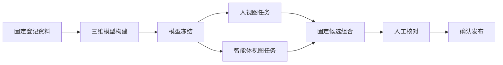

# 固定模型与独立视图 v0.1

日期：2026-11-04。范围：本机几何预览构建。精度为 `unverified`，不声明已验证空闲空间或导航能力。

## 1. 对象和状态



模型冻结不等于候选可用，更不等于发布。新几何任务标记 `pipeline=model_then_views/0.1`；`stage` 从 `building_model` 到 `deriving_views`，两类视图均成功且组合校验通过后为 `candidate_ready`。

| 对象 | 版本标识 | 状态／约束 |
| --- | --- | --- |
| 几何构建任务 | `build-*` | `queued/running/succeeded/failed/interrupted/views_failed`；`views_failed`表示模型已经冻结，但视图或组合尚未完成 |
| 固定模型 | `cospace.frozen-geometry/0.1` | `frozen.json`保存冻结时间、坐标、单位、构建及输入元数据；`spatial.npz`保存几何和颜色；摘要和字节数固定 |
| 视图任务 | `cospace.view-task/0.1`、`view-*` | 独立保存类型、参数、固定模型引用、运行状态、错误、时间和成果清单摘要 |
| 视图成果 | `cospace.derived-view/0.1` | 固定类型、参数、坐标、单位、来源模型、文件摘要与字节数 |
| 候选组合 | `cospace.model-view-composition/0.1` | 人／智能体视图必须绑定同一完整模型引用；不能只因几何摘要相同而混用不同冻结版本 |

`frozen_model`引用固定 `{job_id, model_id, manifest_sha256, source_model_sha256}`，分别识别冻结任务／模型、冻结清单摘要及几何摘要。任务ID不能代替文件完整性校验。视图参数首版固定为人视图 `{"format":"ply"}` 和智能体视图 `{"resolution_m":0.1}`，不是通用算法配置入口。

首版人视图为ASCII PLY；激光颜色为强度灰度并显式声明。智能体视图为 NPZ 表面单元，未列出单元为 `unknown`。格式、单位和坐标含义保持原链路约定。

## 2. 保存与兼容

新构建先只写 `preview-builds/<模型任务>/frozen/{frozen.json,spatial.npz}`，再由两个独立子进程读取该模型，写各自 `views/<view-id>/{task.json,view.log,output/}`。派生进程不重新读取原始传感器资料或已有估计轨迹。

两类视图通过后，输出兼容的 `output/model.json`、`human.ply`、`agent.npz`、`views.js` 与几何文件。`model.json`继续使用现有预览主profile，新增版本化 `derivation` 声明，内嵌固定模型引用及两类完整视图成果记录。为兼容原读取和交付实现，组合输出保留几何副本；逻辑来源仍是同一固定模型，没有重新建图。

旧一体构建和无声明的历史预览照常读取，不自动迁移或补造任务记录。旧任务需要独立派生能力时，显式用原资料发起新构建。语义／台账／关系候选可沿用已固定几何视图组合并附加语义声明，不把它们当成新的几何视图任务。

## 3. 接口与重试

`GET /api/build-stages?space_id=…&candidate_id=…`：返回当前任务的固定模型、两类任务状态及 `candidate_ready`。只读访问会核对当前实际进程状态；与不轮询的工程准备汇总不同。需要场景及任务的 `build.run` 权限。

`POST /api/view-derivations`：

```json
{"space_id":"space-…","candidate_id":"build-…","view_kind":"human","request_id":"0123456789abcdef0123456789abcdef"}
```

只接受以上字段；类型为 `human` 或 `agent`，请求ID为32位小写十六进制。需要有效同源会话、CSRF、场景构建权限、原资料访问权限及冻结模型来源任务的授权。后台检查父候选与冻结来源候选的新使用状态、固定模型和复用视图的完整性。

允许在成功、视图失败或中断任务上显式重派生一类视图。生成新 `build-*` 候选任务，保存 `view_parent_id`、`rerun_view`、`view_request_id`，复用原 `frozen_model` 和另一类视图任务引用。原任务、原视图、原候选均不改写。另一类视图若尚未成功，新组合仍不能发布，需要继续显式重试该类视图。

新创建返回202、同请求找回返回200，统一响应 `{"created": true或false, "job": 保存任务}`。同请求ID在同场景只对应同父任务、同视图类型；冲突409，并发与服务重启均不重复创建。请求结果未确认时，客户端持久保存原请求ID，先按场景任务目录的 `view_request_id/view_parent_id`核对；刷新不自动POST，找不到时只能用原请求ID重发。

固定模型派生不重新准入原始资料／批次；它消费已有冻结快照。重新建几何仍走原资料摘要、状态和批次准入校验。视图重派生不恢复资料、不变更批次、不选择候选或自动发布。

## 4. 组合、发布与消费

组合要求两类任务成功、完整固定模型引用相同、场景／坐标／单位一致、实际视图文件摘要正确。成功后形成独立输出快照；失败组合不能核对或发布。服务端模型读取还检查候选保存的两类任务ID与清单一致。

人工核对固定具体候选；发布固定该候选清单，并保存相同 `derivation`。在线模型、固定发布与离线消费者检查组合来源一致；旧发布不依赖后来视图任务的可用性，不因重派生自动更新。离线包继续只携带智能体消费所需数据与清单，不增加人视图或原始传感器数据。

服务重启将保存中的运行任务标为中断，不自动重跑。模型和成功视图保留，由用户显式选择要重试的视图。取消、分布式调度、多模型拼接、自定义派生参数和生产存储策略均不在本契约中。
