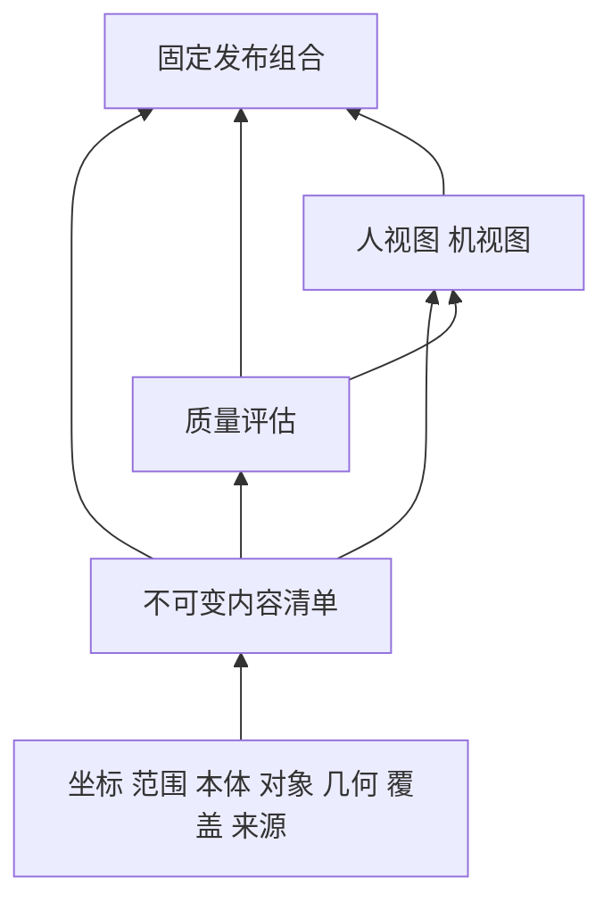

# 真值与双视图发布组合实验契约 F04 v0.1

日期：2026-10-28。状态：synthetic 专用内容关系验证，不是生产发布格式，不升级现有服务 API 或 agent-package。

## 1 消除摘要循环

不可变真值内容清单包含 frame、scope、本体、对象、几何、覆盖和来源目录。质量 assessment 引用该内容清单身份和摘要；视图引用内容清单与质量 assessment；发布组合固定三者。真值内容清单不再反向引用 assessment 或采用记录，避免 `真值摘要→质量摘要→真值摘要` 无法计算。

这里 truth 对象是尚未授权采用的不可变内容载体；正式权威真值仍需内容、独立校核和受控采用记录共同成立。当前 release.adoption 只能是 sample_only，没有正式采用能力。历史“真值清单包含质量”应理解为逻辑组合关系，本轮明确其物理拆分，后续正式采用记录另定契约。

## 2 文档与引用

Schema 根 oneOf 支持 truth、view、release、ontology、objects、frame、scope 七种文档。JSON Schema Draft 2020-12；schema_version=`cospace.spatial-release/0.1`。

所有完整引用含 id、path、sha256 和 bytes，摘要基于文件原始字节，包含空白和编码差异；不采用解析后再序列化的摘要。F03 的紧凑引用为 id+sha256，通过已登记成员目录解析。entry 清单由调用方指定，返回其实际摘要，但未验证调用方期望摘要、签名或来源可信性。

身份在本实验快照内全局唯一，引用相同路径必须绑定相同身份、摘要和大小。JSON 文档重复键、未知版本、未知字段、非法非有限数、缺文件、字节数或摘要不符均拒绝。

## 3 跨文档检查

- 发布固定一个真值内容清单和至少一份 human、一份 machine 视图。保留旧交换语义 machine；产品界面称“机视图”，目录仍使用 agent，不静默修改现有协议。
- 真值、视图与发布 scene_id 必须一致；本 Profile 全部固定为 synthetic，不能只修改标签进入正式发布。
- frame 定义米制右手局部坐标；scope、objects 必须引用同一 frame。本轮视图仅支持与真值完全相同的 frame、scope 和本体引用；局部坐标或范围裁剪需后续 Profile，不做静默变换。
- 本体类型 ID、对象 ID、对象锚点分别检查。重复对象、未知类型、锚点超出半开目标范围拒绝；锚点不是完整对象几何验收。
- F03 profile 与 assessment 的 scope 必须与实际 scope 文件身份、摘要、范围及分辨率一致。assessment 必须绑定真值内容摘要，procedure 与 profile 一致。
- assessment 的语义目标集必须绑定实际 objects 文件，分母等于实例数量；覆盖 partition_ref 必须绑定实际 coverage 文件，不能另选统计分区。
- 质量规程、检查点集通过 provenance.resources 声明完整引用并验证字节摘要。绑定正确不证明内容符合规程、检查点独立或已审核。
- 每份视图固定来源真值、质量评估、本体、坐标与范围；对象映射只能引用真值现有 ID。对象子集必须在 losses 明确包含 object_subset。
- 视图声明 encoding、intended_use、losses、max_geometric_error_m 与 validation。样例只能声明 synthetic_inspection / not_field_validated；误差未知用 null。检查声明存在，不测量实际编码误差或自动检测全部几何损失。
- 视图产物与派生记录核验字节。几何、覆盖、派生、检查点及规程载荷暂为不透明资源；不执行对应解码或领域质量判断。

## 4 校验器与资源边界

`packages/service/release_contract.py` 的 inspect_release_snapshot 接收 path→不可变 bytes 的内存字典，并复制目录；不访问磁盘路径、URL 或网络。不跟随符号链接，也不能代替生产文件安装器的路径检查和原子封存。

目录最多128个文件，每文件最多8MiB，总计最多64MiB；相对路径禁止明显越界和大小写碰撞。遍历完成拒绝未被引用的多余成员。限制是实验保护值，不是机器人资源预算承诺。

content_integrity_verified=true 仅表示所提供快照内完整引用链的内容一致性。F03 限值失败仍可返回结构完整报告及失败原因，以便核查；不得将此结果作为发布放行。

authorized、robot_ready、real_release_ready 和 evidence_semantics_verified 始终为 false。摘要不等于签名，结构不等于可运行能力，synthetic 标记不证明真实/合成来源经过审查。

## 5 样例与验证

生成：`.venv/Scripts/python.exe -m experiments.scripts.generate_release_contract_sample`，生成 examples/spatial-release/synthetic 的19个文件；所有摘要按实际字节计算。

构造器 packages/service/release_sample.py 可复现相同字节；tests/test_release_contract.py 包含摘要正确但来源、质量、本体、对象或视图关系错误的反例。现有 F01/F02/F03 及旧结构、查询协议保持独立验证。

## 6 下一步

F05 定义机视图组件与编码 Profile、索引和缺块语义，并复用既有 agent 文件交付基础。真实格式解码、源数据可信度、完整三维覆盖分区、精度实测、正式采用及生产权限均仍待验证。
