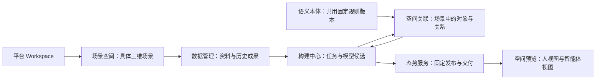

# 三类六板块场景空间总体整理 v0.1

日期：2026-11-03

后续主线实施见[场景空间资料到真值与双视图构建设计](场景空间资料到真值与双视图构建设计-v0.1.md)：构建中心增加“构建流程”，独立样本贯通资料、模型与两类视图；具体格式、版本与验收边界以该补充设计为准。

## 1. 总体原则

产品核心：**空间底图建一次，具身智能体共用。**

平台 Workspace 是客户与协作边界。一个具体三维场景对应一个场景空间，复用既有 `space_id`。不同传感器、格式、采集批次和历史版本不是不同场景；同一场景的资料、任务、候选、关联实例、发布与交付均归属于这个空间。

三类六板块保持不变，属于同一场景数据链路的六个工作入口，不各自创建场景库或第二套空间身份。



图中关联修订返回构建中心核对；不要求每次构建都经过人工关联。空间预览以固定发布为消费入口，候选检查仍在构建中心。

## 2. 六板块职责与数据范围

| 分类 | 板块 | 主要管理对象 | 归属 | 主要页面 |
| --- | --- | --- | --- | --- |
| 使用 | 空间预览 | 授权场景的固定发布与双视图入口 | 场景空间 + 发布标识 | 左侧场景目录，右侧固定发布预览卡片；独立标签页打开全屏三维场景 |
| 使用 | 态势服务 | 发布记录、在线消费、离线交付、追溯及分发状态 | 场景空间 + 固定发布 | 当前场景发布列表与服务操作；不展示其他场景发布 |
| 构建 | 数据管理 | 原始资料、采集批次、来源许可、历史模型成果与血缘 | 场景空间 | 资料 / 场景版本 / 来源追溯，右侧页面级详情 |
| 构建 | 构建中心 | 输入选择、构建任务、候选核对与选择 | 场景空间 + 任务/候选 | 构建任务 / 当前模型候选两个子视图 |
| 定义 | 语义本体 | 类型、属性、关系约束与固定规则版本 | 共用定义；应用时固定版本与摘要 | 共用规则库、规则内容、对象草稿校验；不直接修改场景对象 |
| 定义 | 空间关联 | 语义与几何、对象与业务、对象间关系 | 场景空间 + 基础候选 + 固定本体引用 | 三个子视图；修订产生独立候选，再核对和发布 |

**本体规则与场景实例分开。** 切换场景不复制本体定义，也不改本体固定版本；场景关联保存规则引用及实例。当前本体 API 是服务级共用规则库，尚未实现按 Workspace 管理本体库的写入与隔离；页面不得将现有共用目录宣称为已完成 Workspace 私有本体平台。

## 3. 统一页面布局

```text
┌──────────────────── 全局 DS header，48px ─────────────────────┐
│ Launcher / Vxture CoSpace                     工作区 / 账户   │
├───────────────┬───────────────────────────────────────────────┤
│ 场景空间目录   │ 分类 / 板块 / 当前场景                         │
│ Workspace     │ 板块标题、简短说明、必要操作                   │
│ 检索          ├───────────────────────────────────────────────┤
│ 场景 A        │ 保留当前场景的六板块导航                       │
│ 场景 B        ├───────────────────────────────────────────────┤
│ 场景 C        │ 板块子视图与业务工作面                         │
│               │                                               │
│               │ 数据管理详情按需在页面右侧展开                 │
└───────────────┴───────────────────────────────────────────────┘
```

- 全部使用 header 以下剩余宽高，保留 12px / 8px 外间距，窄屏采用局部滚动，取消居中限宽框架。
- 左侧为独立白色浮层，圆角、轻品牌色边框和柔和阴影；主区融入极淡品牌蓝渐变。数据管理保留淡点阵与空间线框，其余板块先保持克制背景，不重复添加装饰。
- 左侧目录复用同一组件：workspace 标识、检索、实际可访问场景和发布数量；场景身份与目录内容不按板块另造。
- 标题与面包屑采用数据管理现有尺寸；32px 点击区配 16px 线性侧栏切换图标，常态无边框，图标与标题左对齐。
- 单一场景选择入口，工作面不再重复展示“当前工作空间”下拉框或项目选择器。项目保留为兼容后端字段，不作为客户边界或六板块的新导航层。
- 数据管理详情位于 header 下方至页面底部；其他板块复用现有业务操作组件，此轮未新增所有板块的通用详情抽屉。
- 构建和关联按子视图组织，取消同页长列表连续堆放多个完整工作面；访问过的子视图保持挂载，场景内切换保留草稿，跨场景重新挂载。
- 语义本体明确标为“共用规则库”。左侧当前场景仅为返回关联应用的上下文，不成为本体归属声明。
- 空间预览展示真实固定发布目录及原发布标识，不按序伪造 V1/V2。当前发布缩略图接口尚未提供，卡片使用明确标注的本地“空间示意”；打开链接对应真实固定发布，使用新标签页，三维画布保持全屏且不带通用 header。

## 4. 跨模块上下文与错误行为

1. Launcher、页面六板块导航与模块内跳转传递相同 `space_id`。
2. 跨板块跳转只默认继承场景，不继承来源板块的 input、job、artifact、publication 或 tab；显式业务链接可携带必要记录定位。
3. 切换场景空间清除旧记录定位；构建、发布和关联工作面以场景身份重建。未保存草稿仅在当前场景的子视图间保留，不保证跨板块或刷新保存。
4. 外层读取统一 `useSyncExternalStore` URL 快照，并以场景上下文 Provider 向其业务工作面传递同一份已核对定位，避免独立 hook 状态在切换过程中混合新旧场景。
5. 未指定场景时，场景型板块建议第一个授权场景；显式无权或不存在的场景不得自动替换成其他场景，不挂载其业务工作面。
6. 可访问目录并不代表具有全部操作权限。构建、数据管理和关联入口按当前场景 capability 控制展示，服务端继续执行每项权限校验。
7. 本体库保持共用定义入口；无场景时仍可查看固定规则。进入场景关联需选择授权场景。
8. 目录请求带取消信号并按 Workspace 变化重取；详情与候选的输入绑定继续采用既有后端校验。

## 5. 本轮实施边界与后续顺序

本轮完成六入口的布局、场景上下文、导航、预览目录及子视图整理；不迁移旧测试数据，不更改固定发布，不创建新的授权场景，不改算法和发布门禁。

后续按依赖推进：

1. **场景空间初始化**：接入 Workspace 下创建/定位场景的授权能力；NYU、OS1 按真实场景分别初始化，不再默认登记到任意测试空间。
2. **数据管理接入**：样本场景包、来源归属、导入与检查状态，明确观测资料、已建模型和派生视图的输入阶段。
3. **版本与服务整理**：补齐正式模型版本命名与发布别名，保持固定引用及历史追溯；在线/离线都绑定场景与发布。
4. **定义平台扩展**：本体库 Workspace 归属、编辑封存及应用版本管理；关联实例仍按场景独立。

这些是后续能力，不因页面已有入口而视为已实现。历史“测试空间 A/B”曾用于混合格式隔离测试，后续整理需保留引用，不根据名称批量迁移。

## 6. 验证方式

前端执行 TypeScript 检查与 Vite 构建。浏览器在当前 8769 本地模拟平台上验证六板块的上下文继承、场景切换清除旧定位、子视图、无权/不存在场景、页面级资料详情与独立标签页预览，以及 1440 / 919 / 390px 无全局横向溢出。

脚本：`output/playwright/verify-six-scene-workspaces.cjs`；结果与截图保存在同目录。验证只读取已有业务数据，不发起构建、发布、来源启停或样本登记。真实平台、Workspace 私有本体库和实机消费能力仍按各自阶段验收。

### 本轮验证结果

- TypeScript 检查及 Vite 生产构建通过。
- 60 项浏览器检查通过：六板块同场景导航、同级目录与单一主区、移除重复空间下拉、两场景切换、关联子视图、发布新标签页、三种屏宽、显式不存在场景不发起构建请求，以及页面级资料详情边界。
- 原有 195 个工程记录文件摘要复核一致。浏览器操作未提交构建、发布、登记或来源修改。
- 页面可保留现有 favicon 请求被服务端拒绝的控制台记录，与本轮业务工作面无关。
- 验证使用本地模拟管理员；真实平台权限及多 Workspace 隔离继续沿用现有后端验收范围。

截图：`six-modules-space-1440.png`、`six-modules-data-final.png`、`six-modules-build-1440.png`、`six-modules-delivery-1440.png`、`six-modules-ontology-1440.png`、`six-modules-association-1440.png`，均位于 `output/playwright/`。
