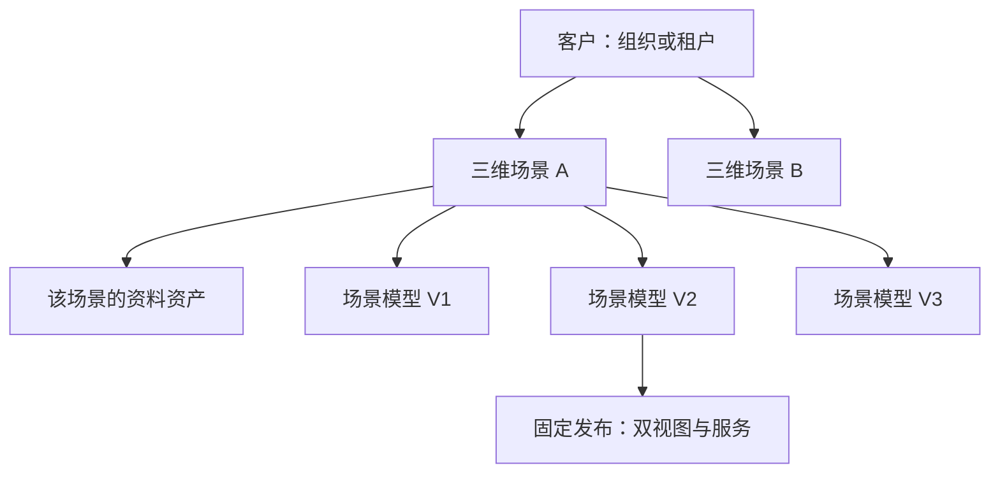
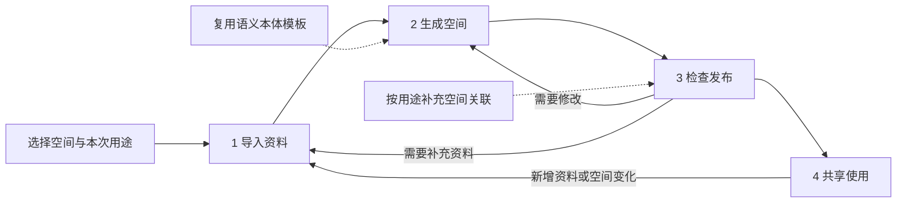
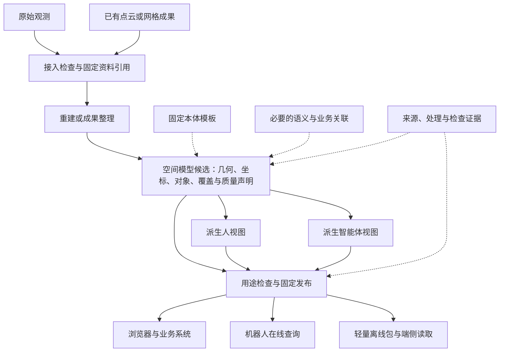

# 业务流程与数据流程简化设计

日期：2026-11-03\
版本：v0.2\
状态：按客户多场景、多历史版本要求修订的设计；尚未实施本次流程与界面调整。现有实现记录见[产品功能架构与模块进度](产品功能架构与模块进度-2026-11-02.md)。

修订依据：保留[v0.1](业务流程与数据流程简化设计-v0.1.md)，明确“客户 → 多个三维场景 → 每个场景的历史版本”为业务主轴。数据管理专项见[场景数据管理设计](场景数据管理设计-v0.1.md)。

## 1. 本次判断

当前复杂性主要来自操作流程，而非六个模块本身：把底层记录和校验机制分别做成用户操作，导致一次交付需要在资料、准备、构建、关联、候选选择、发布之间多次往返。

产品主线收敛为：**空间底图建一次，具身智能体共用。** 工程师的任务是把资料变成可以共享使用的空间；本体、数据管理、构建任务和版本追溯围绕这件事提供能力。

设计原则：

1. 保留“使用、构建、定义”三类六模块；六模块是能力入口，不是必须依次完成的六站流程。
2. 日常交付只走一条主线：**导入资料 → 生成空间 → 检查发布 → 共享使用**。
3. 进入流程时确定一个空间，后续沿用资料、工作版本和用途；只在用户主动更换时重新选择。
4. 格式检查、引用检查、摘要、权限、血缘由系统执行；正常情况下展示结果，异常时展开原因与处理入口。
5. 本体是可复用规则，空间关联是具体实例；只有目标用途要求时，才成为本次交付的必要操作。
6. 本次先简化编排与页面，不重写算法、存储和已有不可变成果，不引入新的工作流引擎或微服务。

## 2. 用户与一次交付

### 2.1 场景是业务和数据的核心



- 一个客户可以拥有多个三维场景，每个场景有稳定身份、范围、坐标基准、权限和独立历史。
- 本产品中的“空间”统一指一个具体三维场景，例如设备间及相连走廊；不是用户文件夹，也不等同于平台身份工作区。
- 每个场景有持续积累的资料、多次处理记录和多个历史模型版本；一个模型版本还可以有多个视图派生及固定发布。
- 登录用户按授权访问场景。客户归属与用户访问是两种关系，集成商工程师可以获授权服务多个客户。
- 项目只作为可选的交付归组，不增加必经业务层级，不用项目名或账号名推断场景归属。
- 新增资料不立即创建场景模型版本；构建或语义修订形成确定模型快照，才形成相应版本。并非每个模型版本都已发布。
- 每个场景可在现行发布之外准备后续版本；只更新视图或服务组合时，可复用同一模型版本并产生新发布。

权限绑定沿用平台组织、工作区与现有空间资源的显式映射。上述客户层是业务归属，不另造一套客户账号。逻辑名称“场景”继续映射现有 `space_id`；历史契约中的 `scene_id` 在适配边界明确映射，不新增两套可独立修改的场景身份。

### 2.2 用户与交付上下文

| 用户 | 主要任务 | 默认入口 |
| --- | --- | --- |
| 内部交付工程师 | 导入资料，形成空间，检查并提交发布 | 构建中心 |
| 授权查看者、集成方 | 找到可使用的空间，查看模型与对象 | 空间预览 |
| 集成开发者、机器人 | 获取指定用途的接口或离线数据 | 态势服务 |
| 管理员、本体维护者 | 配置账户权限、资料接入与可复用语义规则 | 通用配置、语义本体 |

人员可以兼任角色，但权限分别判断。工程师可以完成构建和提交；有发布权限的人才能确认发布。不为首版新增多级审批链。

一次交付以“一个场景的一次工作版本”为上下文。默认工作上下文只是当前操作入口，不限制该场景保存多个历史版本。已有后台任务可以保留；首版不增加多人分支合并功能，也不隐藏其他运行任务。

空间目录中的“正在使用的发布”和“正在准备的新版本”分别显示。新版本失败或待检查，不改变旧版已发布状态。

## 3. 业务流程

### 3.1 主流程：四个阶段



| 阶段 | 用户做什么 | 系统做什么 | 进入下一阶段的条件 |
| --- | --- | --- | --- |
| 导入资料 | 选择已接入的资料，确认本次范围与用途 | 识别输入类型，登记并检查格式、坐标、时间与所需字段 | 资料满足所选处理路线；缺项给出可执行提示 |
| 生成空间 | 确认处理方案，启动生成 | 执行重建或已有成果整理，生成模型候选与预览，保存来源和处理记录 | 任务成功且产物完整；失败仍停留本阶段，可修正后重试 |
| 检查发布 | 看空间，检查问题，补充必要关联，确认发布 | 对具体候选检查引用、用途要求、双视图与权限；冻结发布组合 | 对应本次内容的检查通过，具备发布权限并明确确认 |
| 共享使用 | 查看空间，接入接口或获取离线包 | 按固定发布提供人视图和智能体视图，执行访问及有效性检查 | 使用者拿到明确版本；端侧启用另由消费端确认 |

“检查发布”是一个工作阶段，不是一个跳过检查的按钮。可以在同一页面完成检查与发布，也可由不同权限人员接续完成。普通预检无需用户另点一次“保存预检”；开始构建和正式发布时仍重新检查对应依赖。

### 3.2 两类输入，共用后半段

不能强迫所有数据重新建图：

- **原始观测输入**：RGB-D、激光日志等，具备所选路线要求的标定、时序及位姿条件后，进入重建。
- **已有空间成果输入**：点云、网格等，先检查单位、坐标、范围及来源，执行整理、索引和视图派生。

两条路线最终都输出同一种逻辑模型清单，进入检查和发布。导入格式适配按已有实现开放；没有实现的适配器明确显示不支持。单帧激光资料只形成局部样本，不自动称为完整场景。没有位姿或配准依据时，不以简单叠加伪造重建成果。

### 3.3 按用途确定必要工作

以下是流程设计中的用途划分，不表示这些能力已全部验收：

| 本次用途 | 必要工作 | 不默认强制的工作 |
| --- | --- | --- |
| 空间浏览与流程验证 | 可解释的坐标与范围、来源、可读模型、限制声明、固定发布 | 设备台账绑定、完整对象关系、重定位验证 |
| 设备与对象查询 | 上述要求，加目标对象ID、类型、位置及所需语义约束检查 | 无关对象的全量标注、无关业务系统连接 |
| 机器人空间查询 | 上述相关要求，加智能体表达、未知与覆盖语义、接口及资源条件验证 | 自动等同导航或自主避障能力 |
| 重定位等专项用途 | 对应输入、算法、独立序列和目标设备验证 | 用浏览或点云对齐结果替代专项验收 |

缺少某用途必需的证据时阻止该用途发布，可以明确缩小用途后重新检查。流程验证版本持续保留质量未验收标识，不成为正式质量认证成果。

### 3.4 更新、消费与追溯不再各建一套主流程

**更新**：在原空间开始下一工作版本，沿用明确的父版本和可复用配置；有新观测则回到导入，只有语义变化则从关联编辑进入检查。保存新快照，重建受影响的派生视图，检查差异后另行发布。几何不变时不强制重跑重建。第一阶段可继续全量派生，不以“更新”宣称已实现增量融合。

**在线消费**：选择空间和用途 → 解析允许访问的发布 → 固定该发布的查询会话 → 查询对象或区域。当前版本变化不使已有会话静默换版。

**离线消费**：选择发布和目标用途 → 获取必要区域、对象及运行数据 → 校验安装 → 消费端显式启用。下载成功不等于安装或启用成功；服务端未收到端侧证据时显示“未确认”。

**对账与追溯**：在检查阶段、争议处理或周期复测时，从发布展开模型、资料和检查证据；按用途做复测与残差分析。发现问题时限制相关用途或暂停分发，修正后生成新版本；历史内容不覆盖。回退是重新确认仍可用的旧发布并切换服务引用，不删除中间历史。

### 3.5 异常合并呈现

用户只需要看到“哪里有问题、影响什么、如何继续”，无需先理解内部所有记录类型。

| 问题 | 业务处理 |
| --- | --- |
| 输入缺失、损坏或处理失败 | 留在当前阶段，定位资料和原因；保留已发布服务 |
| 未知区域或观测退化 | 在空间中显示范围与限制；按用途判断补采、限制使用或阻止发布 |
| 对象、坐标或版本冲突 | 显示冲突项，要求确认或修正，不能静默覆盖 |
| 发布期间内容或权限改变 | 原确认失效，重新检查对应内容；不生成混合版本 |

## 4. 数据流程

### 4.1 模型为共同来源，发布为共同消费入口



核心约束是“**一个模型来源，两类视图，同一发布组合**”。两类视图不能分别修改成各自的权威版本。工作过程中可以生成预览；发布必须绑定最终被检查的模型与视图。

### 4.2 用户关心四类业务对象

| 对象 | 业务含义 | 关键关系 |
| --- | --- | --- |
| 空间 | 客户拥有的具体三维场景 | 稳定空间ID、客户归属、坐标范围及权限；有多份资料、多个历史模型版本和发布 |
| 资料 | 本次使用的观测、已有成果或参考证据 | 资料ID、类型、坐标/时间说明、内容固定引用 |
| 工作版本 | 当前正在生成或检查的场景成果上下文 | 指向确定模型候选、输入、规则及处理记录；历史模型快照独立保留 |
| 发布 | 已确认可按声明用途共享的一组成果 | 固定模型与视图版本、允许用途、限制及发布记录 |

工作版本是用户的操作上下文；其指向的模型候选仍不可变。修改关联或参数生成新候选，由工作上下文引用，不直接改写旧候选。

任务ID、候选ID、视图ID、摘要、策略修订及预检记录继续保留在系统中，在“处理详情／来源与历史”按需展开。它们不是用户每一步都要选择的新业务实体。对象ID跨工作版本保留，不能每次生成都换成新的设备身份。

默认界面突出“空间版本”；调用和离线交付显示确定的发布引用。模型内容变化产生新模型版本；仅视图配置或服务组合变化可以沿用模型并生成新视图/发布。内部本体、资料、控制策略的修订不混成一串空间版本号。

### 4.3 格式采用分层契约，不寻找一个万能文件

数据管理在这条链路上承接输入、向构建提供固定资料集合、接收处理成果索引，并把场景版本、视图和发布的来源串起来。它是围绕具体场景的数据资产中心；不只是上传文件页，也不代替构建、语义编辑或发布审批。详细对象、流程、格式及页面设计见[场景数据管理设计](场景数据管理设计-v0.1.md)。

| 数据层 | 设计要求 | 当前与后续边界 |
| --- | --- | --- |
| 输入资料 | 保留原始文件；用登记清单说明类型、固定内容引用、坐标、单位、观测时间及可用字段 | 继续现有RGB-D与激光样本路线；其他格式逐个适配 |
| 空间模型 | 模型清单关联几何、覆盖、对象、质量及来源证据；大文件与清单分离 | 复用现有模型清单，不因本次流程调整迁移所有历史文件 |
| 语义规则与实例 | 本体固定版本供实例引用；对象、几何锚点、业务绑定与关系随模型快照固定 | 继续已有小型规则包；OWL/SHACL和行业映射按需求扩展 |
| 人视图 | 浏览需要的分块几何、颜色、对象和质量图层 | 支持后续3D Tiles等适配；渲染引擎不是模型存储格式 |
| 智能体视图 | 按用途提供轻量空间索引、对象和占据/未知等表达；声明分辨率与范围 | 不默认将整个人视图或全部采集日志下发机器人；不把点云无点处推断为空闲 |
| 发布与服务 | 发布清单固定模型和视图；在线响应、离线包沿用相同版本与语义 | 继续已有发布与包契约；新格式须有消费适配和验证 |

流程统一不要求先全面转成USD、IFC或某种体素格式。接入、模型、可视化和机器人运行数据各自采用适合的编码，以清单、稳定对象ID及明确坐标关系连接。现有历史契约中的旧字段保留兼容，本次不做全库术语替换。

时间和有效性仍区分观测、构建、发布与查询时刻，不能用发布时间冒充观测时间。对依赖新鲜度的空间状态查询，消费端声明最大陈旧度，结果返回可确定的数据时刻、有效性与完整性；无法判断则显式返回未知或拒绝该用途。静态模型资产读取不强制附加无业务意义的实时新鲜度参数。

未来设备实时状态、临时障碍、巡检事件作为独立观测关联空间、对象和基础发布，不因每次状态更新重新构建空间模型。经核实的持久空间变化才进入下一工作版本；本轮不增加实时态势实施任务。

## 5. 六模块职责与页面设计

| 分类 | 模块 | 精简后的职责 | 与主流程的关系 |
| --- | --- | --- | --- |
| 使用 | 空间预览 | 查看有权限的空间和可用发布；全屏空间独立标签页打开 | 使用入口；工程操作不堆在查看者页面 |
| 使用 | 态势服务 | 管理发布历史、服务引用、在线接入与离线交付 | 使用入口；可进入特定发布管理 |
| 构建 | 数据管理 | 按场景管理资料、历史模型版本、成果索引与来源追溯 | 向构建提供固定输入并承接成果登记；批次按需使用 |
| 构建 | 构建中心 | 一次交付从导入到检查发布的连续工作面 | 主流程入口 |
| 定义 | 语义本体 | 可复用的类型、属性、关系与约束模板 | 首次配置或规则变化时进入 |
| 定义 | 空间关联 | 对象、几何、业务及对象间的具体关联 | 在当前工作版本中按需打开，完成后返回检查 |

发布业务与权限仍归态势服务。构建中心在“检查发布”调用同一发布能力，不另造发布库，也不要求用户跳页后重新选候选。

建议构建中心工作页：

```text
设备间与相连走廊                         已发布 V1.0 · 正在准备下一版
本次用途：空间浏览与流程验证

  1 导入资料  ──  2 生成空间  ──  3 检查发布  ──  4 共享使用

┌─────────────────────────┬─────────────────────────┐
│                         │ 当前阶段                 │
│     空间预览／输入概览     │ 需要处理的事项             │
│                         │ 必要的配置与用途限制        │
│                         │                         │
│                         │             [主要操作]    │
└─────────────────────────┴─────────────────────────┘
  来源与历史 ▸    处理详情 ▸
```

每阶段突出一个主要操作：导入资料、开始生成、确认发布、查看空间。检查阶段可显示“补充关联”“补充资料”等次要动作；有阻断问题时主要操作变成处理问题。发布完成后的次要入口提供在线接入和离线交付。发布权限不足时显示“等待有权限人员确认”，不新增虚假的审批系统。

正常用户无需处理独立的“保存预检”“核对并选择”“再去态势服务重选版本”操作。检查阶段针对确定候选保存核对结论；后台可继续保存选择指针和核对记录。发布动作携带已核对候选和预期修订，发现变化则要求重新检查。

## 6. 状态设计：不要混成一个状态列表

| 层级 | 主要状态 | 显示原则 |
| --- | --- | --- |
| 工作版本 | 待资料、处理中、待检查、可发布、已发布 | 只描述本次交付；失败显示在对应阶段，并保留原因 |
| 后台任务 | 排队、运行、成功、失败 | 处理中展开查看，不占空间卡片的发布状态 |
| 发布分发 | 可分发、已暂停 | 与工作版本独立；旧发布可继续提供历史访问，是否切换由服务引用决定 |
| 端侧使用 | 未确认、已安装、已启用等实际证据 | 只展示消费端确实提供的结果；不能从导出包推断 |

“可发布”是针对确定候选和用途的检查结果；依赖或权限变化后要重检。首版不再把资料停用、任务失败、语义待核实和发布暂停混在一个空间状态枚举里。

未知、退化、冲突属于观测/质量表达，不能与上述业务状态混用；占据、已观测空闲、未知及质量原因保留既有契约语义。

## 7. 对当前实现的处理

| 当前实现 | 调整建议 |
| --- | --- |
| 分离的准备页、预检记录和构建表单 | 收入“导入资料／生成空间”，正常路径自动检查，保留历史入口 |
| 候选比较、人工核对、选择、发布分散 | 组合成“检查发布”，上下文绑定同一候选；仍需明确发布确认 |
| 对象、业务绑定、关系分别派生候选 | 页面中统一为当前工作版本的关联编辑；后台可继续生成不可变候选 |
| 默认要求对象、台账和关系都齐备的参考流程 | 改为本次用途的必要条件；无关项目不显示待办，也不算未完成 |
| 每空间资料来源许可和批次控制 | 保留授权与来源约束；普通导入不强制人工创建批次，已有批次仍执行准入要求 |
| 权限、生命周期、摘要与血缘 | 保留后台检查；只在影响操作时提示，详细证据按需展开 |
| 原始记录、固定发布和离线包 | 保留；增加流程层映射，不重写历史成果 |

系统默认可以帮助选择资料或候选，但必须在提交前展示具体选择并固定引用。不能自动用“最新”替换用户已确认的输入、模型或发布。

## 8. 实施顺序与验证

先做一次完整主线收敛，再按真实用户卡点补能力，暂停继续扩张独立管理工作面。

1. **统一交付上下文**：先适配已有空间，固定本次资料、候选、用途及发布引用，减少重复选择。空间创建作为同一入口的后续能力，不在缺少实现时展示可用创建按钮。
2. **整合连续工作页**：将导入、构建、核对、发布组织到四阶段页面，复用已有服务和权限；对现有用途先做明确配置，不新增任意规则语言。
3. **收敛定义操作**：复用本体模板，关联按用途进入并返回；先保留已保存关联快照，再考虑统一编辑草稿，不为流程简化重做整个语义平台。
4. **端到端验收**：以现有短场景样本从资料到发布，再分别浏览、查询及离线读取；同时验证更新失败不影响旧发布。

| 验证场景 | 通过标准 |
| --- | --- |
| 初次发布：已有空间、合法样本 | 在一个连续工作面完成导入、生成、检查、发布；无需重复选择同一资料或候选 |
| 仅浏览用途 | 未配置业务台账或对象关系时，不出现无关待办；质量未验收限制持续可见 |
| 对象查询用途 | 缺必要对象定义或锚点时定位具体缺项；补齐后继续原工作版本 |
| 新版本失败 | 已发布版本继续使用；失败记录、重试与新候选可追溯 |
| 检查后修改关联或候选 | 旧检查不用于新内容，发布要求重检；不会混入旧视图 |
| 权限不足或依赖不可用 | 服务端阻断对应动作，界面说明原因；不自动绕过或换用历史发布 |
| 在线与离线读取 | 两侧模型、对象及版本引用一致；断网能读取包内声明能力，不能据此宣称实机导航就绪 |

## 9. 当前能力位置

已具备的基础是样本级资料登记、构建候选、关联快照、核对、固定发布及双视图/离线读取；账户与空间授权完成的是本地模拟平台验证。当前需要解决的是将这些能力组织为可理解的一次交付。

真实平台联调、空间创建、更多输入适配、独立质量与机器人实机验证仍按实际证据推进。本次流程重设计不把它们标记为已完成，也不要求先全部完成再验证简化后的样本流程。
