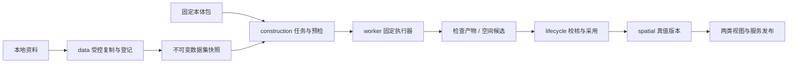

# 受控导入与构建任务设计

版本：v0.1\
日期：2026-10-26\
状态：I1固定输入、I2单任务合成检查及I3只读任务核对已实现；恢复及真实构建仍为设计基线\
依据：[总体模型](真值与两类视图总体模型设计-v0.1.md)、[平台规划](数据管理与语义本体平台规划-v0.1.md)、[目录基线](项目目录结构设计-v0.1.md)

## 1 目标与首批边界

实施进展：I1本地合成包导入、固定数据集和并发幂等已实现，见[验证记录](../validation/受控导入验证-2026-10-26.md)。资产引用暂嵌入dataset清单，独立资产去重、事件表、字段级诊断及恢复待后续细化；以下任务与真实构建内容仍是设计，不表示已经执行。

I2进展：已实现单任务synthetic_check、固定worker子进程、任务状态CAS、任务事件和报告封存，见[检查任务验证](../validation/检查任务验证-2026-10-26.md)。当前每job只允许一个attempt，不支持重试或中断恢复；下文多次attempt及恢复描述保留为后续设计，需迁移唯一约束后实现。任务事件已实现，导入事件仍未实现。运行fingerprint覆盖相关源码、Schema、uv.lock及关键依赖，不能替代完整环境镜像。

I3进展：已完成场景任务列表/分页、详情、固定输入、报告和诊断的只读接口与工作台，见[任务工作台验证](../validation/任务工作台验证-2026-10-26.md)。工程历史读取独立于服务消费撤回，当前没有认证及项目权限。下一步I4先明确进程身份核对及重试提交保护，再实现恢复能力。

把“资料进入系统”推进到“工程师取得可追溯的候选成果”。构建是产品核心，负责将固定输入、固定方法和配置转为候选空间模型；采用、视图发布和当前服务切换仍由lifecycle控制。

下一批先实现本机CLI导入和单任务执行，工作台只读查看。输入使用当前小型合成包，执行器只验证固定资料并生成检查报告，不运行SLAM、不生成真实几何，也不产生新的正式真值。该执行器称为synthetic_check，用于验证任务机制；它的成功只产生检查产物，不产生空间候选。真实构建执行器接入前必须另行完成P1算法及输入条件验证。

箭头表示流程，检查产物本身不满足采用条件。首批闭环止于“检查产物可核对”，图中空间候选、正式采用及真实派生是后续能力。

## 2 领域对象与身份

| 对象 | 固定内容 | 可变状态的归属 |
|---|---|---|
| import | 一次导入请求、来源声明、操作者声明、时间与诊断 | data管理导入过程 |
| asset | 内容SHA256、大小、媒体类型、存储引用 | data管理保留与可取得性，内容不可覆盖 |
| dataset | 场景、数据来源类别、版本、成员角色、资产摘要及用途 | data管理版本与血缘；版本封存后不变 |
| job | 固定输入引用、执行器、配置、运行环境要求、任务种类 | construction管理状态、事件和结果引用 |
| attempt | job的一次实际进程执行、开始/结束、退出原因与日志引用 | construction管理，重试新增attempt，不覆盖失败记录 |
| artifact | 检查报告、诊断或几何等产物清单、摘要与血缘 | data登记内容；解释及校验由产物所属领域负责 |
| candidate | 特定场景的候选空间内容、坐标、覆盖、对象、本体与质量声明 | construction形成，lifecycle记录后续校核与采用 |

产品ID与文件路径分离，使用应用生成的不透明ID；版本身份在场景内固定。内容去重不合并来源身份、资料用途或使用条件。job_id不同于幂等键，也不同于candidate_id。

dataset至少声明data_kind、scene_id、成员角色、source_description、使用条件状态和目标用途。成员角色区分observations、calibration、construction_reference、evaluation_reference、ontology和synthetic_bundle。首批只接收synthetic_bundle，不能借角色名声称已支持真实传感格式。

evaluation_reference用于独立校核；构建执行器不能取得其存储引用或读取权限。若同一内容摘要同时参与构建或调参，不能继续把它标为本次独立证据。摘要可识别同字节重复，人员仍须声明同一次采集的裁剪、转换及调参使用，不能仅靠哈希判断独立性。

## 3 受控导入流程

首批CLI由本机操作者指定资料目录与配置的数据根目录。远程API不接收任意宿主路径，也不开放上传；后续上传使用独立会话、配额和鉴权设计。

1. 创建import记录和专属暂存目录，记录带时区的requested_at及actor声明。请求未成功前不产生可用dataset。
2. 读取源清单，限定相对逻辑路径、受支持类型、文件数、单文件和总量。首批默认最多100个JSON文件、单文件8MiB、总计32MiB；超限明确拒绝，不自动截断。这是小型合成导入限制，真实数据须另设流式profile。
3. 拒绝路径越界、符号链接/Windows重解析点、源与目标重叠、重复逻辑路径和目标命名冲突。新存储写入采用服务器生成路径；媒体类型声明不代替实际结构解析。
4. 将允许成员复制至暂存区，对复制后的字节计算大小和SHA256；清单本身也保存原始字节与摘要。与源声明逐项比较，随后只从暂存副本执行既有Schema、引用、坐标和语义检查。
5. 任一不一致将import记为rejected，记录文件、字段及错误码，不登记可用dataset。源目录后续变化不影响已复制内容；未声明源清单的真实资料暂不进入此profile。
6. 校验通过后封存内容，准备不可变dataset清单。在同一文件系统内原子移动到最终位置，再以数据库事务提交资产、dataset及import完成事件；此时记verified_at和committed_at。

文件系统与PostgreSQL没有共同事务。先封存内容、后提交可见引用；数据库提交失败可留下不可见孤立内容，但不能留下可消费的缺失引用。重启核对按import_id识别暂存与孤立内容，不自动将孤立目录认作成功数据集，也不自动删除已引用内容。存储故障导致封存内容缺失时，读取报错并阻止任务执行。

同一幂等键绑定场景、请求描述及预期源清单摘要；CLI在提交前计算清单摘要，成功后再关联封存内容摘要。相同键相同请求返回原结果；相同键不同清单或声明返回冲突。第一次复制尚未完成时返回进行中，不把目录路径相同视作字节相同。已完成请求重放只能返回原快照，不能重新读取源目录偷偷刷新原dataset；要检查当前源文件需发起新请求。预期清单相同但成员被修改时，新导入的实际字节检查仍必须失败。

导入新记录开始保存实际校验时点；已有P2发布中verified_at=null保持原样，不能通过本轮升级补造历史时间。actor仍是本机操作者声明，认证和受保护审计未实现前不能声称签署身份可信。

## 4 任务输入、执行与边界

创建job时固定dataset ID及清单摘要、本体ID/版本及摘要、配置规范版本及内容摘要、执行器ID及固定实现版本、代码/环境指纹和明确任务种类。拒绝latest、可变源码目录和运行工作目录作为正式输入引用。

任务种类先仅开放synthetic_check。执行器由应用维护白名单，CLI只选择已登记ID；参数按执行器Schema检查，不允许把任意shell命令、镜像名或脚本路径作为任务配置。相同输入、配置、实现和环境可形成重算指纹，但不承诺算法输出字节确定；主动重算生成新job并关联replay_of。

默认配置使用Python现有锁定环境，单进程本地worker运行一个指定job，暂不引入消息队列、Redis、Kubernetes或分布式调度。PostgreSQL存任务与事件；文件存储保存固定输入与产物。真实算法后续使用固定镜像摘要及独立进程适配，不把ROS依赖装入服务API。

执行前逐项验证输入可读取、摘要一致、profile受支持、执行器环境匹配和资源配置可执行。首批synthetic_check必须完成全量输入摘要复核；大型资料的复核和缓存策略另行设计，不能直接沿用小文件假设。

worker以独立子进程执行固定入口，输入只读使用、只写本次attempt目录，不挂载正式发布目录；超时由父进程终止并核对子进程退出。首批实现wall timeout和日志大小限制，默认120秒、日志8MiB；日志截断要记录截断标记。OS文件权限或容器隔离尚未落实时，只能称为应用访问约束，不能称为安全沙箱。真实算法接入前增加可验证的CPU/内存/GPU配额及进程树回收。

## 5 状态、竞争与失败恢复

导入过程与构建任务分别记录状态，不把“导入完成”当作“构建就绪”。

| 状态机 | 状态与允许转换 |
|---|---|
| import | receiving → validating → committed；前两阶段可转rejected；执行中断后核对并转interrupted |
| job | queued → running → succeeded / failed / interrupted；queued可转cancelled |
| attempt | running → succeeded / failed / interrupted；每次失败保留独立记录 |

首批不支持运行中取消或自动重试。queued取消与worker认领竞争使用数据库条件更新，只允许一个成功；running返回明确冲突，不写“已取消”掩盖仍运行进程。重试只允许failed或interrupted任务，通过revision条件更新重新入队，新attempt递增；终态成功不覆盖，想重新计算需新建job。

worker认领使用状态、revision的条件更新，认领成功才创建attempt和启动进程。事件与状态更新同一数据库事务提交；输出文件在事务外生成。重复启动同一job只有一个worker取得认领，另一个返回冲突。首批不设过期自动抢占，因此worker崩溃后任务可能保持running，需要本机恢复命令处理，不承诺高可用。

恢复命令核对host/worker身份、进程是否存活及启动标识，不能仅凭PID判断，也不能仅因心跳超时就重跑。确认旧执行已结束后，才将该attempt标interrupted并允许重试；不能确认时保持待人工核对。未来多主机执行必须增加租约、隔离令牌及旧worker提交拒绝机制，再允许自动接管。

失败诊断至少包括stage、code、message、logical_path、json_pointer、object_id、attempt_id和可选退出码。消息不得泄露数据库URL或凭据。时间分别记录requested_at、started_at、finished_at和verified_at；统一UTC保存、显示按用户时区。缺失值用null并说明原因。

## 6 产物封存与候选形成

任务输出必须先在attempt暂存区完成，再逐项校验并封存。产物清单绑定job、attempt、输入、参数、执行器和环境；不采用“目录里最新文件”。相同ID绑定不同字节时拒绝，不能覆盖历史候选。

synthetic_check产物为input_report、validation_report及run_manifest，包含通过项目、明确未执行的能力和日志引用；不分配candidate_id或truth_version_id，不登记新服务发布。输入合成包内已有truth_version_id仅作为被检查输入引用，不能冒充本任务产生的新真值。

未来spatial_build执行器成功后，必须完成产物结构、引用和坐标检查，才可形成candidate。候选包含几何、覆盖/未知、语义实例及固定本体、质量状态与限制；缺少独立质量证据时标not_evaluated。算法退出码0、产物非空和结构通过都不足以标记真实质量通过。

封存文件先完成，数据库随后原子提交产物引用和任务成功事件。提交失败时任务不得显示succeeded；已封存目录作为待核对孤立产物保留。succeeded仍可能因后续存储损坏而不可读取，此时返回artifact_unavailable或content_corrupt，记录健康问题，不改写原执行历史。

候选审核不通过时追加处置记录，不删除候选和诊断；批准采用时由lifecycle绑定候选摘要、校核证据及用途，创建新真值身份，再安排两类视图派生与发布。所有任务失败、重试和候选形成均不得改变当前服务指针。

## 7 存储与代码落位

| 位置 | 本轮后续实现职责 |
|---|---|
| packages/data | 导入及数据集规则、成员角色、固定引用和产物登记 |
| packages/construction | job/attempt状态、执行器输入规则、预检和候选约束 |
| packages/ontology、spatial | 既有规则校验，后续空间候选结构与质量表达 |
| packages/infrastructure | 数据库存储、事务与本地封存存储；不决定采用结论 |
| apps/cli | 本机import、submit、run、status及recover命令装配 |
| apps/worker | 固定任务执行入口，后续真实算法子进程装配 |
| apps/api、workbench | 首批只读任务、诊断及固定产物信息，不新增网络写入口 |

按增量创建目录，不复制现有service规则。拟新增imports、assets、datasets、jobs、attempts、artifacts、events等表，Alembic新增迁移；先审定字段、唯一约束、状态CAS和幂等关系后编码。现有发布快照不自动转换成数据集，不改写旧快照的内部版本。

首批运行布局在已忽略的var或外部数据根目录：staging/imports/<id>、assets/<sha256>、datasets/<id>、jobs/<job>/<attempt>、artifacts/<id>。用户可见响应只给逻辑路径与内容引用，宿主路径仅由本机装配解析。后续对象存储使用相同身份关系，另行实现提交完成标记和一致性检查。

## 8 实施顺序与验收

| 增量 | 实现内容 | 完成依据 |
|---|---|---|
| I1 固定输入 | 本地合成包导入、限额与路径检查、封存dataset、幂等与迁移 | 源文件修改不影响快照；复制不一致、越界和相同键异内容均拒绝 |
| I2 执行机制 | synthetic_check任务、一次worker执行、状态CAS、事件及报告封存 | 成功/失败/超时/重复认领可追溯，当前发布指针始终不变 |
| I3 工程核对 | 只读任务列表、详情、输入配置及诊断、产物摘要 | 工程师能定位失败，页面不把检查产物称为候选真值 |
| I4 恢复验证 | 故障注入、人工恢复命令、重试及引用保护 | 文件/DB提交中断不暴露半成品，重试不覆盖失败证据 |
| I5 真实构建 | 按P1结果接入固定算法环境和真实资料，形成空间候选 | 独立校核与声明用途通过后，才进入P3采用及发布闭环 |

I1、I2先完成CLI纵向闭环，不先做上传页面。I4故障验证前不能把任务机制称为可恢复交付基线。首批用例与下一次实现范围见[实施与验收清单](受控导入与构建任务实施清单-v0.1.md)。
