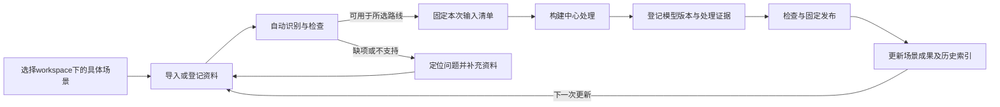

# 场景数据管理设计

归属规则更新：[场景空间数据归属设计](场景空间数据归属设计-v0.1.md)明确一个真实场景对应一个场景空间；多资料、多传感器、多历史版本均归属于该空间。P5a／P5b已实现受控样本初始化与Workspace授权创建场景；登记入口仍不自动创建空间。

日期：2026-11-03\
版本：v0.2\
状态：功能设计；全屏页面首版已实现，后续数据模型与扩展功能按清单推进。\
总体依据：[业务流程与数据流程简化设计 v0.3](业务流程与数据流程简化设计-v0.3.md)。本版明确 workspace 归属，并增加第 11 节功能清单；现有实现与缺口见第 10 节。保留[v0.1](场景数据管理设计-v0.1.md)作为历史。

页面实施更新：已完成[全屏工作区首版](数据管理全屏工作区设计-v0.1.md)，接入现有样本资料、模型及来源目录；P9已实现两类受支持ZIP资料包上传，完整数据模型、大文件及扩展功能仍按清单逐项推进，不能将页面首版视为26项全部交付。

P14实施更新：已有空间成果首条路线已接通，采用带坐标清单的严格PLY资料包；与原采集资料共处同一个场景空间，独立保存资料、批次与构建版本。列表显示点数和已有成果类别，复用资料说明、预检、构建和追溯。见[P14验收](../validation/已有点云接入-P14-2026-11-04.md)。不代表任意成果导入或全部数据管理清单完成。

2026-11-05快照（截至P17）：P15统一入口及批次交接，P16完成浏览器 PLY 准备，P17完成 PLY 本机及登记后受权内容预览，并连接构建阶段可视化。见[P17验收](../validation/资料预览与构建过程可视化-P17-2026-11-05.md)。DM11 仅点云子项完成，图像／轨迹／表格仍待安排；DM05 大文件、DM09 关键解释纠正及 DM10 通用配套不据此视为完成。

2026-11-05 P18补充：构建中心已完成现有RGB-D资料的逐帧过程记录、全屏跟随与源时间回放，使用实际输入帧和已有估计相机位姿，见[P18验收](../validation/逐帧构建过程可视化-P18-2026-11-05.md)。该能力属于构建任务过程查看，不等于DM11原始图像／通用轨迹资料预览完成；数据管理仍沿原场景、资料与批次交接。

2026-11-05 P19更新：数据管理已增加当前NYU RGB-D资料的彩色／深度、逐帧定位、已有估计轨迹与放大查看，全屏构建按当前过程帧联动来源。60对源图及57帧过程映射实际核对，发布消费和重启通过，见[P19验收](../validation/RGB-D资料预览与构建来源联动-P19-2026-11-05.md)。DM11仅增加当前路线的图像／已有轨迹子项，通用图像／轨迹／表格、关键解释纠正和通用配套仍未完成。

2026-11-05 P20已完成[资料编辑、修改历史与成果版本接替](资料坐标声明纠正-P20任务规划-2026-11-05.md)：DM09当前带来源收据的PLY坐标说明可在原资料上编辑并保留审计，列表不增加资料卡片；新任务绑定当前修订及匹配预检，旧封存、任务、模型和发布保留当时内容。已发布成果经新版本接替并退役旧版，错误版可先停止分发。408项后端、52项分组浏览器／HTTP、7项离线汇总、8项完整性与编译通过，见[验收](../validation/资料编辑与版本接替-P20-2026-11-05.md)。DM09其它坐标转换／配准等能力仍未完成，不据此整项勾选。

## 1. 定位：围绕一个具体三维场景的数据资产中心

业务主轴为：**平台一个 workspace 管理多个三维场景，一个三维场景持续积累资料并保留多个历史模型版本。**

数据管理承上接入采集资料、已有空间成果和参考资料；启下向构建提供可解释、可复现的固定输入，并登记模型、视图及发布的来源关系。

它要回答五个业务问题：

1. 这个场景有哪些资料，分别是什么、来自哪里？
2. 哪些资料可以用于本次用途，还缺什么？
3. 本次构建明确使用了哪些资料和规则？
4. 这个场景有哪些模型版本，各自生成了什么成果？
5. 某个发布可以追溯到哪次处理、哪份资料和哪些检查证据？

用户默认先选场景，再管理该场景数据；跨场景总览只提供有权限范围内的检索，不自动合并不同场景的几何、版本和坐标。

## 2. 业务层级与版本关系

```text
平台 workspace（业务归属与协作边界）
└─ 三维场景 × N
   ├─ 资料资产 × N
   │  ├─ 原始采集资料
   │  ├─ 已有空间成果
   │  └─ 参考与业务资料
   ├─ 当前工作上下文
   │  └─ 明确输入、用途、基线版本与当前候选
   └─ 场景模型历史版本 × N
      ├─ 几何、对象、覆盖与质量声明
      ├─ 固定来源与处理记录
      └─ 固定发布 × N
         ├─ 指定人视图与智能体视图
         └─ 在线服务引用及按需离线交付
```

### 2.1 身份与归属

- **workspace**沿用平台定义，是本产品的业务归属与协作边界，原文“客户”对应这里的 workspace。一个 workspace 可以有多个成员和多个三维场景，不对应某个自然人，也不对应单个三维场景。
- 每个场景归属一个明确的 workspace；组织与身份发行方继续作为平台验证上下文。归属核验沿用 `(issuer, org_id, workspace_id)` 绑定，不仅比较名称或孤立的 workspace ID，不新设 customer 实体。
- 用户切换 workspace 后，必须重新读取该 workspace 下获授权的场景与资料，并清空不适用的旧场景和版本选择。成员身份不自动等于全部场景的数据管理权限；有效角色与场景授权沿用平台及产品策略。
- **三维场景**是稳定业务实体，例如“1号楼设备间及相连走廊”。每个场景声明坐标基准、管理范围和权限；不因一次重新采集或重建而另建场景。
- **项目**可用于把多个场景组织为一次交付，不作为每次操作都必须选择的新层级。
- 场景跨界、拆分或合并需要显式建立来源和坐标关系，不通过名称或文件路径猜测。首版不实现自动场景拼接。
- 同一场景内也可以存在不同传感器坐标，只有具备明确且可用的变换关系才能融合。新版本若更换场景基准，必须记录与原基准的变换及适用性；无法建立关系时不假称版本间已对齐。

### 2.2 四种“变化”分别处理

| 变化 | 产生什么 | 不自动产生什么 |
| --- | --- | --- |
| 补传日志、轨迹、标定或参考点 | 新的资料内容记录，或新的固定资料集合 | 场景模型新版本、正式发布 |
| 改算法参数、重建、修正对象或关联 | 新的模型快照；候选和未采用版本保留历史 | 自动替换现行服务 |
| 只改人视图细节或智能体派生配置 | 新视图版本；通过检查后可形成新发布 | 无变化的模型新版本 |
| 改名称、备注、访问权限或分发状态 | 元数据或控制记录修订 | 几何内容新版本 |

界面重点显示场景模型版本及其发布情况；资料、规则和视图的内部版本在详情展开。显示版本如 `V1.1.1` 是场景内标签，稳定身份和内容摘要才用于程序引用。各场景独立编号，同名版本不代表同一内容。

模型版本不等于发布：未发布、未采用和待检查快照也是历史。一个模型版本可以派生多套用途视图并形成多次发布。正在使用哪个发布，由明确的服务引用决定，不能仅按时间取最新。

## 3. 数据分类：三个输入类别，一条成果链

| 类别 | 典型资料 | 主要说明 | 交给谁使用 |
| --- | --- | --- | --- |
| 原始采集资料 | RGB-D、激光日志、图像、IMU、轨迹、标定 | 传感器、时序、坐标、采集范围和字段条件 | 构建中心的重建路线 |
| 已有空间成果 | 点云、网格、已有地图、BIM | 单位、坐标、覆盖范围、来源与已有质量声明 | 构建中心的成果整理路线 |
| 参考与业务资料 | 控制点、独立检查点、参考尺寸、设备台账 | 用途角色、是否参与拟合/调参、业务记录版本 | 构建检查、空间关联 |

“待处理文件”和“可构建输入”不等价。格式能识别、内容可解码、坐标可解释、某路线可使用、某用途质量合格分别判断。

过程产物、模型、人视图、智能体视图、检查报告及发布由各自模块生成，再由数据管理聚合索引。数据管理不要求工程师把每个自动生成的文件手工导入一次。

全局可复用的本体、处理模板和通用标定不默认复制为每个场景的独立平台。需要使用时引用获准的固定版本；现场标定仍须满足对应设备与采集时段的适用条件。

## 4. 接入、整理、供给、回收成果



### 4.1 导入与登记

用户只提供场景、资料、名称及必要的来源说明；系统尽量提取格式、大小、时间、坐标和范围，提取不到时明确缺失，不要求用户一次填写全部技术字段。

接入方式设计为：

- 本机/服务端已配置来源登记：继续复用当前授权来源机制。
- 上传文件或资料包：后续按容量需求接入；正式提交前放在暂存区，检查失败不作为可构建资料。
- 外部存储引用：后续接入；记录受控定位与固定内容，不把一个持续变化的目录当成不可变输入。

当前页面只开放已实现的方式。不因设计中列出上传、BIM或点云就宣称已经支持。

默认一份资料登记归一个场景。一次采集若跨多个场景，应明确截取范围或成员子集、原始采集来源及各场景变换；首版不自动跨场景分发。物理内容可去重，但内容摘要相同不能自动获得另一个workspace或场景的访问权。

### 4.2 自动检查与补齐

| 检查 | 例子 | 结果用途 |
| --- | --- | --- |
| 文件与结构 | 文件存在、可读、长度、摘要、可解码、成员引用完整 | 判断内容是否可取得并可信地固定 |
| 坐标与时间 | 单位、轴向、原点、传感器变换、时钟与同步依据 | 判断能否按所选路线解释与组合 |
| 路线输入条件 | RGB-D是否有对应帧和位姿；激光重建是否具备所需字段 | 判断该路线可否启动 |
| 用途角色 | 构建输入、调参资料、控制参考、独立校核、业务参考 | 防止把用于拟合的数据再称为独立验收证据 |

独立性记录在“本次使用角色”上，不单靠文件名。相同资料若已用于拟合或调参，对应结果不能再把它声明为独立检查证据。

未通过检查的资料可保留登记和问题记录，但不进入不满足条件的处理路线。缺坐标时可以查看元数据；只有适用能力允许时才提供标明限制的局部预览，不能静默融合或推断现场位置。

观测时间未知就记录未知；UTC标准化保留原始时钟及已知映射，不能用文件修改时间补造采集时间。局部室内坐标不强填EPSG。

### 4.3 固定本次输入

构建提交时，系统固定以下逻辑信息：

- 场景、本次用途及明确的父模型版本（初版为空）。
- 资料清单及每份内容的固定引用和摘要。
- 每份资料在本次处理中的角色、子范围及必要变换。
- 所选处理实现、参数、所需本体或模板的固定引用。

用户确认的是“这些资料用于本次处理”，无需另外创建一个数据集版本再创建一个采集批次。多人整理、重复采集或批量交付确有需要时，才显示批次管理。

固定输入清单是逻辑快照，可复用现有登记与构建绑定，不要求先新建一张业务表。若资料已经受现有批次约束，仍须绑定允许使用的封存批次；界面可明确呈现默认建议并随提交确认，不能省略批次绕过门禁。

预检与构建提交之间内容可能变化，提交时必须复核。开始构建后新增资料，不改变在途任务的固定输入。

### 4.4 接收成果与历史

构建模块负责生成产物并确认任务成功；数据管理只登记已经完整形成的模型快照及固定引用。失败或中断任务留在处理记录，不伪装成一个可用模型版本。

语义或业务关联修订由空间关联产生新模型快照，数据管理沿用同一场景和来源链登记。视图与发布同样由对应模块登记引用，避免多个模块各保存一份可独立修改的事实。

历史中的一个模型版本应能展开：使用资料、父版本、处理实现和参数、关联规则、检查结论、派生视图、发布记录。涉及未授权资源时只按权限返回，不生成可绕过授权的原始路径。

## 5. 最小逻辑数据模型

下表是设计字典，不是已上线API或新JSON Schema；落地时优先映射现有实体，避免为改名再造记录。

| 对象 | 最小内容 | 所属模块 |
| --- | --- | --- |
| 场景 | 稳定场景ID、workspace归属绑定、名称、管理范围、坐标基准引用 | 空间配置与权限；数据管理引用 |
| 资料记录 | 资料ID、场景、类别、来源、格式、固定文件成员、观测时间、坐标说明、登记人/时间、使用条件 | 数据管理 |
| 本次输入清单 | 场景、用途、父模型、资料及角色、子范围、变换、固定模板引用 | 数据管理提供；构建提交绑定 |
| 处理记录 | 任务ID、固定输入、实现与参数、开始结束时间、状态、输出与诊断 | 构建中心；数据管理聚合 |
| 模型快照 | 模型版本身份、场景、父版本、几何与对象、覆盖/质量声明、来源与证据 | 空间模型与构建；数据管理索引 |
| 派生与发布引用 | 模型引用、视图身份及用途、发布身份与分发状态、离线导出引用 | 视图及态势服务；数据管理索引 |

大文件成员至少具备受控存储引用、字节数、媒体类型/编码和内容摘要。浏览器获得经过授权的访问地址，不获得服务器任意文件路径或对象存储凭据。

资料显示名、备注可以独立修订；同份资料的坐标说明或适用范围修正保留内部固定修订与修改历史，不因此增加可见资料条目。构建和封存批次绑定当时的文件与说明，已发布成果继续引用当时内容；影响已发布使用的成果时，经新版本构建发布接替并退役旧版，已确认错误的版本可先停止分发。新采集或补充资料仍按实际来源登记，不与填写纠错混同。P20已实现当前PLY子项，能力边界见上方快照。

现有 `space_id` 继续作为具体场景身份；历史 `scene_id` 由适配层明确映射。workspace 归属使用现有平台资源绑定，不新增 `customer_id`，不把用户ID作为数据所有者。资料使用现有 `input_id`，模型快照优先映射现有候选ID和模型摘要，发布使用既有发布ID。只有现有实体无法表达的关系才增加兼容记录。

### 5.1 血缘既要能向前，也要能向后

```text
资料 → 被哪些处理使用 → 形成哪些模型版本 → 派生哪些视图 → 哪些发布引用
发布 → 固定视图及模型 → 构建/关联记录 → 输入资料与检查证据
```

关系至少区分：构建来源、语义修订基线、校核证据、视图派生、固定发布、离线导出。不能把所有关系都叫“来源”，否则无法判断某文件缺失究竟影响重建、追溯还是现有服务。

## 6. 数据格式与存储策略

| 数据 | 规划格式/契约 | 本期处理原则 |
| --- | --- | --- |
| RGB-D、激光及惯性观测 | 保留源格式；日志按设备采用ROS bag/MCAP等，附输入清单 | 先复用现有两类样本适配；不是同时支持所有日志 |
| 点云和网格成果 | 保留已有编码；按消费需求适配PCD/PLY、LAS 1.4/COPC或网格格式 | 先选一种已有成果适配跑通整理路线，不做全量格式转换 |
| 控制点、检查点、轨迹、标定 | 带坐标、单位、角色、时间与证据引用的结构化清单及数值文件 | 局部XYZ采用明确的表格/JSON或相应数值编码；GeoJSON只用于符合其坐标语义的地理数据 |
| 设备台账与业务参考 | 源CSV/JSON等加固定字段映射、业务版本和记录ID | 数据管理登记；对象绑定在空间关联完成 |
| 模型、视图和发布清单 | 复用现有版本化JSON契约，大几何文件单独存储 | 固定引用连接；不把所有内容塞进一个JSON文件 |
| 人视图与智能体运行数据 | 各自按浏览、查询和机器人用途派生 | 不要求输入统一改成展示格式，也不把展示资产默认下发机器人 |

文件/对象存储保存大内容，结构化记录保存归属、索引、引用及状态；两者通过固定清单连接。首版沿用已有本地文件与SQLite，不为本次设计强制迁移数据库；对象存储接口为后续部署保留。

对外部引用文件，登记不等于已复制封存。记录实际存储方式并在使用前校验，缺失或被修改时阻断相关新处理。后续托管导入采用完整接收、校验后提交；暂存区不暴露为可用成果。不承诺现有文件系统与数据库已具备分布式原子事务。

本体格式、BIM语义容器、3D Tiles和机器人专用地图由对应模块决定。数据管理负责描述、保存和解析，避免反过来用一个文件格式限制全部产品流程。

## 7. 页面：一个场景下的三张视图

数据管理使用现有DS组件和布局规范。顶层复用平台当前 workspace 上下文及场景选择；有权限的用户可在多个场景间切换。场景与数据较多时可检索，不使用六模块之外的新Launcher入口。

```text
数据管理        Workspace：当前工作区       场景：设备间与相连走廊 ▾

资料  |  场景版本  |  来源追溯                     [导入资料]

搜索资料……       类型 ▾       可用情况 ▾

名称              类型          观测时间       可用情况       操作
设备间采集-01      RGB-D         已知时段       可用于重建     详情
设备间点云         点云          未提供         缺坐标说明     处理
设备台账           业务参考       业务版本日期   可用于关联     详情

选中资料：用途、检查问题、相关版本、来源与文件成员（详情按需展开）
                                                    [用于构建]
```

### 7.1 资料：默认视图

按名称、类别、观测时间、可用情况、大小和最近处理呈现。原始ID、摘要、文件成员和技术参数放在详情。标签明确显示“流程样本”“单帧局部”“质量未验收”等必要限制。

详情主要操作是“用于构建”或“补充资料”；参考资料可跳转“用于空间关联”。从构建中心打开时复用同一资料选择组件，确认后回到原流程，保持场景上下文。

“资料来源”设置放在受权管理入口；批次作为资料视图内的可选分组/高级操作，不继续与日常操作平铺为同等入口。

### 7.2 场景版本：看得清历史成果

每行显示模型版本、形成时间、变更摘要、用途与检查情况、发布关联。展开查看该版本资料、几何/语义变更、视图和处理记录；可打开候选预览、比较版本或进入检查。

正在使用的发布以明确标识呈现，不能仅标记“最新”。“基于此版本准备更新”只创建工作上下文，不立即发布。发布、暂停、恢复和服务切换继续调用态势服务能力。

### 7.3 来源追溯：按需查询

默认从一个已选资料、版本或发布展开前后关系；无选择时提供检索与时间顺序列表。先提供可展开列表，不以全屏复杂知识图谱作为首版依赖。

报告同时区分内容完整性和追溯完整性：某条历史来源找不到，不等于当前发布的独立快照必然不可读；存在完整快照，也不等于原始采集证据仍然齐全。

## 8. 状态、权限与保留

### 8.1 一个标签不能替代全部判断

- 导入进度：接收/检查中、完成、失败，属于导入过程。
- 资料内容：可读取、缺失、校验失败，描述实际内容检查结果，并标明检查时刻。
- 使用条件：可用于所选路线、缺必要条件、不支持该路线，按当前用途判断。
- 资料管理状态：正常、停用、归档，沿用受控操作；归档不等于物理删除。
- 模型检查、任务执行和发布分发各保留自身状态，不混成一个“场景是否成功”。

页面可合成“可用于重建”“需补充坐标”“已停用”等业务提示；只有用户展开才显示底层检查。没有本次检查不能显示“已验证”。

### 8.2 权限

资料目录、模型历史、追溯、下载及直接URL都以workspace绑定和场景授权为前提。可预览空间不代表可以查看全部原始采集资料、下载大文件或修改记录；原始资料管理沿用对应数据权限。共享本体引用另执行其资源权限。

后台必须检查输入、基线、输出全部归属同一明确场景，或属于明确获准的共享规则资源。搜索、数量和去重结果也不能暴露其他workspace的数据。

### 8.3 停用、归档与删除

停用资料阻止相关新使用，不追溯抹除历史发布。具体操作检查其必需依赖：重新构建需要源资料；完整、独立保存的既有发布可以按自身依赖继续读取，同时保留来源缺口提示。发布暂停/恢复由态势服务管理。

删除前区分运行必需引用与历史证据保留，显示影响范围。第一阶段不提供一键级联物理删除，不因归档回收仍被模型、发布或证据要求引用的字节。实际保留期限按交付与 workspace 的交付约定后配置，不虚构统一年限。

## 9. 最小验收样例

| 场景 | 期望结果 |
| --- | --- |
| workspaceA有两个场景 | 分别积累资料与版本；切换场景清空旧选择，不混用坐标和候选 |
| workspaceB使用同名场景或相同文件 | 身份、访问和来源记录独立，不因同名或同摘要授权 |
| 同场景导入两次采集资料 | 新增资料，不立即产生模型版本；明确选择后才进入构建 |
| 同一输入采用两套参数处理 | 形成不同处理及模型快照，来源可追溯；不覆盖先前结果 |
| 一次输入用作拟合和检查 | 相应结果不得把这份输入标为独立校核证据 |
| 只修改设备关联 | 新模型快照复用明确几何来源，检查受影响的视图与用途 |
| 同一模型只更新人视图配置 | 新视图及发布引用保留同一模型身份，不伪造模型变化 |
| 原文件登记后被修改 | 构建准入复核失败，不沿用旧预检通过结论 |
| 处理中新增资料或新版本失败 | 原任务输入不变；旧发布持续服务 |
| 原始资料丢失，独立发布快照完整 | 禁止需要该源资料的重建；发布按自身完整性与门禁读取，并显示来源缺口 |
| 查询历史发布 | 可定位确定模型、视图、输入和证据；没有的历史字段明确未记录 |

## 10. 现有实现映射与渐进实施

现有样本级能力包括空间资料登记、两类输入检查、批次与来源许可、构建绑定、成果目录、候选/发布来源和生命周期控制。不能把早期合成 `dataset/0.1` Schema 当作所有真实资料的通用模型，也不能将历史登记缺失的创建时间补造为真实记录。

| 实施顺序 | 交付内容 | 复用基础 | 明确缺口 |
| --- | --- | --- | --- |
| 1 场景上下文和目录收敛 | 场景下的资料/版本/追溯三视图，共用选择器 | 现有空间授权、输入和成果目录 | workspace 展示与资源绑定需适配；空间创建尚待实现 |
| 2 固定输入与构建衔接 | 从资料直接进入本次工作上下文，自动检查并固定输入 | 输入登记、构建绑定、批次准入 | 统一资料角色和多成员输入需分路线实现；不能把多选当成已支持融合 |
| 3 成果历史聚合 | 模型版本及发布关系、处理与检查证据、更新基线 | 候选、发布、差异与历史记录 | 增加兼容目录映射，不重写已有模型和发布 |
| 4 一个已有成果适配 | 用一个有明确坐标的点云样本跑通整理路线 | 已有构建/视图/发布链路 | PCD/PLY等适配未因本文而自动实现 |

各阶段以同一短场景复现导入、处理、检查、发布和读取，再加第二场景验证隔离。没有设备时继续使用注明来源和限制的样本；先验证流程，不在此阶段重新开展算法精度竞赛。

本文保留六模块划分，不新增数据治理门户、复杂审批流、全格式转换中心或独立分布式数据平台。后续实现按上述业务对象与职责逐步落地，保证主流程比当前更短。

实施快照（2026-11-04，截至P13）：DM07资料名称／备注／用途已完成独立修订与历史；DM09／DM10已完成现有两类适配器的只读来源事实、缺项及角色用途展示，关键解释修订和通用资料配套仍未实现。DM03增加按当前名称与说明搜索，DM22增加说明修改历史。这些子项不代表整张清单全部完成。见[P13验收](../validation/资料说明与来源信息-P13-2026-11-04.md)及[字段契约](../../contracts/schemas/input-description-v0.1.md)。

## 11. 数据管理功能项清单

### 11.1 范围与优先级

以下七组是功能分组，不新增七个页面。用户仍使用“资料、场景版本、来源追溯”三张视图，导入、详情和输入选择采用抽屉或对话框；管理配置单独按权限进入。

- **首批**：完成现有样本的日常资料到成果闭环，优先实施。
- **随后**：补齐基础数据管理，但不阻塞首批样本流程。
- **扩展**：在真实资料规模、设备或外部系统需求明确后实施。

优先级不是完成状态。已有能力复用，缺口逐项实现；整张清单不能作为已交付功能声明。

### 11.2 功能清单

| 编号 | 功能项 | 具体行为与结果 | 优先级 |
| --- | --- | --- | --- |
| DM01 | Workspace与场景上下文 | 沿用当前平台 workspace，仅列有对应权限的场景；切换后清除旧选择并重新读取 | 首批 |
| DM02 | 场景数据概览 | 汇总该场景资料、已有模型版本、现行发布引用与待处理问题；不虚构完成百分比 | 首批 |
| DM03 | 检索、筛选与分类 | 按名称、类别、格式、观测时间及可用情况筛选；区分原始、已有成果、参考资料 | 首批 |
| DM04 | 已配置来源登记 | 从获准来源选择资料，自动固定来源与内容；显示登记结果、重复登记及失败原因 | 首批 |
| DM05 | 文件或资料包上传 | 上传进度、失败重试、暂存、校验后提交；限制包成员范围，不直接成为可构建资料 | 随后 |
| DM06 | 大文件及外部存储接入 | 断点续传、对象存储或受控连接器；冻结明确内容，不追随变化目录 | 扩展 |
| DM07 | 资料命名与说明 | 编辑显示名、备注、用途说明；保留修改记录，不覆盖原始内容 | 首批 |
| DM08 | 格式与内容检查 | 识别格式，检查解码、成员、摘要及文件完整性，列出可定位的问题 | 首批 |
| DM09 | 坐标与时间整理 | 提取并展示单位、基准、范围、时间和缺项；确认或修正形成可追溯解释记录 | 首批 |
| DM10 | 资料角色与依赖整理 | 区分观测、轨迹、标定、控制参考、独立检查及业务参考，识别路线必需的配套资料 | 首批 |
| DM11 | 轻量预览 | 支持路线内的图像、点云抽样、轨迹或表格预览；显示适用范围及缺少坐标等限制 | P17完成PLY子项；P19完成当前NYU图像／已有轨迹子项；通用格式及表格待安排 |
| DM12 | 重复资料与内容更新 | 同范围、同内容重复提交定位已有记录；不同内容新建固定记录，不按同名覆盖 | 首批 |
| DM13 | 构建输入选择 | 选择所需资料和用途，明确基线模型，检查该路线是否支持所选组合 | 首批 |
| DM14 | 固定输入并转入构建 | 绑定具体资料、角色、子范围及必要变换；转入构建中心时保持上下文 | 首批 |
| DM15 | 批次及多次采集组织 | 按实际采集轮次分组，必要时封存；不把批次变成每次构建前的必填表单 | 随后 |
| DM16 | 模型历史版本目录 | 列出该场景候选与历史模型，显示时间、变更说明、检查情况和发布关联 | 首批 |
| DM17 | 版本详情与比较 | 展开固定输入、参数和检查；比较几何、对象与关联变化，标明坐标可比条件 | 首批 |
| DM18 | 视图与发布成果索引 | 在模型下展示派生视图、固定发布和离线导出入口；状态取自责任模块 | 首批 |
| DM19 | 基于历史版本准备更新 | 选定版本作为明确基线创建工作上下文；不覆盖历史、不立即切换服务 | 首批 |
| DM20 | 来源与使用关系查询 | 从资料查处理及成果，从发布反查模型、输入、规则与证据；区分缺失和未记录 | 首批 |
| DM21 | 使用影响查看 | 停用、归档或纠正资料前显示相关处理、模型及发布，说明哪些新操作受影响 | 首批 |
| DM22 | 操作与检查历史 | 展示实际操作者、时间、变更原因及检查结果；历史缺失字段明确未记录 | 首批 |
| DM23 | 资料停用与归档 | 沿用现有受控状态，保留历史，按依赖阻止新使用；不级联暂停已有发布 | 首批 |
| DM24 | 元数据与记录导出 | 按权限导出资料目录、固定清单或检查记录，保留作用域、版本与限制 | 随后 |
| DM25 | 来源许可与存储配置 | 管理获准接入来源及可用范围；来源目录必须限定当前 workspace 可分配资源 | 首批 |
| DM26 | 保留及容量管理 | 先显示实际已知占用和保留说明；随后再按引用、配额和交付约定治理 | 扩展 |

### 11.3 七组功能与页面位置

| 功能组 | 编号 | 页面位置 | 默认主要动作 |
| --- | --- | --- | --- |
| 场景数据目录 | DM01—DM03 | 模块顶部与资料列表 | 选择场景、查找资料 |
| 资料接入 | DM04—DM07 | 导入入口及资料详情 | 导入资料、补充说明 |
| 检查整理 | DM08—DM12 | 资料详情与问题列表 | 查看检查、处理缺项 |
| 构建供给 | DM13—DM15 | 共用资料选择器及可选批次分组 | 用于构建 |
| 版本成果 | DM16—DM19 | 场景版本 | 查看版本、准备更新 |
| 来源追溯 | DM20—DM22 | 来源追溯及详情历史 | 查看来源与影响 |
| 保留与配置 | DM23—DM26 | 资料操作及受权配置 | 停用、归档、配置来源 |

### 11.4 五个高频操作的明确行为

| 操作 | 用户最少提供 | 系统返回 | 不在此处执行 |
| --- | --- | --- | --- |
| 导入资料 | 当前场景、获准来源或文件、必要说明 | 固定资料记录、自动提取结果和问题；失败保留可解释记录 | 自动建图、自动发布 |
| 补充资料 | 原资料或原工作上下文、补充的轨迹/标定等 | 新资料与明确配套关系；原输入引用不被改写 | 修改在途任务 |
| 用于构建 | 本次用途、具体资料与明确基线 | 可启动性结果、固定输入上下文，并转入构建 | 在数据模块再造算法任务系统 |
| 准备更新 | 选定历史模型及本次变化 | 同场景的新工作上下文，继承明确基线 | 改写旧版本、自动切换当前发布 |
| 归档资料 | 选中资料及原因 | 影响说明、权限检查和保存后的归档记录 | 删除被引用字节或级联撤销发布 |

多文件属于同一资料包，还是多份资料共同参与处理，由适配器和路线明确决定。界面多选不代表后台已经支持多日志融合。首批固定输入仅承诺现有路线能够解释的组合。

### 11.5 模块职责边界

| 功能 | 数据管理负责 | 责任模块负责 |
| --- | --- | --- |
| 场景创建、范围与成员 | 展示已获权场景，提供统一配置入口 | 空间配置及平台权限维护归属、范围和授权 |
| 算法与参数 | 提供满足条件的固定资料引用 | 构建中心选配、执行及诊断 |
| 数据转换、裁剪、配准 | 保存输入输出及血缘，提供受控入口 | 构建中心或其处理器执行，不悄悄改源文件 |
| 类型与约束 | 引用固定本体，不编辑类型定义 | 语义本体维护规则 |
| 对象标注、几何与台账绑定 | 保存业务参考资料及成果引用 | 空间关联编辑具体实例 |
| 发布、在线调用和离线交付 | 展示固定引用、检查与来源 | 态势服务执行发布、分发及消费管理 |

### 11.6 Workspace作用域的落地要求

1. 正常页面从平台当前 workspace 开始，再选择其场景；不新增“客户管理”页面或 customer 实体。
2. 每个场景归属一个明确 workspace。资料、输入、候选和发布通过持久场景绑定继承归属；如持有冗余 workspace 字段，必须与场景绑定一致。
3. Workspace成员、场景权限、资料管理和导出权限分别检查。切换 workspace 不迁移资料；跨 workspace 转移或共享不列入首批。
4. Workspace共用的本体和模板按明确引用使用。首批场景资料不增加一个无归属的 workspace 文件仓库；跨场景资料复用后续按授权及坐标条件扩展。
5. 当前部署来源目录不具备逐来源的第二层租户分配ACL。沿用单作用域部署时，目录只能配置该 workspace 可分配的来源；多 workspace 共用服务前须补充来源归属及过滤，不能把现有全局可选目录视作已满足隔离。

### 11.7 验证按业务动作验收

首批以三个完整操作验收上述功能：

- 在 workspace A 的场景一登记合法样本，自动检查后进入构建；结果出现在场景一的版本目录，可追溯到确定输入。
- 在同一 workspace 的场景二执行同样流程，两边版本和坐标独立；切换场景不会继承另一场景的资料选择。
- 切换到 workspace B 后，仅显示当前授权资源；workspace A 的列表、来源、详情、下载与直链均不能沿用旧上下文访问。

然后覆盖资料被修改、缺轨迹、重复登记、版本检查失效、归档及来源缺失等异常。先证明高频流程可用，再实现上传、大文件和自动容量治理。
