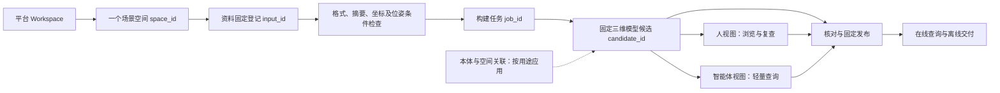

# 场景空间：资料 → 三维模型 → 双视图构建设计 v0.1

日期：2026-11-03。适用阶段：本机样本流程验证。主轴是一个具体场景的成果闭环，优先跑通流程。

2026-11-04 更新：后续执行顺序以[业务与技术流程任务批次及验收](业务技术流程任务批次与验收-v0.1.md)为准，优先连续核对发布与失败恢复，精度后置。P1 已完成流程页核对、固定目标候选交接及发布成功定位；下文关于退回任务列表核对的描述为上一版实现记录。

## 1. 本轮确定的主线

**选择场景空间 → 登记并检查资料 → 生成固定三维模型 → 从同一模型派生人视图与智能体视图 → 核对并按需固定发布。**

客户边界沿用 Vxture 平台 Workspace；Workspace 下可以有多个场景空间。一个物理场景只有一个稳定 `space_id`，它包含多批资料、多个模型历史版本、多份视图及发布。输入格式、传感器不同，不能据此把同一个场景拆开；不同真实场景也不能混成同一模型的历史版本。

技术架构中的“真值”是权威来源的角色，不是“算法运行成功”的别名。当前样本产物称为**三维模型／真值候选**，持续保留 `quality=unverified`、`production_ready=false` 和 `robot_ready=false`。独立精度与用途验收另行实施。

智能体视图直接从固定模型派生；不从人视图截图、渲染缓存或下载包反向生成权威模型。

## 2. 六个板块如何接续

| 板块 | 这一条主线中的责任 | 不由它承担的工作 |
| --- | --- | --- |
| 数据管理 | 当前场景的资料登记、检查、使用状态、历史模型及来源索引；把确定资料交给构建 | 不直接覆盖已有模型，不执行发布 |
| 构建中心 | 确认输入、提交任务、查看模型与两类视图产物、核对候选 | 不另建空间身份，不把构建成功当质量验收 |
| 语义本体 | 提供固定规则版本；按用途复用 | 纯几何流程验证不必先造设备语义 |
| 空间关联 | 在具体场景的模型候选上补对象、几何锚点、业务绑定与关系 | 不要求每次几何构建都造台账或完整关系网 |
| 态势服务 | 固定模型及视图组合、版本追溯、在线／离线消费 | 不静默把最新任务替换成现行发布 |
| 空间预览 | 浏览有权访问的场景和固定发布；独立标签页查看全屏空间 | 不把未发布的新候选当成现行版本 |

旧“六模块参考流程”用于展示本体、关联及交付的完整参考链，继续保留其原有接口语义；它不是每次几何构建都必须完成的检查表。本轮新增的“构建流程”是构建中心的默认工作面，不再以旧参考流程中的台账缺项阻止查看双视图成果。

## 3. 阶段、判据与实际文件

| 阶段 | 输入与必要判据 | 本轮实际输出 | 成功含义 |
| --- | --- | --- | --- |
| 资料登记 | 已有场景；服务端允许的来源；资料属于该物理场景 | `input-*.json`：固定输入登记和摘要 | 已登记，不表示精度合格 |
| 输入检查 | 报告与轨迹匹配；图像存在且摘要、尺寸、格式符合适配器要求 | 预检结果；认证服务中保存执行人、时间、序号 | 当前文件可用于此构建路线；提交构建时仍重新校验 |
| 三维模型构建 | 固定资料引用；符合路线要求的位姿或整理条件 | `spatial.npz`、模型清单 `model.json`、任务日志 | 已生成统一局部坐标的点云候选 |
| 人视图派生 | 冻结后的 `spatial.npz` | `human.ply`；浏览预览 `views.js` | 几何与颜色来源固定，能够显示 |
| 智能体视图派生 | 同一个 `spatial.npz`；显式分辨率 | `agent.npz`：表面单元索引 | 可以做声明范围内的表面／未知查询，不等同避障或导航 |
| 核对及固定发布 | 具体候选、比较摘要、选择修订和发布权限 | `publication.json`、独立成果快照、按需离线 ZIP | 固定引用可共享，仍是流程预览发布 |

**本轮执行方式仍是一个构建任务。** 任务内部按“资料核验 → 模型冻结 → 人视图派生 → 智能体视图派生”的顺序执行，全部可读并绑定一致后才成功。逻辑阶段已分清，尚未实现独立的视图重试、分布式工作流或按配置重新派生。失败时保留失败任务，重新提交产生新任务与新候选。

已经纳入采集批次的资料，继续执行现有封存与修订准入规则；未纳入批次的单份样本不强制增加一个空批次。本轮不改变批次门禁。

## 4. 数据格式及字段定义

### 4.1 原始资料与登记清单

首条验证路线为 NYU 办公室 `office_0001a` 短片段，60 组 RGB-D 图像，57 帧已有估计位姿。

- 观测数据：`raw/*.pgm` 深度、`raw/*.ppm` RGB；原文件只读。
- 资料清单：`report.json`，已有 `cospace.nyu-short-scene/0.1`，固定成员大小与摘要、接受帧对及时间。
- 轨迹：`comparison.json` 的 `prefix_T_anchor_camera`，4×4 局部变换矩阵；它引用同一资料报告摘要。它是已有估计轨迹，不是本轮新实现的 SLAM。
- 登记记录：`cospace.preview-input/0.1`，固定 `id`、`space_id`、`format`、`snapshot_sha256`、`tracking_sha256` 及帧数。模型通过 `source.input_binding` 嵌入此登记的非路径部分。
- 服务端来源配置决定哪些封存数据可登记；浏览器不提交任意磁盘路径。目录检查不代替文件检查。

当前 ROS1 激光适配器仍是单帧局部候选路线，不与这套办公室样本拼接，也不宣称已经实现多传感器融合。

### 4.2 三维模型清单与载体

| 字段／文件 | 定义及约束 |
| --- | --- |
| `model.json` | `cospace.real-model-preview/0.1`；模型、来源、坐标、范围、视图、质量及成员的共同清单 |
| `id` / `space_id` | 具体不可变候选标识／唯一场景身份；当前 job 与 candidate 共用标识是现有实现，不代表概念永远合并 |
| `source.input_binding` | 固定资料及其摘要；必须与任务的 `input_id`、登记内容和场景一致 |
| `frame_id` / `axes` / `unit` | 具体局部坐标基准、轴顺序及米单位；样本是首帧深度相机坐标，右／下／前，不能假设为 Z 向上或 EPSG 坐标 |
| `bounds_m` | 模型观测点范围；不是已证明完整采集的场景边界 |
| `spatial.npz` | NumPy 无 pickle 数组 `points`、`colors`；几何与颜色的当前权威载体。此路线采用 5 cm 单元首点抽样，未生成封闭网格 |
| `members` | 固定文件名、SHA-256 和字节数；清单与大数据分离，读取时校验 |
| `quality` / readiness flags | 明确精度未验收、算法与实机准备状态；不随文件生成自动升级 |

NPZ 是当前本机工程样本格式，便于读写验证，不是跨厂商的最终统一标准。未来 USD、COPC、3D Tiles、网格与体素分块作为相应层的适配路线，不能在没有生成器、解析器和消费验证时写成“已支持”。

### 4.3 两类视图

| 项目 | 人视图 | 智能体视图 |
| --- | --- | --- |
| 载体 | `human.ply`，彩色点云 | `agent.npz`，去重表面单元整数索引 |
| 来源 | 同一 `spatial.npz` | 同一 `spatial.npz` |
| 固定引用 | `human_view.path`、`source_model_sha256` | `agent_view.path`、`source_model_sha256` |
| 必须声明 | 坐标与模型一致；可视化裁剪不修改模型 | 分辨率、表面单元数量、`unlisted_state=unknown` |
| 本轮限制 | 无网格、非 3D Tiles、未验证大场景流式能力 | 不是概率占据图；无空闲空间推断、TSDF／ESDF、导航或重定位验收 |

本轮智能体分辨率为 0.1 m，单元索引为 `floor(point / resolution)`。在线查询及离线读取均返回 `surface_candidate` 或 `unknown`。`surface_candidate` 不等同于独立验证的障碍占据概率，NPZ 不是 ROS `OccupancyGrid` 格式。

服务端对声明了人视图的双视图模型新增共同来源校验：两类视图都必须引用当前几何 SHA-256，且文件被 `members` 固定。旧的查询专用预览仍兼容；新的双视图声明不能混入另一模型的引用。读取构建流程页也核对场景、资料和双视图来源，失败时显示错误，不借旧成果替代。

## 5. 模型版本、视图与发布的区别

1. 原始资料内容变化，形成新的登记；相同场景与相同来源重复登记复用原记录。
2. 重新构建形成新任务与新模型候选，即使几何内容摘要恰好相同也保留运行历史。
3. 两类视图固定引用某一模型内容摘要。未来可单独重派生视图，不要求几何变化；当前独立重派生任务尚未实施。
4. 保存候选与切换“当前已选候选”是两件事。构建成功不会自动选择，新的未选候选不会替换当前发布。
5. 固定发布使用具体候选、清单摘要与选择修订；相同几何摘要不代表可以借用另一候选的发布。
6. 发布、查询、离线包均保留同一 `space_id` 与具体发布引用。下载成功不表示机器人安装或激活成功。

语义变更形成新的模型快照并保留基线与固定本体引用；几何摘要可以不变。规则库及关联编辑仍使用既有功能，不为这个几何验证场景补造设备台账。

## 6. 已实施页面

构建中心默认页为“构建流程”，另保留“构建任务”“当前模型候选”。

- 上部选择当前场景的具体构建任务，默认观察最新任务；显式指定任务不存在时直接报错，不自动换成别的任务。
- 四段流程展示资料、三维模型、人视图和智能体视图；只在真实成果可读且绑定一致时标记生成完成。
- 成果区显示三个载体、大小、摘要、坐标、输入数量，以及当前是否选中。
- 数据管理详情“用于构建”携带场景与资料进入任务页；提交成功后自动进入该新任务的流程页，进行中刷新其状态。
- 每条任务可“查看流程”；新候选需要核对后才进入发布。纯预览链接使用独立标签页。
- 已匹配发布会定位态势服务中的具体记录；最新候选尚未发布时不会借历史发布显示完成。
- 任务失败、来源不一致或指定记录不存在时显示问题，历史发布继续独立保留。

布局继承全宽场景目录、48 px Header、淡品牌背景与 DS 控件。流程卡片在宽屏排四列，中屏两列，小屏单列；成果信息采用无嵌套卡片的三栏，窄屏纵向排列。

## 7. 本轮结果与下一批

独立实测记录见[单场景资料到双视图验证](../validation/单场景资料到双视图构建-2026-11-03.md)。原有 8769 服务及原工程数据继续保留；新的 8770 仅为同机独立样本与模拟认证验证，不是真实平台联调。

下一批顺序：

1. 把“创建／初始化场景空间”接入真实平台 Workspace 授权能力，再将样本包初始化整合到数据管理；不能把本轮独立测试目录创建当作已完成正式空间创建 API。
2. 单独派生任务：固定模型快照、派生参数与视图标识；允许独立重试人视图或智能体视图，并核对兼容发布。此项才是后续任务拆分，不先引入新工作流引擎。
3. 在已有模型与双视图主线稳定后，再按设备查询用途补本体与空间关联；按真实机器人需求扩展占据／距离场／离线分块，不在本轮继续提高重建精度指标。
