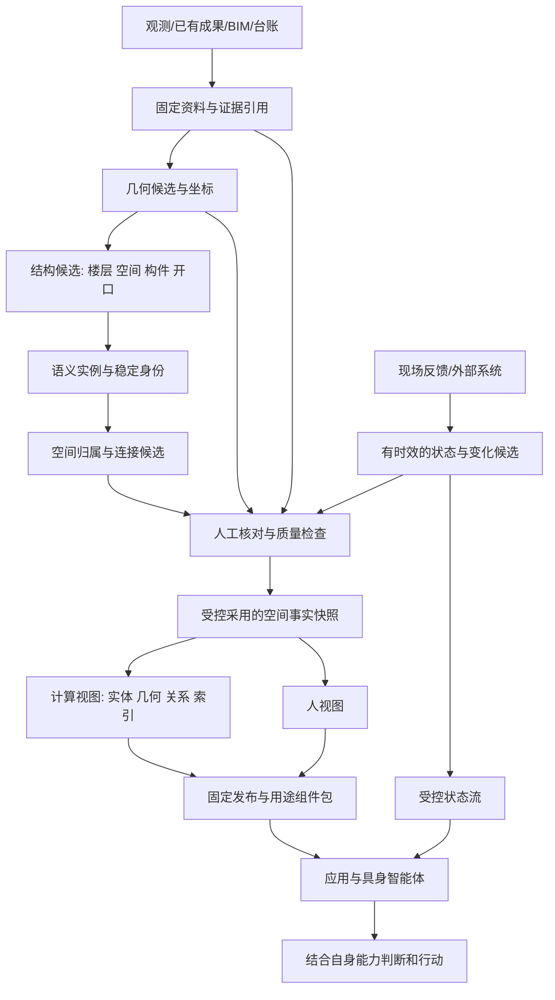

# 态势底图计算视图技术设计 v0.1

日期：2026-11-16。状态：技术设计草案；产品边界已确认，本文数据结构、接口路径和实现模块尚待契约样例与原型验证，不表示已实现。

决策依据：[ADR-006](../decisions/ADR-006-态势底图与设备决策边界.md)。能力现状见[技术路线评估](计算视图派生技术路线与选型评估-2026-11-16.md)。本设计细化“描述空间，交给应用判断”的实施方式，不引入平台导航或机体通行规则。

## 1. 目标、边界与首批范围

核心问题是：这里是什么、在哪里、形状尺度怎样、属于哪里、与哪里相连、当前发生什么、依据何在。首批采用两层真实建筑空间，包含楼层、房间、楼道、楼梯、门与配电柜。可先人工确认结构与语义，不把全自动识别作为首批成立条件。

平台提供几何、结构化实例、空间连接、带来源的状态、版本及通用查询；应用提供设备物理模型、通行判断、导航图、路径与轨迹、接近位姿及具体作业。可读取几何尺寸不等于平台担保通行。

非目标：平台自带机器人导航栈、为每类机器人维护权威地图、预置全部设备通行配置、用语言模型代替实测事实。定位参照、占据与距离场为可选组件，各自验收。

## 2. 总体结构与事实归属



几何事实、实体/关系和状态分别管理，但都要能固定到可追溯读取上下文。计算视图只派生编码、索引、几何简化与必要查询表达，不成为可以独立修改的第二套权威空间图。识别算法给出的对象或关系先作为候选，经核对采用后进入事实快照。

旧“冻结几何”继续是几何重派生输入。结构语义修订不得反向覆盖该几何，而应在来源清单中明确固定几何、语义、关系和证据的组合。生成已观测空闲时，需要额外固定观测、轨迹和标定引用；只读 points/colors 不足以完成该组件。

## 3. 逻辑实体与契约

以下名称为新契约草案，不能直接作为旧 v0.1 Schema 的额外字段写入。每个 ID 均在场景作用域解析；跨场景引用必须显式携带场景身份。

| 逻辑记录 | 主要字段 | 约束 |
|---|---|---|
| SceneFrame | scene_id、frame_id、unit、axes、gravity、transform_refs | 米制；轴向、变换方向与适用修订明确；没有重力依据时不假定 Z 向上 |
| Entity | entity_id、kind、type_ref、name、revision、lifecycle | 稳定身份与名称分离；类型绑定固定本体版本 |
| GeometryRepresentation | representation_id、entity_id、role、encoding、member_ref、frame_id、bounds、error_ref | 一个对象可有多个表达，必须声明各自用途与来源 |
| Relation | relation_id、type、endpoints、revision、evidence_refs、assessment | 端点类型、方向、基数明确；几何推断不自动成为已核实关系 |
| Connection | connection_id、connector_id、ports、mode、evidence_refs | 一个构件可连接两个或多个空间；连接不是导航边 |
| AttributeAssertion | entity_id、property_ref、value、unit、definition_ref、evidence_refs、assessment | 属性单独有依据；不以统一对象分数替代每项可信度 |
| Observation | observation_id、subject_ref、property_ref、value、observed_at、received_at、valid_until、source_ref | 原始事件追加保存，纠正事件显式引用被替代事件 |
| Evidence | evidence_id、kind、member_ref、capture_ref、transform_ref、method_ref | 文件引用固定字节摘要；不允许任意本机路径或可变外部 URL 充当固定证据 |
| Assessment | dimension、status、method、evidence_refs、review_ref、scope | 几何/语义/身份/关系/时效分别核验 |
| Snapshot | snapshot_id、geometry_ref、entity_ref、relation_ref、ontology_ref、evidence_ref | 内容固定，不以数据库当前行替代历史快照 |
| ChangeSet | base_ref、target_ref、added、revised、removed、split、merged、unresolved | 变化区分几何/语义/关系/状态，不将点云差异直接宣称物理变化 |

公共约束：有限数值；有界列表与字符串；时间统一 UTC；几何有明确坐标与单位；外部资产号不能替代 entity_id；范围盒只用于索引；成员引用包含大小、摘要和受控相对路径。

### 3.1 身份、修订与重建

`entity_id` 对应真实对象或空间实例，`revision` 对应该实例的一次描述。网格重划分、点索引变化或重新估计边界不自动改变实例身份。新增、移动、移除、拆分和合并分别记录；匹配不确定时生成身份候选。

归并策略：优先外部可靠资产绑定和已确认关系，辅以位置、形状、类型、外观和邻接上下文；算法只提出关联建议，不能仅凭最近邻继承身份。跨版本不确定匹配应可查询。实体删除以移除记录保留历史，不复用 ID。

首批实体种类：building、level、space、element、asset。房间/楼道属于 space 的类型；墙/楼板/门/楼梯属于 element 的类型。该划分为本体模板，不把业务类型固定成 Python 枚举，基础结构角色需有受控语义映射。

### 3.2 几何表示

建议角色：reference_point、surface、region、opening、axis、measurement_section。编码可分别选择点、三角网格、面片/多边形、体积或线；首批只实现经过验证的最小集合，不声称全格式支持。

- 点用于定位/标注，不能表示整个对象范围，也不能参加需要真实区域边界的包含判断。
- 楼层提供标高与空间范围；楼板和楼层是不同对象，重叠楼层范围不构成错误。
- 房间/楼道提供边界面或经验证的区域表达；只有二维边界时声明 2.5D 及高度假设，不能当任意三维实体。
- 门洞与门扇分别表达，可同属一个门实例；开口面的两侧与端口要有明确方向约定。
- 楼梯首批支持楼梯段/平台和上下端接口，台阶细节按资料能力提供；不要从“楼梯”类别自动填台阶高度。
- 资产可先有向包围盒加表面引用，明确粗略范围不能用于精密碰撞或截面量测。

不闭合网格不得假装封闭体；缺边界时空间归属返回不确定。关系数据声明的归属和基于几何计算的包含是两项结果，出现冲突时并列返回并产生复核项。

### 3.3 尺寸属性

门洞宽度、门扇尺寸、门当前开口宽度分开命名；楼道截面宽度与全段最小宽度分开。每个量测带定义、范围、算法/人工依据、误差与观测时间；单位归一后保存原始声明来源。没有足够截面覆盖时不得输出“全段最小宽度”。

平台提供原始几何与量测定义，不预置“适合机器狗”“可供无人机通过”等事实属性。第三方这类结论如需保存，放外部应用声明域并绑定应用、设备配置、时间与依据，禁止混入核心空间事实。

## 4. 空间关系与连接模型

| 关系 | 含义 | 核验 |
|---|---|---|
| contains / located_in | 某对象属于某空间或层级 | 层级规则与可用几何交叉核对；声明与几何事实分开 |
| adjacent_to | 共享边界或明确邻接 | 不代表存在开口或可互达；明确邻接依据 |
| bounds_space | 构件构成空间边界的一部分 | 允许局部边界与未观测缺口 |
| installed_on | 资产安装于构件 | 安装关系不是单纯最近邻 |
| part_of | 构件组成 | 如楼梯段属于楼梯；与空间包含使用不同规则 |
| connects_spaces | 通过连接构件形成空间连接 | 必须有连接构件和端口；不得由两空间邻近直接推断 |

只对指定 containment 关系族执行单直接父与无环规则。空间归属、物理组成、跨层覆盖不能合并为一棵树；跨层楼梯可服务多个 level，不因此违反“所属建筑”的单父关系。首批保持旧 contains 规则的语义，不向旧验证器塞入新型多端关系。

连接采用显式记录，而不是只有两个 ID 的无解释边。示意：

```json
{
  "connection_id": "connection-door-01",
  "connector_id": "door-01",
  "mode": "opening",
  "ports": [
    {"space_id": "corridor-l1", "geometry_ref": "door-01-port-a"},
    {"space_id": "room-l1-101", "geometry_ref": "door-01-port-b"}
  ],
  "assessment": {"status": "unverified"}
}
```

示例只解释字段关系，不是可直接安装的完整文件。门的开放状态通过 Observation 读取，不写成连接永久可用。楼梯用 stair_transition；电梯允许多个楼层端口和外部状态引用，不把每对楼层连接都声明为同时直达。one_way 等业务通行政策如有需求单独存储，不当作构件几何固有属性。

平台可以返回连接邻接集合，默认不做路由或可达性推断。连通分量等纯结构分析即使将来提供，也必须命名为结构连通，不代表设备可达。

## 5. 状态与读取一致性

静态发布固定结构事实；动态状态独立追加。需要两个时间维度：现场实际观测时间，以及平台接收/登记时间。迟到消息不应仅因接收更晚就覆盖更新观测。源序号、源时钟质量、去重键和纠正关系一并保存。

一个状态可能是 open、closed、partially_open 或 unknown；没有接入和过期状态分别说明原因。冲突来源保留各自观测，按预先固定的源优先级/冲突策略生成读取结果；没有可靠规则时返回冲突，不静默选一条。

读取模式：

1. 默认固定发布：可复现几何、实体、关系与可选发布时状态截面。
2. 显式实时状态：固定发布加 `state_cursor`、`as_of` 和状态策略版本，返回当前证据及新鲜度。
3. 历史读取：明确固定发布与时间条件；支持收到时间条件时可区分“当时发生”与“当时平台已知”。

涉及新几何结构的变化先进入候选再受控发布，不能通过一条状态事件直接覆盖门的位置。状态主题引用的实体若不在当前发布中，返回不适用或需要结构更新，不把事件挂到同名对象。

## 6. 派生任务与模块设计

### 来源结构、本体与实例采用分责

IFC、点云和人工标注提供空间证据及候选；其源类别和原始关系独立保存。语义本体维护可复用的类型、属性、关系及约束，不持有某个场景的楼层、门、楼梯等实例。场景通过独立映射把来源类别关联到某个固定本体版本；映射只提出候选，实例属性、连接端点与现场含义由场景核对后采用。

例如，IFC 可以声明某对象是 IfcDoor、填充某洞口；本体定义“门”及其关系约束。即使已配置类型映射，也不能由此证明门两侧是哪些房间、当前开闭状态或设备通行性。IfcSpace 也不自动等同设备间或楼道。类型未配置时保留未映射；关系未来单独映射并校验方向、端点类型与证据，不复用类型映射作为关系确认。

本体版本或映射规则更新可以重新生成语义提案，不需要重提取 IFC 或重建几何。历史发布仍固定原来的来源、映射和本体版本。采用空间实例仍走候选核对和发布流程。

沿用 FastAPI 管理与查询、独立算法任务的结构；先模块化，不为每个步骤新增微服务。

| 拟新增模块/逻辑职责 | 输入 | 输出 |
|---|---|---|
| spatial/scene_entities | 固定本体与实体候选 | 实体快照、类型与身份规则报告 |
| spatial/scene_geometry | 几何快照、对象绑定、坐标 | 表达目录、范围索引与几何核验 |
| spatial/scene_connections | 连接构件、空间和端口 | 连接快照及一致性报告 |
| spatial/scene_observations | 来源事件与实体身份 | 追加事件、去重和有时间上下文的读取 |
| construction/derive_spatial_structure | 几何/资料及结构配置 | 楼层/空间/构件/连接候选，不直接发布 |
| construction/scene_snapshot | 审核采用记录及来源集合 | 固定事实快照和清单 |
| views/agent/scene_graph | 固定事实快照与组件配置 | 机器可读实体/关系、查询索引与块 |

以上路径是职责建议，不是现有文件。引入前与现有 ontology、preview_objects、preview_relations、生命周期和构建编排复用接口，避免重复存一套权威对象。

任务依赖：几何校验 → 结构候选 → 实例/身份关联 → 连接候选 → 人工核对/规则报告 → 事实快照 → 表达派生 → 发布准入。几何不变时允许只重算实体、连接或索引；观测位姿改变时重算受影响几何与后续依赖。

派生键固定：输入快照摘要、组件角色、配置摘要、实现/容器版本及必要依赖摘要。结果复用需匹配完整键和完整性，不能只按场景 ID 命中缓存。执行器依照既有任务代次和提交保护规则提交；失败、中断保留诊断，不将部分成员声明为完整成功。

人工修订形成新候选，提交时校验 base_snapshot / expected_revision，冲突返回 409，不覆盖别人已提交的修订。删除、重构或覆盖沿用现有危险确认机制；本文不绕过审核与发布控制。

## 7. 算法路线与首批选择

| 环节 | 首批选择 | 后续验证 |
|---|---|---|
| 几何整理 | 复用现有来源与固定模型，补坐标/重力/质量要求 | Open3D/PCL 等组件；不以重写 SLAM 为前置 |
| 结构建立 | 支持人工标注、BIM 对齐导入与半自动几何提取 | 平面/开口/楼层分割，按真实数据比较 |
| 语义实例 | 固定本体、人工核实；图像/点云算法提候选 | 二维识别投影、多帧实例关联、三维分割 |
| 空间图 | 自有最小领域模型与确定性规则 | 借鉴 Spark-DSG/Hydra 表达思想，复用需适配与许可核验 |
| 开放词汇 | 不作为首批正式事实来源 | ConceptGraphs 类方法用于检索/候选生成，评估误识别与跨版本身份 |
| 几何加速 | 范围索引与局部分块 | 距离场、OctoMap/nvblox 等按消费需求增加 |

领先性重点是语义几何一致、结构关系准确、身份稳定、变化可追溯和跨应用消费，不是引入开源项目的数量。IFC/IndoorGML 作为语义与连接建模参考，首批不宣称完整标准符合性。任何自动识别输出都标注算法、配置和证据，支持人工拒绝。

## 8. 存储与发布

### 8.1 逻辑存储

数据库保存 scene_entities、entity_revisions、geometry_representations、relation_revisions、connections/ports、attribute_assertions、observations、evidence_refs、snapshot_members 与 review_records 等逻辑记录。先复用当前领域持久化规范，正式迁移前确认现有数据归属；这些不是本次已创建的表。

较大几何和体积块进入不可变成果存储。块摘要、范围、编码、版本与字节数由清单固定。数据库写入与文件成果不能假定跨存储事务：先写隔离区并验证成员，再提交可见快照引用；只读已提交清单，孤立内容按单独维护策略回收。

对外 JSON/分块文件是标准读取载体，本地可生成 SQLite 索引；索引属于派生加速，不是新权威源。不因采用场景图就立即部署图数据库；先验证关系数据库与索引是否满足查询负载。

### 8.2 发布与包

草案组件角色：entities、geometry、structure、states_snapshot；后续可选 observations_coverage、occupancy、distance、localization。structure 包含关系/连接，不使用 navigation 或 traversability 角色描述底图。

最小包清单固定 scene/snapshot/release 身份、坐标、本体、能力/限制、成员摘要及组件依赖。structure 依赖相应实体目录；几何绑定依赖所用表达与变换。裁剪时带上被引用端点的最小身份记录或明确 external_stub，避免连接悬空；stub 不算完整对象，也不能用于几何判断。

一个用途包可以只含语义目录，但不能声称支持点归属或精确几何查询。几何范围可局部裁剪，身份引用不因裁剪重编号。未知必需编码拒绝读取，可选编码缺失则明确对应查询不可用。

发布验证按组件和范围记录几何/语义/结构/身份/状态质量，不能只给一个百分比。预览与已核实分别声明；缺少某类语义不必禁止基础几何发布，但必须如实列出覆盖与限制。摘要完整性与来源签名/有效性是不同问题，可信分发继续沿用既有专题。

## 9. 查询接口草案

以下路径为设计草案，实际命名在契约落地时与现有路由统一。默认不替换现有 preview 查询端点。

共同路径前缀建议为 `/s2s/spaces/{space_id}/releases/{release_id}`；`release_id` 是固定服务发布，不使用含义模糊的“最新”。新旧发布身份映射需在适配器中定义。

| 方法与相对路径 | 用途 |
|---|---|
| GET /manifest | 能力、限制、质量、编码与组件依赖 |
| GET /entities | 按类型、楼层、归属和范围筛选；稳定分页 |
| GET /entities/{entity_id} | 实体及修订、几何引用、属性、来源和核实状态 |
| GET /entities/{entity_id}/relations | 有向/无向关系和连接；返回方向、角色与证据 |
| POST /spatial/query | 点所在空间、邻近、相交或范围查询；显式坐标和精度要求 |
| GET /connections | 楼层/空间/构件过滤，返回端口与结构连接 |
| GET /chunks/{chunk_id} | 已授权范围内的固定成员或块；固定摘要 |
| GET /states | 显式 as_of/游标/状态策略；返回时效与冲突 |
| GET /changes?base_release_id=... | 固定两版差异及类型，明确未知匹配 |

点归属返回候选空间、几何判定方法、精度与边界不确定性，可多结果；不强迫在边界上选择唯一房间。nearest 操作只证明在声明距离与候选集合中的近邻，不说明对象类型、可见性或可达性。

语义搜索可以按名称/类型/外部资产号筛选；若后续加自然语言检索，解析到结构化查询，歧义返回候选，不生成虚构实体。

状态语义：成功结果包含 found / no_match / indeterminate 等操作结果；缺失组件返回 unsupported_component；范围外返回 out_of_scope；缺块/损坏返回 data_unavailable 或完整性错误。401/403 仍是鉴权错误，409 用于坐标、版本或修订冲突，422 是非法输入；不能全部包装成空间 unknown。

查询设置范围、条数、几何字节量、关系扩展深度和超时预算。分页固定发布与游标；实时状态另带状态游标，不能跨页悄悄混合多个数据截面。包访问与查询都由服务端执行场景授权，不从底图字段推导订阅或商业配额。

## 10. 兼容与迁移

1. 保留现有 `preview-*`、`machine` / `agent` 字段和 `surface_candidate/unknown` 语义。
2. 新空间图使用独立契约版本。旧点锚可映射为 reference_point；几何范围、结构连接和核实状态缺失时明确 unavailable/unverified，不能补造为完整对象。
3. 旧本体沿用固定版本引用。需要新关系时发布本体新版本或明确适配，不追改旧本体解释。
4. 旧关系验证器的单父/无环约束仅继续约束原关系族。新 Connection 单独解析，不能混在旧二元关系集内绕过校验。
5. 旧质量与 readiness 字段按原契约保留。新组件提供能力与质量清单；不得将 robot_ready 改 true 来代表结构化底图已完成。
6. 几何候选、语义候选与固定服务发布的 ID 含义清晰，提供映射，不仅凭相同文件摘要借用审核与权限。
7. 首批以并存方式读取；正式切换前验证工作台、在线接口、离线包和失败语义一致。

## 11. 样板验收与分批实施

### D0 契约样例

制作明确标 synthetic 的两层空间样例：每层有空间与楼道、一个跨层楼梯、两个门和一处配电柜；连接图包含正例、错误端点、缺失端口、未知状态与冲突状态。输出 Schema 草案、完整清单、读取样例与失败矩阵，不接触正式发布。

验收：几何/语义/关系引用一致；尺寸单位和坐标明确；端口连接不自动生成设备通行结论；含旧点锚映射样例；拆分/合并和身份未决有表达。

### D1 人工结构化真实样板

在一个真实场景上建立楼层、空间、楼梯、门和资产实例，人工核对关键身份及连接，形成可复查几何依据。优先补精确角色与结构，不先投入大规模自动识别。

验收：独立核对几何误差、楼层/空间归属、门两侧关系、楼梯跨层端口、资产身份与范围。误识别、漏检、错误连接逐项记录；不以规则报告通过代替真实核验。

### D2 在线离线消费

实现新版本读取、局部包及兼容适配；用两个独立消费样例读取同一底图，展示空间关系和对象查询。消费样例可分别模拟不同设备需求，但平台不建立设备通行规则。

验收：固定发布相同结论、坐标变换正确、裁剪无悬空依赖、未知/不支持/损坏/未授权区分明确；包体、峰值内存、局部加载、查询 p50/p95 记录硬件和数据条件。性能目标在真实样板规模明确后确定。

### D3 半自动派生与持续变化

对人工基准比较楼层/墙/开口识别、实例匹配与连接提取；按类别统计准确率和漏检。接入门状态、资产移动等反馈，验证迟到、冲突、过期、变更候选与局部重派生。

验收：算法提案可解释且可拒绝；未确认身份不自动继承；结构修订与动态状态分离；变化影响可追溯；实测不能支持的自动化保留人工路线。

每批独立 PR，按既有质量与部署流程推进。本文只形成技术设计，不表示开始代码实现或部署。

## 12. 首批技术决定与待验证项

已确认：态势底图边界、同一空间事实多应用复用、设备决策归属下游。

推荐设计：实体/几何/关系/状态分开、连接显式端口、稳定身份、固定快照、组件化计算视图、人工样板先于自动化、现有协议并存迁移。

待验证：真实输入是否足以恢复结构；几何编码与分块尺度；本体扩展与当前验证器适配；数据库迁移规范；对象跨版本匹配；状态源可信性；算法许可与维护；查询性能。以上可先通过 D0/D1 验证，不应先重构整个服务栈。
