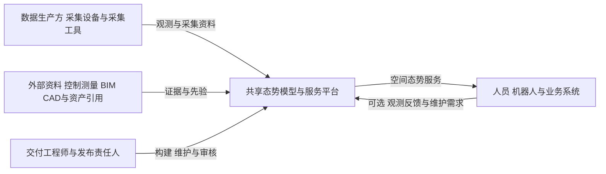
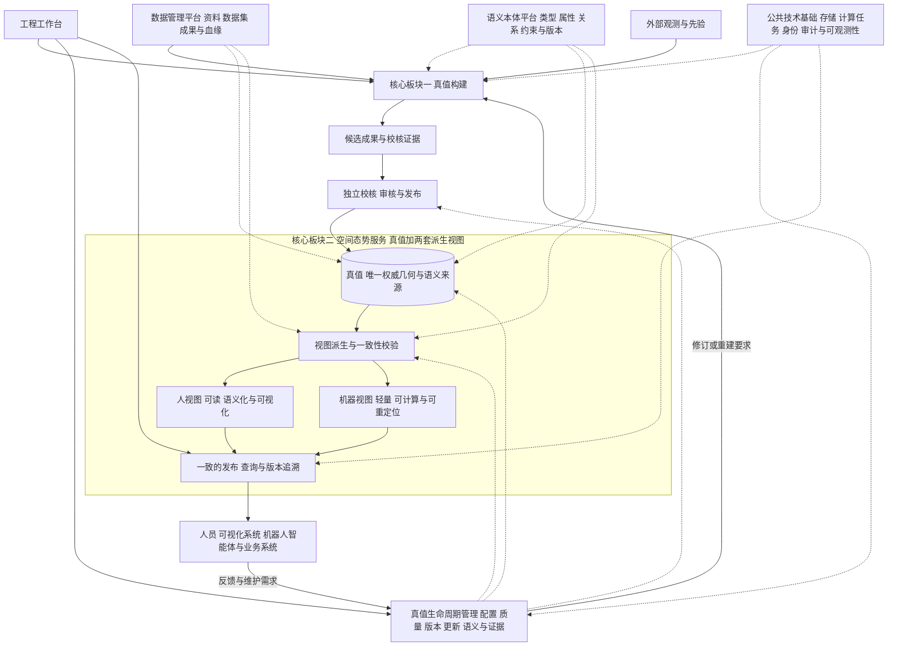
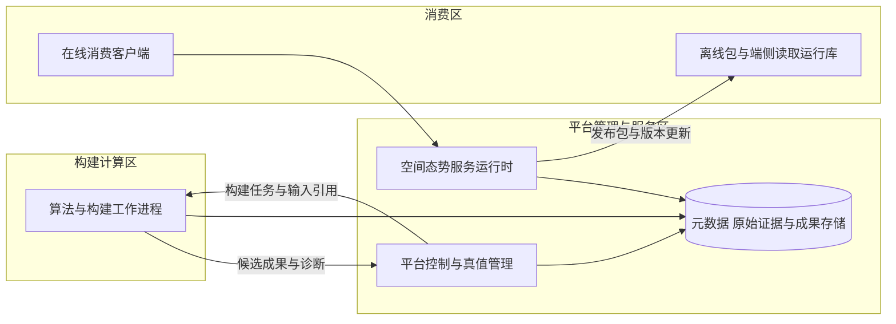

# 共享态势模型与服务平台总体概要技术架构设计

版本：v0.4\
状态：总体设计草案，已统一真值与两套派生视图口径\
日期：2026-10-26

## 1 目的与设计依据

本文规定产品的总体技术结构、核心板块职责、主要数据流、契约边界、运行方式和演进约束，作为后续各部分详细设计的共同依据。

产品的核心表述是“真值＋两套派生视图，即是服务”。价值表述统一为“真值建一次，两类视图共用之”。真值是唯一权威的几何与语义来源，人视图与机器视图由同一真值版本派生，服务统一两类视图的发布、查询与版本追溯。真值构建是另一个核心板块，负责从观测与先验形成可信真值。真值管理、更新、质量校核、版本发布、语义维护与数据管理围绕该资产组织。

服务以真值为唯一权威来源，通过人视图与机器视图提供一致、可追溯的空间能力。“真值＋两套派生视图”规定服务的内容基础；发布、查询、更新、权限及追溯等运行机制使其成为可长期使用的服务。仅生成三份数据不等于完成服务交付。

客户顺序为行业集成商、机器人厂商、场景业主。首版由内部交付工程师操作，从零建立技术能力，算法优先评估成熟开源实现。

依据包括《共享态势模型-产品定义与规划.docx》《共享态势模型-技术设计方案.docx》及本轮架构讨论。原技术方案中的精度数值、算法假设、平台泛化和分布式合并机制均须按后续验证结果审定，本文不将其视为已确认的技术承诺。

本文是总体架构入口。《首版架构设计-v0.1.md》保留为首版实现设计参考；其中更具体的模块、实体及流程属于待细化建议。若二者存在冲突，以本文件的总体边界为准，相关实现建议应随详细设计修订。

### 1.1 统一术语

| 术语 | 定义 | 用语约定 |
|---|---|---|
| 真值 | 带度量、精度与完整度声明、对象标识的唯一权威几何与语义数据 | 技术章节统一使用真值，避免底图、基础地图等同义混用 |
| 机器视图 | 由真值派生的轻量、可计算、可重定位的视图，面向机器人智能体 | 避免机器端底图、导航地图；具体栅格、索引等属于视图表达 |
| 人视图 | 由真值派生的可读、语义化、可视化的视图，面向人与可视化系统 | 避免展示底图、可视化底图 |
| 服务 | 以真值为唯一来源，向两类视图提供一致的发布、查询与版本追溯 | 技术章节不以平台功能或接口集合替代服务定义 |

“真值”是产品内经过校核和受控发布的权威数据，在声明的空间范围、精度、完整度、时效与用途内成立。它仍可能存在已标注的未知、退化和缺陷；独立校核使用的参考真值称为“独立校核基准”，与产品真值分开。

真值在测量意义上仍是带误差和适用条件的估计。“权威”规定产品内的采用基准，不构成绝对正确或永久有效的保证。真值及其服务结果必须保持与相应质量声明的关联，不能因标为真值而省略不确定性和限制条件。

“唯一”针对同一场景的确定版本及当前正式基准，允许保留历史版本。视图可以有多种分辨率和消费配置，均须指向确定的真值版本。“建一次”强调两类消费者共享同一次构建成果，后续变化仍通过更新产生新的真值版本。

“两套”指人视图与机器视图两类消费表达，不限定为两个文件、两份全量副本或两个部署实例。每类可以包含多个用途、分辨率及平台配置的派生实例；这些实例共享确定的真值来源，按影响范围维护。

### 1.2 本轮确定与后续细化

| 本轮确定 | 后续细化 |
|---|---|
| 核心资产、板块划分及职责归属 | 数据字段、类和表结构 |
| 构建、管理、服务间的协作与发布边界 | 算法选型、融合公式、质量阈值 |
| 数据分层、版本及质量原则 | 文件编码、分块粒度、索引和缓存策略 |
| 对外契约、部署分区与扩展方向 | API路径、协议细节、SDK语言与接口 |
| 质量、安全、可靠性和演进约束 | 硬件规格、吞吐时延、容量及部署脚本 |

## 2 系统定位与边界

平台处于数据生产方与空间能力消费方之间。它接受外部采集资料和可选先验，形成并维护真值，通过统一契约提供空间态势服务。

平台负责真值构建、空间表达、空间能力服务，以及真值生命周期管理。它不承担搭载平台制造、设备驱动研发、机器人运动控制、行业业务流程、资产主数据维护或实时安全控制。

数据接入契约与设备驱动分开，空间服务与消费方决策分开。平台对所输出的空间数据、质量声明和服务语义负责；消费方依据这些结果作出的业务决策及运动执行由消费方负责。

对接所需的适配工作可作为单独的集成工作开展，其实现通过受控扩展点接入，不把客户专属逻辑写入核心真值模型。

## 3 总体逻辑架构

架构以真值为中心，设置真值构建、空间态势服务两个核心板块，以及真值管理支撑域。工程工作台承载内部操作，对外契约承载程序消费；公共技术基础提供统一运行能力。

数据管理平台与语义本体平台是独立的领域支撑平台，分别负责资料与成果组织、语义定义与约束，通过固定数据和本体版本支撑构建、真值、视图及服务；首版共用工程工作台和运行基础。两者不归入通用存储或工具集合，规划见[数据管理与语义本体平台规划](数据管理与语义本体平台规划-v0.1.md)。

图中的单元表示逻辑职责，不直接对应微服务、安装包或数据库。构建与服务通过正式发布的真值契约衔接，管理能力贯穿两者。

### 3.1 真值构建

真值构建将多源观测及可选先验转化为候选真值，是算法与计算任务最集中的板块。

| 输入 | 内部能力范围 | 输出 |
|---|---|---|
| 观测资料、标定与时钟资料、场景要求、可选控制资料与先验、可选基线真值 | 数据适配与预检、轨迹估计、配准优化、重建融合、空间表达准备、构建诊断 | 候选真值、质量诊断、过程证据与构建记录 |

构建可按需调用不同算法实现，但必须输出统一可解释的成果和来源信息。算法进程不得自行写入正式发布状态。首次构建、局部重建和全量重建共享构建边界，具体执行流程在构建子系统设计中确定。

### 3.2 空间态势服务

空间态势服务由真值及其两套派生视图共同构成。人视图和机器视图共享唯一权威来源，服务负责一致的发布、查询与版本追溯，并据此向人、机器和业务系统提供空间能力。服务能力是产品价值出口，需要独立于构建算法设计与验证。

人视图承担可读、语义化和可视化表达；机器视图承担轻量、可计算和可重定位表达。两者按用途保留精度与完整度声明，并记录派生损失和能力限制。可重定位是机器视图的关键验收能力，提供参照与索引只是实现手段；是否交付在线位姿解算组件在专题设计中确定，但不能以不交付该组件为由免除机器视图的重定位适用性验证。

| 能力类别 | 提供的总体能力 | 边界说明 |
|---|---|---|
| 人视图服务 | 三维查看、质量表达、剖切量测、版本对比 | 量测能力受真值质量与表达分辨率限制 |
| 空间查询 | 空间区域、几何、占据、空闲与未知查询 | 数据不可用与语义未知分别表达 |
| 对象空间服务 | 对象身份、位置、区域归属及外部资产关联 | 不接管外部资产主数据 |
| 定位参照 | 提供定位所需的空间参照数据与索引 | 在线位姿解算是否作为产品能力另行细化 |
| 空间计算 | 基于支持的能力模型进行净空、通行等分析 | 不承担实时避障、运动控制或任意平台泛化 |
| 分发与追溯 | 真值读取、版本分发、变化解释和证据追溯 | 明确版本、质量、时效与证据访问条件 |

以上是总体能力分类，不代表首版全部实现。服务可在集中环境运行，也可通过离线包与读取库在消费端运行。不同承载方式共享基本空间语义，但可以声明不同能力范围，不强求所有终端与服务端完全同构。

### 3.3 真值管理支撑域

| 管理能力 | 职责 |
|---|---|
| 场景与配置管理 | 管理空间范围、坐标定义、构建条件、验收用途与服务配置 |
| 质量与证据管理 | 组织独立校核、质量分区、问题处理及证据关联 |
| 版本与发布管理 | 管理候选、审核、发布、撤回、切换及历史版本 |
| 更新管理 | 登记变化、判断影响、组织修订或重建并形成新版本 |
| 语义实例维护 | 依据固定本体版本确认现场对象、实例关系与资产引用；定义及约束由语义本体平台维护 |
| 数据与证据协作 | 使用数据管理平台登记的原始、过程、成果及血缘；生命周期管理负责采用、发布及撤回状态 |

更新管理负责“为什么更新、影响哪里、走什么路径”；构建负责需要计算时“如何重新生成”；服务负责消费明确版本并反馈使用中发现的问题。更新、构建和在线服务不能通过直接改写同一份可变地图耦合在一起。

### 3.4 工程工作台与公共基础

工程工作台围绕选定场景与真值组织构建、核查、维护和服务验证，并呈现真值状态与责任。页面和交互布局在产品交互设计中细化。

公共技术基础提供存储寻址、计算任务执行、身份与权限、操作审计、日志指标及备份恢复。基础能力为领域板块服务，不扩建为通用企业数据治理或通用任务调度产品。

### 3.5 数据管理与语义本体平台

数据管理平台管理资料身份、数据集版本、来源条件、内容摘要、引用及血缘，覆盖原始观测、独立参考、过程和正式成果。它登记领域版本，不替代生命周期管理的审核采用；文件存在或上传成功不代表真值合格。

语义本体平台管理类型、属性、关系、单位、约束及映射的固定版本。现场实例及其几何锚定属于真值，类型定义属于本体；外部资产主数据仍由外部系统负责。含语义实例的真值绑定本体版本及摘要，视图与服务沿用同一解释，离线包包含所需快照。

本体更新通过影响分析和迁移进入受控真值更新，不能静默改变旧实例含义。首版先支持小型人工词表、实例校验和资料登记，随后扩展管理界面、映射及迁移；不以复杂推理或全行业知识图谱为前提。

## 4 核心空间资产模型

### 4.1 真值的组成

真值是可版本化、可服务、可校核的空间资产，不等同于单个三维文件或展示模型。总体上由以下内容组成，各内容可使用不同物理表达，通过版本清单关联。

| 组成 | 意义 |
|---|---|
| 空间几何 | 描述表面、结构及空间形状 |
| 观测与占据表达 | 区分已观测空闲、占据与未知，保留适用分辨率 |
| 空间对象与语义 | 描述对象身份、类型、位置、关系及外部引用 |
| 坐标与空间基准 | 解释各数据及版本间的空间关系 |
| 质量与适用性 | 说明精度、覆盖、退化、缺陷及允许用途 |
| 版本与来源关系 | 关联输入、配置、算法、校核、审批及历史变化 |

人视图与机器视图是真值的两套派生表达。可视化细节层级属于人视图，端侧轻量表达、定位参照和通行代价等属于机器视图。两套视图必须关联所依据的真值版本、生成配置与适用条件，记录派生损失；视图不能形成独立权威数据源，也不能通过视图编辑静默改写真值。人工修订和机器观测回写均作为证据或变更候选进入真值更新流程。

视图派生是一项受质量约束的技术能力，需满足以下总体要求，具体指标与方法在详细设计中确定：

| 派生约束 | 总体要求 |
|---|---|
| 来源绑定 | 每个派生实例明确关联真值版本、派生实现及配置，支持定位差异原因 |
| 损失声明 | 区分无损编码与有损简化，声明分辨率、几何偏差、信息保留及允许用途 |
| 质量传递 | 保留真值的未知、退化、冲突与限制；派生不得无依据地提高精度或完整度声明 |
| 语义一致 | 在相同范围、版本和适用分辨率下保持可解释的一致性，允许有声明的表达差异 |
| 消费验证 | 人视图验证可读与核查能力；机器视图验证计算、加载及重定位能力 |
| 更新闭合 | 真值变更后识别受影响视图并重新派生或验证复用，不能静默沿用失效实例 |

实例身份、坐标关系和质量引用在两类视图之间保持可关联。必要的转换和派生误差须可解释；视觉上相似不代表技术一致，数据可解码也不代表机器消费可用。

### 4.2 静态真值与动态态势

首版以静态真值为主体。动态态势后续作为关联真值版本、具有来源和时效的状态扩展，其存储与更新周期可独立设计。

静态资产通过受控发布形成版本；动态状态按其有效期更新。动态反馈只有经过证据判断、影响分析和发布流程，才能成为真值的新版本。动态状态不能静默改写正式真值。

不在本轮预先固定全部业务动态字段，不要求一期搭建完整在线状态系统；保持真值版本、对象身份、来源与时间等关联能力即可支持后续演进。

### 4.3 数据分层

原始证据保留原貌；过程数据按构建记录管理；正式发布内容不可变；可重建的服务索引与缓存按来源版本管理。保留策略区分这几类数据，不能清理仍支撑有效质量结论的必要证据。

首版内部工程坐标必选，地理坐标关系按需建立。坐标定义、转换依据、时间基准及标定版本须可追溯，不以未知或默认参数伪装已知关系。详细坐标模型与误差传播另行设计。

## 5 总体运行闭环

### 5.1 首次构建与服务启用

场景要求确定 → 资料接入与预检 → 构建候选真值 → 校核及问题处理 → 审核发布真值 → 派生人视图与机器视图并校验 → 启用服务与交付。

真值发布与某种服务启用是不同状态。正式真值通过质量门禁后发布；某种服务所需表达、索引和校验完成后才能宣告可用。对首个交付包声明的必备服务，应在验收前完成就绪检查，不能以真值已发布代替服务可用。

服务就绪至少确认所引用真值版本、两类视图中本次交付所需的派生实例、质量与适用用途、权限和追溯链均有效。某类视图或能力未通过验证时，应明确其未就绪范围，不能将局部能力可用声明为完整服务已交付。

### 5.2 更新闭环

变化或维护需求登记 → 证据及影响分析 → 语义修订、局部重建或全量重建 → 候选校核 → 新真值版本发布 → 两类视图按影响范围重新派生并校验 → 服务版本切换。

维护需求可以来自人工检查、外部数据或后续在线反馈。更新失败时，当前正式版本保持不变，但服务需按实际影响声明已有版本的限制、过期或撤回状态，不能因未产生新版本就继续宣称当前结果有效。

### 5.3 服务消费

消费者选择版本或解析当前版本 → 服务确认权限、能力与可用性 → 按一致快照读取和计算 → 返回结果、版本及必要质量和时间信息。

一个请求及其相关分页不得混用多个真值版本。消费方采用不同版本可以被允许，但必须明确版本及适用限制。涉及后续写回的反馈必须说明其参考版本，不以消费方“读到的当前版本”隐含替代。

## 6 契约与板块协作

### 6.1 对外三个契约面

| 契约面 | 规定的内容 | 主要对象 |
|---|---|---|
| 数据接入契约 | 输入数据语义、时空及标定说明、质量前提、来源、校验和异常处置 | 采集工具、集成适配方及后续反馈生产方 |
| 空间表达契约 | 真值如何解释和读取、坐标单位、版本、质量、未知及派生表达的适用性 | 第三方读取端、机器人及离线工具 |
| 平台服务契约 | 空间能力调用、构建与管理操作、发布查询及证据访问规则 | 集成系统、工程工作台及运维工具 |

表达契约规定空间含义及数据解释，服务契约规定调用行为；同一查询的语义不能因API、离线包或SDK不同而相互矛盾。具体协议、数据字段和能力协商规则在契约设计中细化。

### 6.2 内部四个协作边界

| 边界 | 总体约定 |
|---|---|
| 算法执行边界 | 输入、参数、实现版本及输出可登记；不同算法可替换，不能直接发布 |
| 候选审核边界 | 构建结果先成为候选，质量结论与审批绑定确定内容 |
| 正式发布边界 | 发布形成一致、不可变、可寻址的真值快照 |
| 服务加载边界 | 服务以正式快照及派生配置运行，不依赖构建临时目录或算法内部状态 |

程序实现可复用公共库，但不能通过共享可变文件和跨板块直接改库绕过上述边界。

## 7 部署与技术组织

### 7.1 三个运行分区

技术选型建议见[技术栈规划](技术栈规划-v0.1.md)：TypeScript工作台、Python平台与编排、C++算法及必要空间计算，PostgreSQL元数据与独立文件成果存储。当前为待验证推荐，不替代本章的职责与部署边界。

三者是运行分区，可部署在同一机器或分开部署。首版优先采用模块化平台程序与独立算法进程，允许在一台工作站或服务器运行；构建负载增加后可迁移到计算节点，查询规模增加后可独立扩展服务运行时。

构建计算区与服务运行时之间设置资源边界，避免批处理耗尽查询所需资源。算法环境与平台管理环境可以分别打包。最终操作系统、容器方式、资源额度及加速硬件经选型验证后确定。

### 7.2 存储与状态组织

结构化元数据采用事务型存储，大体量观测与成果采用文件或对象存储，服务索引与缓存按负载选择。具体产品和物理编码暂不冻结。

发布以不可变成果与一致清单为基础，对外启用通过受控状态切换实现。首版不要求分布式地图写入、块级版本向量或自动分支合并；正式发布历史可先采用线性组织，后续机制变化不得破坏历史版本可解释性。

首版不把消息集群、微服务网格或集群编排平台设为交付前提。网络隔离和离线环境可通过本地部署与离线包满足；云端托管作为同一逻辑架构的后续部署形态。

## 8 跨板块架构约束

| 方面 | 总体要求 | 详细设计需补充 |
|---|---|---|
| 空间一致性 | 坐标、版本和对象引用可解释；查询固定快照 | 转换模型、跨版本映射与引用校验 |
| 质量可信性 | 质量分项表达，独立检查与拟合数据分开；未知不等于空闲 | 指标口径、检查方法、阈值与质量规则 |
| 版本不可变性 | 已发布内容不能原地改写；新变化形成候选及新版本 | 发布事务、切换和撤回机制 |
| 可追溯性 | 成果关联来源、配置、算法及审核；证据访问范围明确 | 血缘粒度、保留期限及导出策略 |
| 可恢复性 | 构建失败可定位，发布失败不暴露半成品，服务更新可恢复 | 重试、幂等、备份及恢复演练 |
| 权限与审计 | 构建、修改、审核、发布及读取授权明确 | 角色模型、日志与审计保护 |
| 资源隔离 | 重建不应无界侵占服务资源 | 调度方式、额度及并发策略 |
| 开放与兼容 | 数据、接口、算法与配置版本分别治理 | 格式演进、兼容周期及能力协商 |
| 开源使用 | 对候选及依赖进行技术和许可证审查 | 分发方式、依赖清单及授权证据 |
| 场景复制 | 在已声明支持范围内以配置吸收差异 | 配置边界、扩展点和复制验收 |

可靠性、安全性和性能承诺必须同时注明数据规模、运行环境和适用用途。总体设计不预先给出缺乏实测依据的统一时延、精度或容量数值。

## 9 首版与后续演进

| 阶段 | 构建核心 | 服务核心 | 真值管理支撑 |
|---|---|---|---|
| 首版 | 一种经验证的采集组合，离线构建与受控重建 | 基础人视图与机器视图，支持经验证的查看、空间及对象查询、定位参照与离线读取 | 场景配置、人工实例确认、独立校核、版本发布与追溯 |
| 扩展阶段 | 经过验证的多源路线、更多场景与增量效率优化 | 扩充定位参照、空间计算、端侧分发与服务规模 | 更完善的更新、配置模板、兼容与交付管理 |
| 在线阶段 | 接收在线维护证据，按需触发构建 | 叠加动态态势与时效约束下的查询 | 在线证据治理、变化确认及持续维护 |

具体阶段范围可根据客户验证调整。自主探索、多机任务协同和行业业务流程不能因进入后续阶段而默认归入本产品；如确有必要，应另行审定责任边界。

架构验证围绕三个结果展开：构建能产生可信且可服务的真值；服务在目标消费条件下可用；管理能够支持更新、追溯及跨场景复制。公开数据可以验证算法流程，真实现场与独立消费序列用于验证交付能力。

机器视图的重定位验证使用独立于构建输入的采集序列，在声明的传感条件、场景变化和初始位姿条件下验证定位成功、误差与错误检出能力，并记录失败区域。具体阈值和测试规模在服务专题中确定，不能仅凭文件可加载、索引已生成或构建轨迹回放成功判定可重定位。

## 10 后续详细设计划分

工作顺序与阶段完成依据见[总体设计与渐进实施规划](总体设计与渐进实施规划.md)，采用设计、最小实现和验证逐步收敛的推进方式。

总体模型已形成：[真值与两类视图总体模型设计 v0.1](真值与两类视图总体模型设计-v0.1.md)。该文档承接本设计，统一真值组成、两类视图、派生关系、服务发布及更新模型，作为下列专题的共同输入；其内容仍保持逻辑模型层级。

| 专题 | 要解决的主要问题 | 依赖关系 |
|---|---|---|
| 核心真值模型与版本 | 真值组成、身份、坐标、质量及成果关联，发布状态 | 首先形成共同基线 |
| 空间态势服务 | 服务目录、用途、输入输出语义、在线与离线能力边界 | 与真值模型共同收敛 |
| 真值构建 | 输入条件、阶段契约、算法候选、质量诊断和计算执行 | 依据真值产物与服务要求设计 |
| 真值管理与更新 | 配置、证据、校核、候选审核、发布和更新路径 | 贯穿模型、构建与服务 |
| 数据管理平台 | 资料登记、数据集、成果引用、来源、血缘、保留与归档 | 与构建和发布清单共同收敛 |
| 语义本体平台 | 类型、属性、关系、约束、映射、本体版本与实例迁移 | 与真值实例及视图解释共同收敛 |
| 数据与部署 | 存储、任务、资源隔离、恢复、权限与运维 | 依据数据规模及运行负载细化 |
| 工程工作台 | 工程师围绕真值开展工作的流程与界面 | 依据领域状态与操作边界细化 |

真值模型与服务能力优先共同设计，避免先固化一种地图格式后再寻找用途。构建路线根据目标服务所需成果与质量条件进行选择，并通过试验反馈修正模型。

## 11 本轮总体决策

1. 统一核心表述为“真值＋两套派生视图，即是服务”，价值表述为“真值建一次，两类视图共用之”。
2. 设置真值构建与空间态势服务两个核心板块；服务包含真值、人视图和机器视图的一致组织，真值管理支撑其生命周期。
3. 构建产生候选，审核发布形成正式资产，服务消费一致版本，变化通过受控更新闭环返回。
4. 逻辑真值可关联多种物理表达，算法内部地图不直接成为产品统一契约。
5. 构建和服务运行可以分离，首版允许合并部署，后续按计算和消费负载扩展。
6. 首版聚焦静态真值与可信交付，在线态势沿版本、来源、对象与时间关联扩展。
7. 本轮固定总体职责和边界；具体算法、技术栈、数据编码、接口字段及性能参数在专题设计中审定。
8. 视图派生必须保持来源、质量与语义可解释，机器视图以独立消费序列验证重定位适用性。

## 12 修订记录

| 版本 | 修订内容 |
|---|---|
| v0.1 | 建立总体职责、协作、部署和演进边界 |
| v0.2 | 统一真值、人视图、机器视图与服务定义；调整前言、架构图、数据流及生命周期用语 |
| v0.3 | 补充权威真值的测量边界、服务运行机制、两类视图的实例含义、受约束派生及独立重定位验证要求 |
| v0.4 | 显式纳入数据管理与语义本体两个领域支撑平台，区分数据登记、类型定义、现场实例及审核发布责任 |
