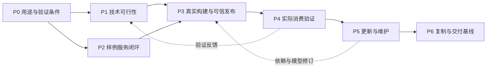

# 总体设计与渐进实施规划

版本：v0.1\
日期：2026-10-27（阶段复核）\
状态：渐进实施规划；合成子集已有实现，真实构建与正式交付待验收

当前状态以[总体里程碑复核与下一阶段计划](总体里程碑复核与下一阶段计划-2026-10-27.md)为最新入口。历史增量按当时范围保留；下一阶段优先P1输入预检、真实短序列与隔离算法回放，不把合成交付链路完成视为P1/P3/P6完成。

## 1 工作目标与推进方式

围绕“真值＋两套派生视图，即是服务”，逐步建立可构建、可校核、可服务、可更新、可复制的产品能力。首版服务行业集成商的项目交付，由内部交付工程师使用。

总体设计负责统一模型、职责与契约，各专题在临近实现时细化。每个阶段同时推进设计、最小实现和验证，以验证结果更新设计。未验证的假设不写成已具备能力，也不要求在编码前完成全部详细设计。

实施以纵向闭环组织：先贯通一种真值、两类基础视图和一次服务发布，再逐步增加真实构建、质量、更新与场景复制能力。算法可行性验证前置，正式算法定型由真实数据和消费结果决定。

本规划中的阶段表示依赖关系，不代表固定工期。人员、硬件、现场和采集条件明确后，再估算工作量与日历排期。

## 2 当前成果与设计基线

| 成果 | 当前状态 | 后续处理 |
|---|---|---|
| 产品定义与规划原始文档 | 已读取并分析 | 保留为产品输入，新的设计结论在工作文档中记录 |
| 技术设计原始方案 | 已审阅，存在待重审假设 | 作为参考，不直接作为实现承诺 |
| [总体概要技术架构设计](总体概要技术架构设计-v0.1.md) | 文内v0.3，已形成草案 | 作为总体边界，随架构验证修订 |
| [真值与两类视图总体模型设计](真值与两类视图总体模型设计-v0.1.md) | v0.1，已形成草案 | 作为模型和专题设计输入 |
| [首版用途与验收矩阵](首版用途与验收矩阵-v0.1.md) | v0.1，已形成草案；场景确认为普通设备间及相连走廊 | 明确任务与验收语义，数值、现场及设备条件继续细化 |
| [数据采集与独立校核需求](数据采集与独立校核需求-v0.1.md) | v0.1，需求及资料登记模板已形成 | 核验公共资料，落实现场采集与独立参考 |
| [开源算法对照验证方案](开源算法对照验证方案-v0.1.md) | v0.1，候选及试验步骤已形成 | 核验上游来源、输入与许可，再执行试验 |
| [算法数据与运行环境核验记录](算法数据与运行环境核验记录-2026-10-26.md) | 已核验两主仓库说明及LICENSE、两个数据候选页面、本机Docker；证据已保存 | 完整依赖审查、可用数据和算法环境仍待准备 |
| [首版架构设计参考](首版架构设计-v0.1.md) | 已形成实现建议 | 服从总体及模型设计，不视为全部已定型 |
| 合成实现与验证 | P2服务、导入/检查任务及交付核对已有局部证据 | 按最新复核区分子集与整体阶段，不累计历史测试作为新结果 |
| 真实算法评测与现场验证 | 尚未运行真实建图或取得现场质量证据 | 优先推进P1，再依证据进入P3/P4 |

草案形成不等于设计已经冻结。每阶段仅稳定本阶段需要依赖的职责、模型和契约，其余保留明确的待验证项。

## 3 总体工作分解

| 工作线 | 要解决的问题 | 阶段产出 |
|---|---|---|
| 总体与模型 | 真值、视图、服务和管理如何协作 | 总体架构、模型、决策记录与变更影响 |
| 真值构建 | 如何从观测生成可信候选 | 输入要求、算法验证、构建流程及诊断 |
| 人视图与机器视图 | 如何派生并满足消费任务 | 视图契约、基础实现及用途验证 |
| 服务与发布 | 如何一致地发布、读取和追溯 | 服务契约、版本组合、加载及切换 |
| 质量与更新 | 如何确认可信并持续维护 | 校核规程、质量门禁、修订及更新流程 |
| 工程交付与基础运行 | 如何让工程师复用和交接 | 工作台、部署、配置模板、恢复与操作手册 |

这些是协同工作线，不是必须拆成独立团队或微服务。一个纵向阶段通常同时涉及数条工作线。

## 4 分阶段设计与实施

### P0 首版用途与验证条件

先确定“首个服务要帮助谁完成什么”，将真值模型和两类视图落到一个可验收用途。首版候选用途为室内设备空间核查与机器人定位参照，须明确选取的实际验收任务及消费条件。

| 项目 | 工作内容 |
|---|---|
| 设计 | 首版能力清单、支持与排除范围、端到端流程、质量与消费验收口径 |
| 准备 | 公共样例及许可证、真实采集与独立校核资料需求、候选传感条件、最低运行条件 |
| 最小验证 | 验证样例资料能覆盖几何、覆盖、实例和两类消费测试；明确缺失资料 |
| 产出 | 首版范围与验收矩阵、数据与现场准备清单、风险及待验证项 |
| 完成依据 | 每项首版能力都有消费任务、必要输入和验证方法；不依赖未声明的设备或资料 |

可在资料不齐时开展公开数据和模型验证。真实质量与重定位的结论必须等待相应采集条件，不以演示数据代替现场验收。

### P1 算法与关键技术可行性验证

先处理可能推翻构建路线的风险。此阶段允许独立试验脚本，不提前建设完整平台。

| 项目 | 工作内容 |
|---|---|
| 设计 | 候选输入前提、算法阶段输入输出、质量与资源对照方法 |
| 最小实现 | 两条具有比较意义的开源候选路线，输出可检查几何、轨迹、覆盖依据与诊断 |
| 验证 | 公开数据跑通、真实采集适配、独立几何检查、基础消费适用性、许可证及依赖审查 |
| 产出 | 技术验证报告、候选对照、暂定算法路线、数据契约修订建议 |
| 完成依据 | 至少一条路线有证据支持首版用途；明确失败条件与剩余风险，具备可复跑输入与环境 |

不因某算法一次出图就冻结技术路线。未取得真实采集数据时，只能形成公开数据层面的暂定结论。基础服务样例贯通可与本阶段交错推进，正式构建集成依赖本阶段结果。

### P2 真值与两类视图最小服务闭环

用来源明确的样例数据贯通模型和发布关系，证明核心结构可实现。样例必须标明演示或测试性质，不能作为已校核正式真值交付。

| 项目 | 工作内容 |
|---|---|
| 设计 | 最小真值清单、视图实例与服务发布关系、基础查询语义、错误与未知语义 |
| 最小实现 | 样例登记、人视图基础浏览、机器视图局部读取及空间查询、一致版本的服务发布与加载 |
| 验证 | 来源及坐标可解释、同一对象两视图可关联、未知不被当作空闲、当前版本切换不混读 |
| 产出 | 最小运行骨架、样例发布包、初版表达与服务契约、模型修订 |
| 完成依据 | 从一个确定来源形成两类视图，经一次明确发布被消费，并可查到版本与派生依据 |

此阶段固定最低必要契约，身份、坐标、版本、质量与未知语义必须包含。编码、缓存和表达性能仍可调整。

### P3 真实构建与可信发布闭环

将验证后的构建路线接入平台，把样例闭环推进为真实资料到正式真值的工程流程。

| 项目 | 工作内容 |
|---|---|
| 设计 | 接入预检、构建任务、候选、独立校核、质量门禁、审批及证据保留 |
| 最小实现 | 真实数据导入、独立算法执行、候选形成、人工实例确认、校核报告、真值及视图发布 |
| 验证 | 数据与参数变更可追溯、质量结论对应实际候选、必要门禁不可绕过、失败不暴露半成品 |
| 产出 | 首个可信发布样本、构建与质量设计、表达契约及操作流程修订 |
| 完成依据 | 一个真实场景按声明用途通过独立校核，工程师能解释缺陷和限制，并发布可消费版本 |

先实现必要操作，不提前制作大量管理页面。工程工作台随已形成的领域状态逐步扩展。

### P4 两类视图消费与服务能力验证

证明实际可用性，校准首版对外能力声明。基础消费测试从P1至P3持续开展，本阶段集中完成目标条件下的正式验证。

| 项目 | 工作内容 |
|---|---|
| 设计 | 人视图核查任务、机器视图查询与重定位测试、派生损失及目标资源条件 |
| 最小实现 | 必要量测与质量交互、重定位参照适配、最小读取库及集成样例、资源与错误诊断 |
| 验证 | 独立采集序列重定位、两类视图一致性、几何及语义损失、目标终端加载与查询、错误检出 |
| 产出 | 消费验证报告、视图及服务设计、实测性能范围、格式与接口兼容规则 |
| 完成依据 | 已声明的人与机器消费任务有可复核结果，未通过能力明确排除或限制 |

读取库先覆盖一个明确目标环境，不同时承诺多语言、多平台与所有API能力同构。

### P5 更新与持续维护闭环

形成第二版真值与服务，验证产品能够长期维护。

| 项目 | 工作内容 |
|---|---|
| 设计 | 变化分类、影响依赖、局部或全量更新、视图复用、限制撤回与切换 |
| 最小实现 | 一次几何更新、一次语义修订、一次仅视图配置更新，完成新旧版本对比与追溯 |
| 验证 | 更新范围及接缝、对象身份、派生失效识别、增量分发一致、服务切换与恢复 |
| 产出 | 更新管理设计、维护样本、失败恢复记录与运维流程 |
| 完成依据 | 能说明哪些变化修改真值、哪些只改视图，形成一致新服务并保留可解释历史 |

先允许全量重建作为正确性基线，再按收益实现局部更新；正式声明具备局部维护能力前必须通过对应验证。增量传输的哈希一致性与增量建图的质量容差分别验收。

### P6 场景复制与首版交付基线

以第二个不同布局的真实现场检验产品化程度，整理可交接的首版。

| 项目 | 工作内容 |
|---|---|
| 设计 | 标准配置范围、部署与升级、证据归档、恢复、交接及授权分发边界 |
| 最小实现 | 同一产品构建在第二现场完成交付，建立配置模板、手册、安装与诊断方式 |
| 验证 | 已支持范围内无需产品代码修改、外部工程师依据规范读取、另一工程师依手册操作、备份恢复及交付成本 |
| 产出 | 首版设计基线、发布清单、验证记录、部署与交付手册、已知限制 |
| 完成依据 | 两个场景证据支持范围声明，配置差异可解释，交付和维护可接手 |

如第二现场暴露必须修改核心代码的缺口，修订模型或实现后重新验证，并重新执行复制测试；不把必要缺口藏成配置脚本或客户专属分支。

## 5 阶段依赖与迭代组织

依赖图中的交错推进是工作安排，不要求多人并行。单人也可以先跑算法试验，再贯通样例服务，随后集成真实构建。发现关键假设失败时，优先回到相应设计修订，不能持续堆叠界面和平台能力掩盖风险。

每个阶段使用以下循环：

1. 明确本轮消费任务、范围和待验证假设。
2. 只细化实现所需模型与契约，记录待定选择。
3. 实现一个可运行、可检查的纵向增量。
4. 使用相应数据与条件验证，保留失败和限制。
5. 更新设计、契约、样例和决策，再选择下一增量。

阶段结束可以继续迭代，不要求每次都发布正式软件。对外发布的能力必须对应适用条件和验证证据。

## 6 文档与实现协同管理

| 内容 | 更新时机 | 管理要求 |
|---|---|---|
| 总体架构与总体模型 | 职责、来源、版本或板块关系改变 | 分析影响，避免子系统各自解释 |
| 专题设计 | 进入相应阶段及试验反馈后 | 区分已实现、已验证、暂定和延期 |
| 契约与样例 | 输入输出及空间语义发生变化 | 同步版本、兼容说明和可读取样例 |
| 技术决策记录 | 有重要取舍或验证推翻原假设 | 记录依据、替代项、适用范围和重审条件 |
| 验证记录 | 每次关键试验与阶段检查 | 关联数据、实现、配置、环境及结果 |
| 工作清单 | 阶段开始和增量结束 | 标记未开始、进行中、已实现待验证、已验证或受阻 |

文件名版本沿用现有文件以保持链接稳定，正文版本与修订记录表明当前内容。正式基线通过仓库版本与发布清单确定；后续若调整命名规则，统一迁移引用。

原始产品定义和技术方案保留为输入资料。新的经验证结论逐步回写工作设计；正式交付需要Word等格式时，再统一生成相应文档版本。

## 7 当前下一批具体工作

2026-10-27 已完成[内部交付整合验收](内部交付流程验收清单-v0.1.md)：真实CLI/本机HTTP的31项必执行检查通过，独立页面24项检查通过；新增5项验收器测试，相关回归49通过，见[记录](../validation/内部交付流程验收-2026-10-27.md)。下一步总体里程碑复核，围绕空间构建、真实数据算法和工程交付确定优先级，报告流程通过不提升生产或机器人能力。

2026-10-27 已实现[受控生成与报告选择](交付报告受控生成与选择-v0.1.md)，新增16项实例，相关回归58通过，构建及浏览器通过，见[验证](../validation/交付报告归档与选择验证-2026-10-27.md)。本地生成、原子不覆盖保存，Web显式固定选择；下一批整合内部交付端到端验收脚本，长期存储、权限及真实机器人另行设计。

2026-10-27 后续已完成[报告生成上下文契约](../../contracts/schemas/delivery-generation-v0.1.md)与0.2生成/兼容读取/工作台展示，新增18项实例、相关回归42通过、构建与浏览器验证通过，见[记录](../validation/交付报告上下文验证-2026-10-27.md)。批次及观察区间独立于读取时间，目录/组件摘要不认证身份。下一批细化受控生成、独立输出、原子保存与多报告固定选择；不自动扫描或授予权限。

2026-10-27 后续已接入[保存报告只读工作台](交付核对工作台设计-v0.1.md)，新增13项测试，相关回归37通过、5跳过，构建和浏览器检查通过，见[记录](../validation/交付核对工作台验证-2026-10-27.md)。不在Web请求中扫描底层，刷新只重新读取配置报告；读取时刻不代替观察时刻。下一批补报告生成批次、观察区间和来源上下文契约，受控生成与选择另行细化。

2026-10-27 新增[只读交付核对](智能体只读交付核对设计-v0.1.md)，关联文件包完整性、固定binding、恢复状态及待补证明；新增11项测试，相关回归40项通过，四阶段合成证据已核对，见[记录](../validation/智能体只读交付核对验证-2026-10-27.md)。不修改门禁和存储运行规则，不将诊断成功当成能力许可。下一批先形成内部工程师只读核对工作面与刷新语义；真实设备、算法构建、维护认证、可信时间、网络挑战和I4仍独立未完成。

2026-10-27 J4第二批补齐[跨进程会话/恢复屏障](../validation/智能体查询恢复跨进程验证-2026-10-27.md)，新增5项测试，全量266通过、6跳过及22个子用例通过，明确门禁已判定的在途响应边界及后续旧会话拒绝；不改变生产实现。下一批形成统一只读交付核对报告，关联文件包完整性、固定绑定及恢复元数据，给出阻断原因；报告不授予能力、不自动修复。维护权限、可信时间、线上挑战和真实设备仍独立未完成。

2026-10-27 J4首批完成[文件运行包会话与恢复日志组合](智能体恢复与文件会话组合设计-v0.1.md)和只读恢复元数据审计，新增15项测试，全量261通过、6跳过、22个子用例通过，见[记录](../validation/智能体恢复与文件会话组合验证-2026-10-27.md)。验证固定内容、绑定、恢复代次和期限/撤回；未做并发会话屏障或跨进程组合。下一批先补这些证据，再细化维护身份与操作审计入口。真实设备、可信时间、线上挑战、旧库迁移及I4仍独立未完成。

2026-10-27 J3实现[独立恢复状态机](智能体恢复状态机实现-v0.1.md)，新增30项测试，全量246通过、6跳过及22个子用例通过，见[记录](../validation/智能体恢复状态机验证-2026-10-27.md)。重放完整历史后生成封存计划，提交前核对版本/代次/未决集合，原子提交对账结果；完成也推进代次，旧对象不复用。下一批J4组合运行包文件会话和只读审计，验证旧会话拒绝与版本绑定。真实机器人、可信时间、旧库迁移及I4任务恢复均未由此完成。

2026-10-27 J2实现[独立消息日志与原子提交](智能体消息留存与原子提交实现-v0.1.md)，新增24项测试，全量216通过、6跳过及22个子用例通过，见[记录](../validation/智能体消息留存与原子提交验证-2026-10-27.md)。原始消息/intent先持久保存，应用状态与receipt同事务；未决意图不自动重放。下一批J3实现begin/resume、恢复计划CAS和撤回对账，J4再组合真实运行包会话。旧v1、I4及真实算法/构建保持独立边界。

2026-10-27 J1独立Windows原型完成11个锁与代次场景，新增14项测试，全量192通过、6跳过及22个子用例通过，见[记录](../validation/智能体恢复锁与代次原型验证-2026-10-27.md)。只验证模拟控制库，不代表真实门禁、恢复状态机或v2迁移完成。下一批J2实现新实验库的完整消息、intent与receipt原子路径，再按J3推进恢复CAS；I4与真实算法/构建仍独立未完成。

2026-10-27 R2b第四批形成[恢复日志协议](智能体恢复独占与提交日志协议-v0.1.md)、[交换契约](../../contracts/schemas/recovery-journal-v0.1.md)和[故障清单](智能体恢复日志实施与验收清单-v0.1.md)，4正例、16负例完成结构核对，见[记录](../validation/智能体恢复日志契约核对-2026-10-27.md)。下一批J1先验证独立跨进程锁与代次，J2再实现新实验库的消息留存及状态/receipt同事务，J3实现恢复CAS，J4组合接入。尚未实现v2、迁移或解除，不以Schema通过替代运行验收。

2026-10-27 R2b第三批实现[故障只读核对](智能体故障核对与人工恢复条件-v0.1.md)，新增14项测试，全量178通过、6跳过及22个子用例通过，见[记录](../validation/智能体故障只读核对验证-2026-10-27.md)。核对不等于验签、授权或恢复，现有故障标记保持拒绝。下一批细化恢复独占、完整消息留存与提交凭据、状态对账契约，再推进恢复状态机；网络挑战、真实设备和I4任务恢复仍独立。

2026-10-27 R2b第二批完成[测试委托及故障门禁加固](智能体密钥委托与故障门禁补充-v0.1.md)，新增11项测试，全量164通过、6跳过及22个子用例通过，见[记录](../validation/智能体委托与门禁加固验证-2026-10-27.md)。下一批先做pending只读核对和人工恢复条件设计；信任上下文迁移、可信时间来源及R2c网络挑战仍待推进。原R1入口与robot_ready=false不变，I4及P1/P3保持独立未完成。下文保留阶段历史。

2026-10-27 R2b首批实现实验状态仓储、时间区间接口及R1文件会话门禁封装，新增19项测试，见[记录](../validation/智能体有效性门禁验证-2026-10-27.md)。下一批先补根委托/密钥限制、跨对象故障状态及查询撤回并发，再考虑R2c；现有CLI和robot_ready边界保持不变。

2026-10-27 R2a首批完成合成证明及测试信任Schema、标准Ed25519向量和受限JWS校验，新增28项测试，全量本地134通过、6跳过及22个子用例通过，见[记录](../validation/智能体测试证明验证-2026-10-27.md)。下一步R2b先建立状态高水位、可信时间接口及授权判定，不将签名通过提升为机器人可用。

2026-10-27最新设计：R2已形成[可信分发与离线有效性方案](智能体可信分发与离线有效性设计-v0.1.md)、[验收清单](智能体可信分发与离线有效性验收清单-v0.1.md)及[ADR-004](../decisions/ADR-004-智能体可信分发与离线有效性.md)。下一批R2a实现独立Schema、测试密钥签名及负向测试向量；R2b再验证时间、高水位与会话门禁，R2c接在线同步，R2d验证设备运维。本轮仅设计，现有合成参考工具不因此具备可信授权或机器人运行能力。

2026-10-27 R1c已实现只读完整性与遗留目录核对，新增11项测试和实际CLI，见[记录](../validation/智能体运行包完整性核对验证-2026-10-27.md)。下一批R2先细化信任根、签发、离线时限及撤回；现有包保持synthetic及robot_ready=false。R1真实大图和物理断电、R3机器人SDK与I4任务恢复仍有独立未完成项。

2026-10-27 R1b首批已实现独立文件后端、持久安装状态、活进程锁保护和中断安装标记；新增11项故障/恢复测试，见[记录](../validation/智能体运行包文件存储验证-2026-10-27.md)。下一步R1c为只读完整性核对及遗留目录清单，保持不自动清理。大文件性能、物理断电、可信分发及机器人SDK仍未验收；I4任务恢复保持独立未完成。

2026-10-27最新进展：R1a已实现小型合成包的SQLite安装、revision切换及固定读取会话，新增8项正常/中断测试及CLI路径通过，见[记录](../validation/智能体运行包本地闭环验证-2026-10-27.md)。下一批R1b推进文件块后端、安装状态与恢复边界；物理断电、可信有效性及机器人SDK尚未实现或验收。此前R0及I4记录保留为阶段历史。

2026-10-27最新进展：R0首批完成Schema、三组件运行包样例、来源与依赖校验及CLI；新增16项测试通过，见[记录](../validation/智能体运行包契约验证-2026-10-27.md)。下一批细化R1安装、固定会话和原子切换。R0空间裁剪延期，R2可信同步及R3机器人SDK未实现；I4恢复保持独立未完成。

最新规划补充（2026-10-26）：用户已确认[双视图与机器人消费技术栈方向](../decisions/ADR-003-双视图与机器人消费技术栈.md)。已形成[智能体视图运行包与在线离线消费架构](智能体视图运行包与在线离线消费架构-v0.1.md)，新增R0契约、R1本地闭环、R2可信同步、R3机器人消费四批工作。下一增量先做R0合成包契约及失败样例；I4恢复工作保持未完成，后续仍需单独实施验收。Next.js及设计体系迁移另设兼容增量，不与机器人运行包混为一次改造。下文保留历史推进记录，未由本次设计推导真实定位或交付能力已完成。

进入下一轮实现前，先以[项目目录结构设计](项目目录结构设计-v0.1.md)审定仓库职责与依赖边界。目录采用单仓库、按职责划分、按增量创建；本轮保留既有文件位置，后续代码按该方案落位。目录审定优先于新的样例服务实现。

目录基线已确认，并补充data与ontology两个领域支撑平台。后续每个阶段的数据登记及本体任务按[平台规划](数据管理与语义本体平台规划-v0.1.md)同步推进；P2最小闭环包含固定资料引用、小型本体包及实例语义校验，不延后到服务界面完成后再补建。

当前阶段为P0进行中，已开始输入预检工具实现。首版用途与验收矩阵草案已形成，场景类型由用户确认为普通设备间及相连走廊；具体现场、数值阈值及数据条件尚待落实。下一批按以下顺序继续推进：

数据与独立校核需求、算法对照验证方案及资料登记模板已形成。P1处于上游核验与试验准备阶段：已保存固定上游资料与公共数据使用条件，完成本机Docker核验；已编写ROS1输入预检、三组合成日志及限额运行脚本，语法检查通过，尚未取得实际容器测试结果或执行SLAM。真实短序列与算法构建仍待补齐。详见[核验记录](算法数据与运行环境核验记录-2026-10-26.md)。

P2已形成[最小数据与服务发布契约草案](最小数据与服务发布契约-v0.1.md)，明确坐标、三类版本清单、固定读取、撤回与空间三态查询。下一增量可用合成包实现本地校验和查询，验证契约，不将其作为真实真值或重定位能力证明。

P2首个实现增量已完成离线合成包的引用与语义一致性校验，串联data、ontology、spatial、service及CLI，12个用例通过。该子集尚无几何覆盖、查询、切换、撤回或正式发布能力；下一轮先补完整结构规范和失败诊断，再推进空间三态查询。详见[验证记录](../validation/合成服务包校验记录-2026-10-26.md)。

后续结构增量已完成试验子集的JSON Schema及专用结构检查，错误返回文件与JSON Pointer路径，总计16个测试方法通过。生产格式、证据采用及通用Schema引擎选型仍未定案；当前下一步为合成空间证据及三态查询。

最新增量已将标准Schema引擎和Python3.14根环境落地，完成0.2合成证据、固定快照三态点查询、CLI与最小FastAPI入口。28个测试方法、19个子用例及真实本机HTTP调用通过，见[验证记录](../validation/空间三态查询验证-2026-10-26.md)。P2仍未完成完整服务发布闭环；下一步为受控发布切换、撤回及持久化，P1真实数据与算法验证继续推进。

后续已实现PostgreSQL持久合成快照、受控指针切换、立即能力撤回、历史追溯和托管查询，验证并发激活单一胜者及撤回串行化，详见[生命周期记录](../validation/发布生命周期验证-2026-10-26.md)。P2合成发布路径已可运行，但人视图实际消费、正式数据库迁移及恢复仍待补齐；P1/P3不得据此标记完成。

最新完成初始Alembic迁移及只读工作台，浏览器验证撤回前后查询与历史追溯；数据库全量44个测试及19个子用例通过，见[记录](../validation/工作台与迁移验证-2026-10-26.md)。下一增量为固定版本的最小三维人视图；生产恢复、权限与真实构建验收仍待推进。

| 顺序 | 工作 | 产出 |
|---|---|---|
| 1 | 已形成首版服务任务与能力范围草案，继续细化输入与定量门槛 | 首版用途与验收矩阵，标明人视图及机器视图分别完成什么 |
| 2 | 已形成数据需求，继续核验与获取资料 | 公共数据选择条件、真实采集清单与现场需求 |
| 3 | 已形成最小契约草案，待合成样例验证 | 真值、视图和服务发布的最小清单及查询语义 |
| 4 | 已形成算法验证方案，继续上游核验和试验准备 | 两条候选路线、输入条件、许可检查与比较方法 |
| 5 | 建立试验及最小实现骨架 | 组织可复跑试验、样例数据及最小服务闭环 |

第1、2项先形成可讨论的具体提案，真实现场、传感条件或消费任务缺失时及时确认；不因这些输入尚未确定就停下独立可开展的模型、公开数据和算法准备工作。

2026-10-26后续增量已完成合成三维人视图的WebGPU实际显示、固定版本核对、未知/冲突分区及撤回门禁，见[验证记录](../validation/三维人视图验证-2026-10-26.md)。下一增量按[数据与本体最小工作面设计](数据与本体最小工作面设计-v0.1.md)扩展只读核对能力，之后进入受控导入与构建任务。P1真实算法和P3真实构建保持独立验收。

2026-10-26数据与本体只读工作面已按设计实现，浏览器核对资料/规则/对象及撤回清除路径，PostgreSQL48个测试和19个子用例通过，见[验证记录](../validation/数据与本体核对验证-2026-10-26.md)。下一增量细化受控导入、构建任务状态和不可变产物登记，真实算法及现场质量仍按P1/P3单独验收。

2026-10-26已形成[受控导入与构建任务设计](受控导入与构建任务设计-v0.1.md)、[实施与验收清单](受控导入与构建任务实施清单-v0.1.md)及[ADR-002](../decisions/ADR-002-构建任务与候选边界.md)。下一次先实现I1：本机合成资料导入、固定数据集封存及幂等登记；再实现synthetic_check任务。该任务只验证执行机制、产生检查报告，不产生空间候选或新真值。任务机制、真实算法及恢复能力均未因设计完成而标记已实现。

2026-10-26 I1首批已实现合成本地受控导入、快照封存与并发幂等，见[验证记录](../validation/受控导入验证-2026-10-26.md)。封存后数据库失败不产生可见dataset，导入不会切换当前发布；下一步I2检查任务。恢复、独立资产去重、字段级诊断、真实算法和候选采用仍待实现。

2026-10-26 I2单任务synthetic_check已实现，真实worker子进程、固定环境/输入核对、报告封存与任务状态CAS通过验证；PostgreSQL64个测试和22个子用例通过，见[任务记录](../validation/检查任务验证-2026-10-26.md)。下一增量I3为只读任务核对工作面；当前不支持重试、恢复或真实空间候选，不改变P1/P3验收状态。

2026-10-26 I3只读任务工作台已实现，包含场景列表/分页、任务及attempt诊断、固定输入与成功报告；PostgreSQL66个测试和22个子用例、前端构建及实际浏览器路径通过，见[记录](../validation/任务工作台验证-2026-10-26.md)。

2026-10-26 I4已形成[恢复设计](故障恢复与受控重试设计-v0.1.md)和[故障验收清单](故障恢复与受控重试验收清单-v0.1.md)。当前下一步I4a先验证单机Windows进程所有权、启动空窗及强杀行为，再实施迁移、执行代次保护、人工恢复及多attempt读取；导入恢复单列I4d。设计完成不代表恢复已实现或通过验收，P1/P3状态不变。

2026-10-26 I4a独立Windows原型完成7项真实进程试验，验证原子Job关联与父进程强杀后子进程退出，见[记录](../validation/Windows进程所有权原型验证-2026-10-26.md)。实际worker随后通过基础Python与venv绑定解决单进程限制下的启动问题，新增7项环境与强杀试验通过，见[环境记录](../validation/检查worker环境绑定验证-2026-10-26.md)。下一步推进I4b执行代次迁移和提交保护，同时补进程身份及运行器适配。当前仍未开放恢复或重试。
