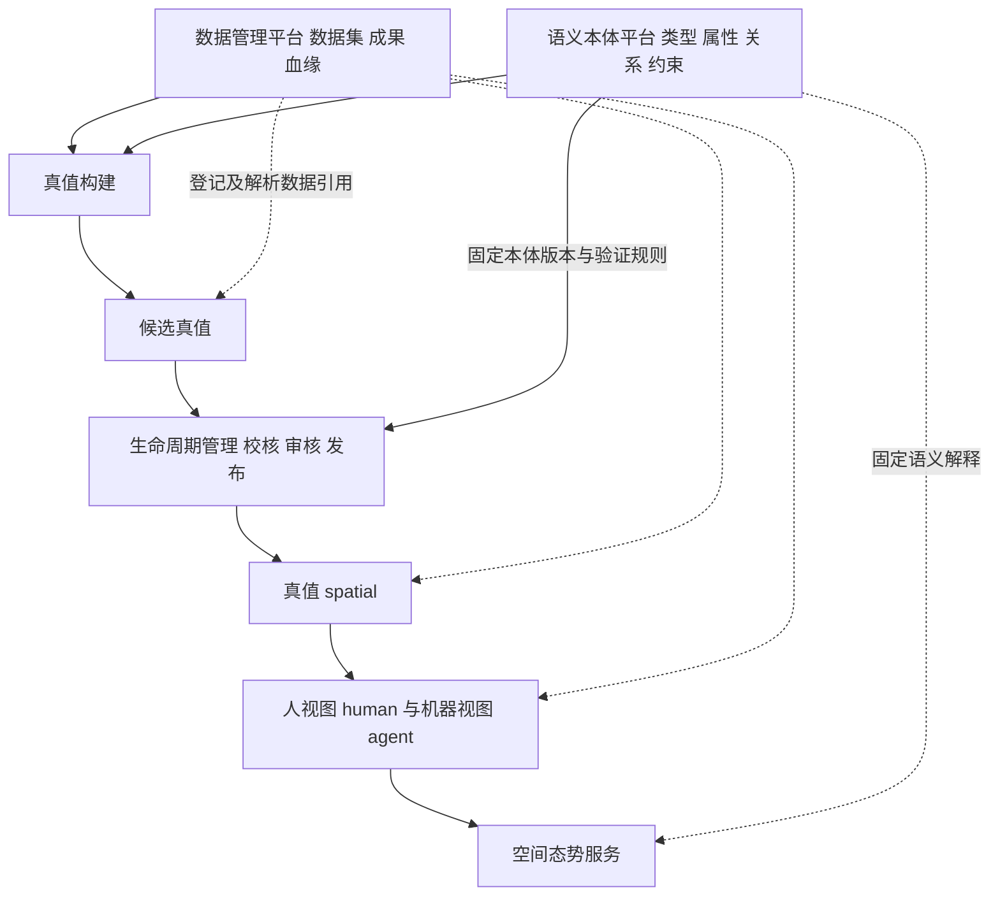

# 数据管理与语义本体平台规划

版本：v0.1\
日期：2026-10-26\
状态：总体规划；P2合成资料与本体只读子集已实现，其余按阶段建设\
依据：[总体架构](总体概要技术架构设计-v0.1.md)、[总体模型](真值与两类视图总体模型设计-v0.1.md)

2026-11-03细化：数据管理当前设计入口为[场景数据管理设计 v0.2](场景数据管理设计-v0.2.md)，以平台 workspace 多场景、场景多历史版本组织资料、构建输入和成果追溯，列明七组二十六项功能；总体流程见[简化设计 v0.3](业务流程与数据流程简化设计-v0.3.md)。该细化尚待实施，下文保留早期总体规划及当时状态。

## 1 总体定位

实施进展：已完成固定发布的资料清单、本体类型及实例核对，详见[验证记录](../validation/数据与本体核对验证-2026-10-26.md)；后续I1已实现合成数据集受控导入及封存，I2/I3已接检查任务及只读工作面，见[导入验证](../validation/受控导入验证-2026-10-26.md)与[任务验证](../validation/任务工作台验证-2026-10-26.md)。真实传感资料接入、导入恢复、在线本体编辑治理及真实构建仍未完成，不能把现有子集当作完整平台。当前优先级见[里程碑复核](总体里程碑复核与下一阶段计划-2026-10-27.md)。

产品保持真值构建与空间态势服务两个核心板块。数据管理平台、语义本体平台作为可复用的领域支撑平台，与生命周期管理共同支撑核心板块。二者具备独立职责、契约与版本管理；首版可共用工程工作台、API进程及存储基础，不要求分别建设独立站点或微服务。

数据管理回答“有哪些资料和成果、从哪里来、被谁使用、是否可取得”；语义本体回答“对象是什么、属性和关系如何解释、哪些约束适用”。真值模型回答“某个确定场景中，经过确认的空间内容是什么”。三者分工协作，不能互相替代。



图中箭头表达信息供给，跨模块调用通过约定接口及应用编排实现，不要求形成相同方向的代码依赖。

## 2 数据管理平台

### 2.1 管理对象与能力

| 管理对象 | 最小管理内容 |
|---|---|
| 原始资料 | 采集批次、传感日志、标定、时钟、坐标、来源、使用条件与完整性 |
| 独立参考 | 控制点、检查点、尺寸及参考轨迹，标记是否参与构建或调参 |
| 数据集 | 固定成员与版本、采集轮次、开发集与保留集划分、适用输入条件 |
| 过程与候选成果 | 构建任务、输入输出、实现、配置及失败诊断的关联 |
| 正式资产登记 | 真值、视图、服务发布的不可变内容引用及摘要，关联其领域版本 |
| 证据与血缘 | 数据、变换、任务及结果之间的可追溯关系 |

平台提供登记、导入、校验、检索、预览、访问控制接入、引用解析、保留及归档能力。首版预览以元数据和必要抽样为主，不以通用数据湖、全格式在线编辑或大规模标注平台为前提。

同一文件内容可按摘要去重复用，但同字节不意味着同一采集身份、用途或许可。数据集成员改变须产生新版本；原始内容不覆盖。血缘记录区分独立校核参考与参与估计的输入，避免同一资料被误称为独立证据。

### 2.2 与其他模块的边界

data拥有资料登记、数据集成员关系及血缘规则；infrastructure实现对象存储、数据库及实际传输。领域内容是否合格由spatial、construction及相应验证器判断，不由“上传成功”决定。

lifecycle拥有候选采用、服务发布和撤回的业务状态；data登记相应固定内容并提供寻址，不再维护一份竞争的正式发布状态。数据可读取、资料许可明确、几何质量合格及能力可消费分别检查。

删除或归档前检查引用、证据保留与权限，不能删除有效发布仍依赖的内容。首版先提供受控检查及人工处置，不提前实现复杂自动清理策略。

## 3 语义本体平台

### 3.1 管理对象与能力

| 内容 | 职责 |
|---|---|
| 类型 | 空间、结构和设备等类型的稳定身份、名称及层级 |
| 属性 | 数据类型、单位、允许值、是否必填及解释 |
| 关系 | 关系身份、方向、允许的起止类型及必要数量约束 |
| 约束 | 必要属性、引用完整性及关系合法性，返回可定位诊断 |
| 外部映射 | BIM、资产台账等外部类型与内部类型的映射、来源及适用版本 |
| 本体版本 | 草案、检查、发布、弃用、差异及迁移说明 |

首版采用人工维护的小型领域词表及可执行约束，覆盖设备间、走廊、基础结构和必要设备类型。具体设备分类随现场资料细化，不把当前未知类别强制塞入确定类型。

本体平台不直接拥有某现场设备实例的位置或确认结果。比如“设备柜”类型及其属性定义属于ontology，“设备间A中的柜体实例及其几何锚定”属于spatial，“该柜体资产编号对应的业务主记录”仍属于外部资产系统。

自动识别是可选实例生产方式；通用大模型、自动本体生成、复杂逻辑推理和全行业知识图谱均不构成首版依赖。JSON、RDF/OWL或图数据库等表示与工具在专项技术设计中比较，不由“本体平台”的名称提前确定。

### 3.2 版本与迁移

类型、属性与关系采用稳定ID，名称不是身份。已发布本体内容不可变；重命名、属性约束或类型含义改变形成新版本，并说明对现有实例的影响。

每个含语义实例的真值版本绑定确定本体包、版本及内容摘要；视图与服务继承该语义来源，不默认读取最新本体。离线交付包含实际解释所需的本体快照及依赖闭包，不能依赖外部在线最新词表。

发布新本体不自动改变旧真值。迁移先评估实例与关系，形成映射和问题清单；需要改变正式实例含义或随版引用时，经lifecycle审核形成新真值，再检查两类视图及服务影响。自动迁移失败或语义不明确时保留待确认状态，不静默归类。

## 4 模块与操作入口

```text
packages/
├── data/                 # 数据登记、数据集、引用及血缘规则
├── ontology/             # 类型、属性、关系、约束与本体版本
├── spatial/                # 某场景的权威空间内容与实例
├── construction/
├── views/{human,agent}/
├── service/
└── lifecycle/
```

data与ontology是同级领域模块，均不放入通用工具或基础设施目录。spatial保存固定语义引用及实例约束，通过接口或固定快照完成本体校验，不依赖ontology的运行数据库。data的血缘采用版本化实体引用，避免反向导入每种产品实体形成循环依赖。

工程工作台规划“数据管理”“语义本体”两个功能区，与场景、构建、视图及发布操作共享导航和身份。后续若形成独立团队、负载或复用需求，可增加独立应用入口；共享模块和契约保持不变。

contracts按需补充资料清单、数据集版本、血缘记录、本体包及映射规范。预置词表包及映射模板按需放入configs/ontology；正式发布本体包及其登记放在运行数据根目录的ontologies下，不与产品源代码混存。

## 5 分阶段建设与验收

| 阶段 | 数据管理平台 | 语义本体平台 | 验证重点 |
|---|---|---|---|
| P0/P1 准备 | 资料登记、来源条件、固定输入及独立参考分组 | 基础词表草案、语义来源与待确认项 | 资料可追溯，不混用开发和独立校核资料 |
| P2 样例闭环 | 最小目录登记、摘要检查及引用解析 | 小型版本化词表、类型与必要属性校验 | 同一合成实例在真值与两类视图中的身份及语义一致 |
| P3 真实构建 | 接入真实批次、候选、过程证据与血缘 | 人工确认实例、外部分类映射 | 正式真值绑定真实来源与固定本体，无悬空引用 |
| P4 消费 | 查询、权限接入、离线打包与追溯 | 消费端解释与约束一致 | 离线可解释，不能因最新词表变化而改变旧版本含义 |
| P5 更新 | 影响分析、引用保护及保留规则 | 本体差异、弃用及受控迁移 | 类型变更触发可解释的实例、视图和服务处理 |
| P6 复制 | 第二现场资料组织及交接 | 复用基础词表，受控扩展现场类别 | 无须修改核心代码即可完成已支持范围内的配置与复用 |

最小失败用例包括：引用内容被修改、资料来源缺失、独立参考被混入拟合输入、未知类型被当作已确认、本体版本缺失、属性单位不符、本体升级静默改变历史解释，以及仍被有效发布引用的数据被删除。

## 6 下一步设计顺序

先联合细化资料登记与本体包的最小契约，再与真值、两类视图和发布清单一起生成小型合成样例。这个闭环验证数据引用、对象身份与语义解释，不先建设两个庞大的管理界面。

首版明确基础词表由产品维护，现场实例由交付工程师确认，资料来源与使用条件由资料登记责任人记录；人员可以兼任，职责与记录分别保留。跨行业词表的组织权限与协作治理在真实复用需求出现后细化。
