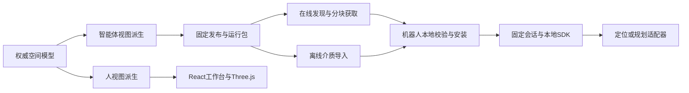

# 智能体视图运行包与在线离线消费架构

日期：2026-10-26，修订：2026-10-27。状态：R0/R1受限合成参考实现已推进，R2可信消费设计已形成；真实运行包、机器人SDK及可信同步未实现。依据：[总体模型](真值与两类视图总体模型设计-v0.1.md)、[发布契约](最小数据与服务发布契约-v0.1.md)、[技术栈决策](../decisions/ADR-003-双视图与机器人消费技术栈.md)。

## 1 产品边界

2026-10-27 R2已形成[可信分发与离线有效性专题](智能体可信分发与离线有效性设计-v0.1.md)，区分内容、能力凭据和状态证明，明确可信时间、撤回及旧会话门禁；尚未实现。下一批R2a先验证契约与标准签名，不改变现有合成参考工具的授权边界。

2026-10-27 R1c已新增[只读完整性核对](智能体运行包完整性核对设计-v0.1.md)，包括包摘要、活动引用与遗留内容观察；当前不提供可信有效性、删除或修复。下一增量R2先形成信任与离线有效性设计。

2026-10-27 R1b首批进展：已增加文件组件存储、安装状态及互斥恢复，见[设计](智能体运行包文件存储与恢复设计-v0.1.md)和[验证](../validation/智能体运行包文件存储验证-2026-10-27.md)。真实大图和物理断电尚未验证，R2可信有效性与R3 SDK未实现。

2026-10-27 R1a进展：已实现小型合成包的本地安装、revision激活、固定会话与查询，详见[专题设计](智能体运行包本地安装与会话设计-v0.1.md)和[验证记录](../validation/智能体运行包本地闭环验证-2026-10-27.md)。实现只使用SQLite合成内容，不代表大文件后端、物理断电、可信有效性或机器人SDK已完成。

2026-10-27进展：R0首批Schema、用途组件样例与CLI校验已实现，见[验证记录](../validation/智能体运行包契约验证-2026-10-27.md)。仅保留来源原坐标、全范围及组件原字节；空间裁剪延期。校验仍需外部来源，安装、可信同步与机器人SDK未实现。以下为总体目标，不因R0首批通过而全部标记完成。

真值建一次，两类视图共用之。机器人消费智能体视图的用途子集；工程师工作台消费人视图及管理接口。机器人不安装整套工作台、构建工具链或管理数据库。运行包不形成另一份可独立编辑的权威空间模型。

运行包绑定一个固定发布、真值和智能体视图版本。机器狗与UAV可基于同一真值派生不同能力配置，不强求使用同一分辨率、定位算法或通行规则。首版仍以普通设备间及相连走廊为场景，未据此承诺UAV实机适用。

服务器负责构建、审核发布、能力有效性、运行包生成与分发；机器人本地负责校验、版本安装、固定会话读取及适配。定位解算、规划与控制的归属由目标机器人集成约定；平台管理API不承担实时控制。

## 2 最小部署形态

| 形态 | 必需组件 | 可选组件 |
|---|---|---|
| 平台或现场服务器 | FastAPI、PostgreSQL、文件成果存储；工作台按部署需要提供 | 独立算法worker、GPU计算、Next.js门户 |
| 机器人在线消费 | 本地SDK、已安装运行包、同步客户端 | 本地进程服务、ROS 2适配 |
| 机器人离线消费 | 本地SDK、完整任务区域运行包、可信配置及有效性凭据 | 小型本地索引、现场诊断界面 |
| 工程师离线浏览 | 本地化人视图资源及浏览工具 | 静态React界面或桌面容器 |

SDK优先评估C++读取接口，具体编译器、C ABI和二进制分发方式待目标架构确定。ROS 2是可选适配层，不作为读取包的必需依赖；ARM64/x86-64须分别构建验证。首批不同时建设多语言SDK。SQLite仅在本地索引需要时引入，不复制平台全部表。

Next.js standalone依赖Node服务，不等于纯静态离线站点。离线浏览若采用静态导出，需单独验证路由与功能限制，不承诺Server Actions或在线认证流程离线可用。

## 3 运行包逻辑契约

下表是待样例验证的逻辑字段，不是已经冻结的JSON Schema。正式实现前在contracts建立Schema及合成样例；沿用现有JSON中的view_kind=machine，目录和SDK术语使用agent，不在本轮静默改协议字段。

| 内容 | 最小声明 |
|---|---|
| 身份与来源 | schema_version、package_id、scene_id、data_kind；固定release、truth、view身份与摘要 |
| 能力配置 | profile身份及摘要、所需组件、用途、限制、机体/传感器适用条件 |
| 空间解释 | frame、分块坐标变换、任务范围、分辨率及边界处理；跨块查询语义一致 |
| 派生依据 | 生成实现及配置摘要、规则/本体快照引用、来源视图和消费验证记录 |
| 组件 | component_id、role、encoding及版本、required标志、依赖组件、固定块引用 |
| 内容成员 | 包内相对路径、媒体类型、字节数、SHA-256；逻辑块ID及包围范围 |
| 资源声明 | 下载量、展开量、安装临时空间估计；查询工作集估计及测量条件 |
| 兼容性 | SDK契约版本、必要特性、编码版本、坐标规则、最大成员及解包限额 |
| 有效性 | 引用独立有效性凭据和来源信任配置；不把静态包摘要当作在线有效证明 |

纯数据包不包含需要自动执行的安装脚本、任意动态库或ROS节点。平台专用编码通过受控适配器解释；客户端不从包中动态下载并加载插件。压缩只改变传输，不改变解包后的成员身份；解包检查越界、符号链接、大小膨胀及重复路径。

有效性凭据与内容包分离，避免每次续期重发几何。凭据绑定发布、视图、包摘要、能力/范围、状态序号、签发及失效时间和签发者。凭据编码、签名方案和密钥生命周期须在可信分发专题核验，当前未实现；SHA-256仅证明字节一致，不能证明签发者可信。

## 4 能力组合与表达扩展

| 组件角色 | 用途 | 首批边界 |
|---|---|---|
| occupancy | 占据、已观测空闲、未知及范围判断 | 延续现有查询语义；范围外单独返回，不能默认为空闲 |
| distance | 局部距离场、净空辅助查询 | 必须同时带有效域与观测状态；未观测区不返回可通行结论 |
| localization | 点云、NDT或其他定位参照 | 独立声明实现兼容与验证条件，不因包存在就声称能重定位 |
| topology | 区域、连接关系、通行图 | 空间事实引用真值；可通行性结合机体规则派生 |
| semantics | 设备、巡检点及必要属性 | 固定本体版本，稳定对象ID，最小字段子集 |

TSDF可作为构建中间表达或有明确需求的派生成分，不要求每个机器人包都携带。ESDF、OctoMap、NDT具体库和编码仍是候选，不由角色名决定；3DGS等人视图资源默认不进入机器包。OctoMap导出按厂商契约引入，并记录概率、分辨率或语义损失。

客户端声明支持的角色、编码和版本；未知必需组件拒绝安装，未知可选组件可跳过，但相应能力不可宣称可用。忽略可选组件后仍需校验必需依赖闭包。新增编码不要求平台领域模型依赖第三方内部结构。

## 5 在线分发、离线安装与切换

在线流程：发现发布及适用配置 → 固定package身份与摘要 → 校验可信清单及有效性 → 获取缺失成员 → 本地检查 → 待激活。下载可断点续传，完成后按固定成员摘要复核，不能把不同版本同名文件拼接。最初按不可变整块复用；二进制差分以后再评估。

离线流程使用相同清单和校验器，通过受控介质取得完整任务区域包及有效性凭据。安装时不依赖平台数据库或互联网；缺必要块则不能将整个任务区域标记就绪。在线按需加载时，未缓存且网络不可用的块返回data_unavailable，不返回空闲或伪造距离。

本地状态为staging → verified → ready → active，失败保留diagnostic且不改变当前包。原子切换只修改本地活动引用；旧会话固定旧包，新会话读取新包。采用任务开始前切换为首版默认，运行中切换需机器人侧明确允许。查询返回package/release/view身份和有效性状态。

回退也需重新检查兼容和有效性；已知撤回、已过期或不适用的旧包不能因“恢复上次版本”重新激活。删除只针对无会话引用的内容，安装预留旧包、新包、暂存和索引空间；磁盘不足在切换前拒绝。

## 6 弱网、撤回与动态观测

在线平台查询继续按现有服务规则检查撤回。已下发的离线包无法即时获知新撤回：离线有效性是有界授权条件，不是实时状态镜像。

离线策略绑定能力而非整机总开关：声明可离线使用的用途、有效时长、最大未同步时长及超限返回。失效时停止提供受限能力并通知机器人集成层，由集成层执行约定的安全动作；SDK不擅自控制整机。数值阈值待现场和机器人条件确定。

客户端保存已见最高状态序号，拒绝更低序号的凭据降级；已知撤回不能被旧介质覆盖。可信时间不可用、时钟回拨或重启后无法确认离线时限时，返回validity_unknown；单靠本地普通文件不能抵御设备管理员回滚，威胁模型和是否需要可信硬件另行明确。

本地实时障碍层记录观测时间、来源和坐标变换，与固定视图分别标识；过期、冲突及未知策略交给规划适配。实时障碍不直接回写真值，后续变化资料需进入受控更新流程。定位失效时也不能继续把新观测叠到错误坐标。

## 7 模块与接口落位

packages/views/agent定义组件及派生能力；service定义发布分发和有效性读取；lifecycle管理撤回记录；data管理内容引用和血缘；ontology提供解释所需快照。adapters负责格式、ROS及厂商接口，infrastructure负责传输、存储和签名接入，apps负责装配。

sdk按目录基线在实际消费验证时创建，读取公开契约，不导入内部数据库或工作台。首个合成验证可先采用本地参考读取器验证语义，不能因此宣称C++机器人SDK已经交付。

拟定SDK动作：inspect_package、verify、install、activate、open_session、query、close_session、inspect_validity。查询结果区分unknown、out_of_scope、data_unavailable、unsupported_capability及validity_unknown等状态；最终错误码与现有契约映射后固化。平台发现接口和文件下载接口另行设计，不直接承诺当前API已存在。

## 8 分批实施与验收

1. R0契约：仅在现有合成发布上建立运行包Schema、能力配置及样例，先验证来源、裁剪和组件依赖，不集成新地图算法。
2. R1本地闭环：实现参考读取器、受限安装、会话固定及原子切换；验证坏摘要、缺块、不支持编码、磁盘不足和断电重启后不出现半包。
3. R2可信同步：明确签发与信任模型后实现在线下载、离线导入、有效性及防降级；验证弱网、撤回、过期、时钟异常和回退。
4. R3机器人消费：确定目标OS/CPU、传感器和接口后实现C++ SDK与必要ROS适配，实测资源、独立定位或查询效果。机器狗与UAV分别验收。

轻量化指标至少包括包大小、任务区域展开量、峰值RSS、冷启动、局部加载及查询p50/p95、CPU、更新峰值磁盘和网络流量。统一数据、范围、分辨率和硬件比较；当前不填写未经实测的MB或毫秒目标。

本专题不替代当前I4恢复工作，也不将P2合成包验证提升为P1算法或P3真实构建验收。下一次先完成R0契约及失败样例；现有运行器、接口和前端保持当前实现，迁移按独立增量验证。
