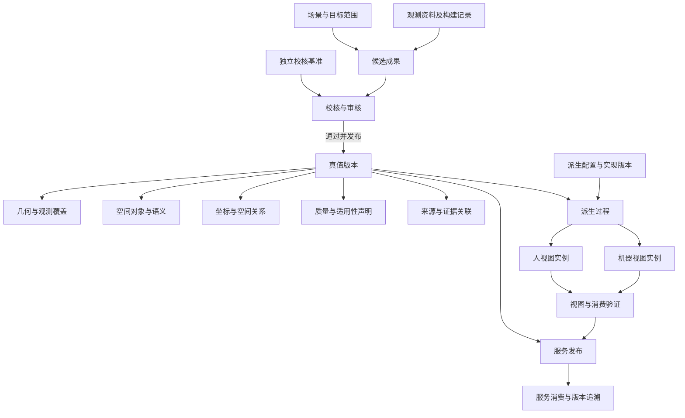
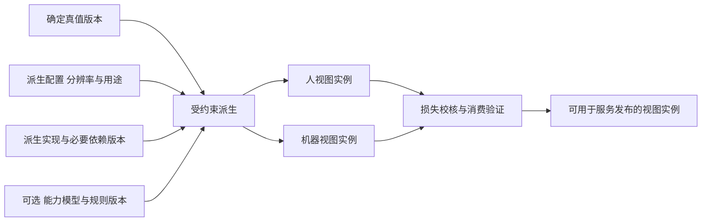
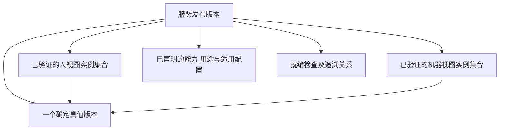
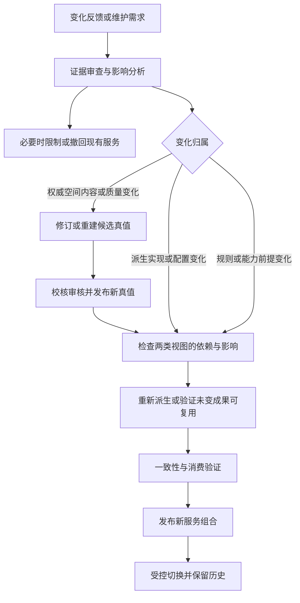

# 真值与两类视图总体模型设计

版本：v0.1\
状态：总体模型草案，作为后续构建与服务专题的共同输入\
日期：2026-10-26\
上位依据：[总体概要技术架构设计](总体概要技术架构设计-v0.1.md)，文内版本v0.4

## 1 模型目的与核心结论

本设计落实“真值＋两套派生视图，即是服务”，明确真值的内容、两类视图的消费边界、派生依赖、版本关系和更新规则。模型服务于首版内部工程交付，也为后续软件授权与场景服务保持统一的空间语义。

核心关系为：构建形成候选，经独立校核和受控发布成为真值；人视图与机器视图从确定真值版本派生；服务发布绑定真值和所需视图，通过一致的查询、分发及追溯提供能力。管理、修订和更新围绕这一关系展开。

本轮定义逻辑对象和约束，不确定数据库表、文件编码、算法、分块尺寸、API字段和指标数值。以下逻辑对象可在同一程序中实现，不代表必须采用独立服务或独立存储。

## 2 总体模型关系

场景确定真值所描述的空间及管理归属，目标范围确定需要覆盖和检查的对象。构建过程可以产生多份候选，只有受控发布的候选才被采用为权威真值。历史真值版本保留，当前正式基准明确，候选不参与正式服务的默认读取。

“真值”是产品内经过校核的权威测量估计，始终受精度、完整度、时效和用途约束。“独立校核基准”用于检验该估计，不能与参与拟合和调参的资料不加区分地使用。

## 3 真值组成与内容归属

### 3.1 真值的逻辑组成

| 组成 | 包含的内容 | 必须回答的问题 |
|---|---|---|
| 空间范围与坐标 | 目标范围、已建范围、局部工程坐标、可选外部基准关系 | 数据描述哪里，坐标如何解释 |
| 几何 | 被观测的表面、结构、位置及必要几何关系 | 实际观测到什么形状 |
| 观测覆盖与占据事实 | 已观测区域、空闲证据、占据证据、未观测和不可判定区域 | 哪些地方有证据，哪些地方不知道 |
| 对象与语义 | 空间对象身份、类型、几何锚定、已确认关系及外部资产引用 | 这是什么、在哪里、身份是否连续 |
| 质量与适用性 | 几何精度、覆盖、语义确认、退化、冲突、时间及用途限制 | 结果在什么条件下可信、可以做什么 |
| 版本与证据关联 | 输入、构建、配置、校核、审核、历史版本关系及保留信息 | 结果从何而来，如何复核和还原 |

以上是逻辑组成，可以通过清单引用不同数据对象，不要求复制为单个巨型文件。真值的正式采用内容必须能够被确定、校验和解释。

### 3.2 真值与外围数据的界限

| 内容 | 归属与处理原则 |
|---|---|
| 原始传感数据 | 是构建证据，未经估计和校核不能直接称为真值 |
| 构建轨迹与算法内部地图 | 是过程成果，可作为证据或候选输入；不自动成为产品统一模型 |
| BIM、图纸与资产台账 | 是外部先验或主数据引用；发生冲突时保留双方证据并复核 |
| 传感器外参与时钟关系 | 是构建和解释观测所需的版本化依据；真值关联其适用版本 |
| 展示LOD、渲染网格、缩略图 | 属于人视图表达，其损失不能反向改写真值 |
| 定位特征、查询索引与通行代价 | 属于机器视图或其运行派生结果；关联真值及消费配置 |
| 人工禁入规则与平台能力参数 | 属于独立配置，不冒充测量几何；参与计算时必须绑定配置版本 |
| 温度、开关状态等动态观测 | 后续以带来源和时效的状态关联真值，不直接改写静态权威几何 |

“真值为唯一来源”指空间几何和语义事实采用唯一权威来源。派生还可使用算法、能力模型、规则及配置，但必须显式记录，不能由其生成未经观测或确认的空间事实。外部台账的业务属性仍由外部主数据源负责。

### 3.3 几何与占据的关系

点云或表面几何主要记录命中位置，不能单凭没有点推导区域空闲。真值需要保留足以解释覆盖和占据的观测依据；机器视图再按消费分辨率生成查询表达。

总体上保留占据、已观测空闲与未知三种空间语义。未知可因未观测、退化或冲突等原因产生，原因应可查询。数据损坏、权限不足和版本不支持属于服务错误，不能伪装成空间未知。

遮挡后方默认不能因为遮挡表面已建成就视为完整覆盖。完整度必须在预先定义的目标范围或对象集合中评估，不能仅以算法生成的有效几何作为统计分母。

### 3.4 对象身份与语义

空间对象使用稳定身份，与位置、显示名称和外部资产编号分开。跨版本移动可以保留身份；新增、移除、拆分、合并及身份不确定情况需要明确记录，不能仅依据坐标接近自动认定同一对象。

对象的几何锚定、语义确认和外部资产绑定可以具有不同质量状态。已确认类型不代表位置已验证，存在外部资产编号也不代表空间绑定正确。

首版目标为几何及覆盖可用、必要空间实例经人工确认。关系和业务属性按实际可得资料增加，不以自动识别为前提。

类型、属性、关系及约束定义由语义本体平台维护，现场实例由真值持有。含语义实例的真值固定引用本体版本及摘要，视图与服务继承其解释；新本体不自动改变历史实例。本体迁移及资料血缘边界见[数据管理与语义本体平台规划](数据管理与语义本体平台规划-v0.1.md)。

### 3.5 质量声明

| 质量维度 | 声明内容 |
|---|---|
| 几何精度 | 测量对象、误差口径、校核方法、有效范围与实测结果 |
| 几何覆盖完整度 | 目标范围、已观测、遮挡、不可达、未知及检查结果 |
| 语义完备度 | 已提供的语义层次、对象和关系覆盖情况 |
| 语义确认质量 | 类型、身份、位置和资产绑定的确认方式及未决问题 |
| 时效 | 观测时间、确认时间及是否存在已知变化 |
| 适用性 | 允许用途、限制条件、退化与冲突影响 |

几何覆盖完整度与S0至S3等语义完备层次分别表达，不共用一个“完整度等级”。质量不得压缩为一个无明确解释的综合分数。

质量可以按区域、对象及内容分别声明。声明的评估范围与证据必须明确，不能用全局平均值掩盖关键区域超差。

## 4 两类视图的总体模型

### 4.1 共性与差异

| 维度 | 人视图 | 机器视图 |
|---|---|---|
| 主要消费方 | 人员与可视化系统 | 机器人智能体及程序消费方 |
| 主要目标 | 看懂、核查、量测和解释变化 | 读取、查询、计算和重定位 |
| 典型表达 | 可视几何、语义标识、质量叠加、差异展示 | 占据表达、局部几何、空间索引、实例索引、定位参照 |
| 组织依据 | 场景、区域、对象、图层与观察尺度 | 查询范围、计算用途、分辨率和能力配置 |
| 核心验证 | 质量信息可识别，量测用途及差异可解释 | 查询语义正确、资源受控、重定位适用性可验证 |
| 共用约束 | 来源真值、对象身份、坐标基准、质量引用和版本可追溯 | 来源真值、对象身份、坐标基准、质量引用和版本可追溯 |

两类视图是两类表达，可以包含多个实例。实例由用途、分辨率、配置和实现共同决定；不要求两套完整数据副本，也不要求所有消费方使用相同编码。

人视图可读与机器视图可计算不构成互斥限制。人视图可以支持受精度约束的量测，机器视图也可以被工具显示；分类依据是主要消费目标。

### 4.2 人视图

人视图至少组织几何、对象语义、质量及版本差异。质量表达必须让使用者区分已观测空闲、未观测、退化和冲突；不能用视觉补洞或背景渲染掩盖证据缺失。

用于浏览的简化表达与用于核查量测的表达应标明用途。量测结果需关联所用真值版本和视图精度，不把显示小数位数当作测量精度。

首版覆盖基本浏览、实例选择、必要量测、质量查看和版本变化检查。具体图层及交互方式留待人视图专题设计。

### 4.3 机器视图

机器视图按用途组织可选择加载的表达，原则上包含以下能力分组，物理结构可分别选型。

| 能力分组 | 作用 | 约束 |
|---|---|---|
| 空间查询表达 | 查询占据、空闲、未知、射线及局部空间 | 粗化不能静默把未知或细障碍转为空闲 |
| 对象查询表达 | 按身份、类型、位置及区域检索对象 | 保持身份与几何锚定可关联 |
| 局部几何表达 | 加载精细形状、结构及必要表面信息 | 注明精度、范围和资源条件 |
| 重定位参照表达 | 提供可供目标定位路线使用的参照及索引 | 独立采集序列验证，不能只证明文件可读 |
| 空间计算表达 | 在支持的能力模型和规则下提供净空、通行等结果 | 绑定能力与规则配置，不能等同实时安全判断 |

首版选择一种经验证的消费条件，形成基础查询、局部读取、对象访问及重定位参照闭环。通行等计算能力依服务需求和验证结果分阶段交付，不因字段可配置就宣称跨所有平台通用。

## 5 视图派生关系

派生可以包括转换、简化、索引生成及用途相关计算，不等于必然压缩，也不等于压缩必然有损。人视图与机器视图共享真值来源，但可以采用不同派生实现。

派生过程可以读取共同的中间计算结果以减少成本；每个视图实例仍需解析到确定真值版本和完整依赖，不能把另一个未经校核的视图当成独立事实源。

### 5.1 派生必须保留的关系

| 关系 | 总体约束 |
|---|---|
| 来源 | 指向确定真值版本、内容范围和来源摘要 |
| 空间 | 坐标一致或存在明确可追溯变换 |
| 身份 | 对象身份保持；对象过滤、聚合或显示隐藏须可解释 |
| 质量 | 传递源质量和限制，附加自身损失与验证结论 |
| 用途 | 声明适用计算、显示或定位任务及有效条件 |
| 版本 | 派生实现、配置和能力规则版本可确定 |

源数据未知的区域不能通过插值或先验补全被声明为已验证事实。若某种算法产生推断或假设，须单独标记其性质与用途；是否允许用于正式服务在相应质量规则中审定。

### 5.2 派生损失与一致性

派生误差和真值误差分开描述；服务结果的适用性同时受两者约束。总体设计不预设可对所有误差直接相加、取平均或取均方根，具体合成方法依误差定义与相关性确定。

一致性指同版本、同范围及可比精度下的事实和语义不矛盾，不要求两类视图逐点、逐体素或逐字节相同。低分辨率视图不能回答超出自身能力的问题，失败或未知必须显式返回。

## 6 版本与服务发布关系

### 6.1 分别管理的版本

| 版本对象 | 表达的变化 | 与其他版本的关系 |
|---|---|---|
| 真值版本 | 权威几何、语义、坐标或随版质量结论变化 | 历史内容不可变，是视图来源 |
| 视图实例版本 | 派生内容、实现、配置或用途发生变化 | 始终绑定一个确定真值版本 |
| 规则与能力配置版本 | 禁入、平台约束等计算前提变化 | 影响使用它们的派生或查询结果 |
| 服务发布版本 | 对外采用的真值、视图实例和能力集合变化 | 将一次服务交付固定为可解释组合 |
| 格式及接口版本 | 数据解释、调用及兼容规则变化 | 不等同于上述数据内容版本 |

真值不变时，可以因为改进压缩、显示、索引或适配而产生新视图版本。视图变化不自动要求重建真值。真值变化后必须进行影响检查，不能只修改视图清单中的来源版本号。

### 6.2 服务发布组合

一次服务发布采用一个真值版本，其所声明的各视图实例均与之对应。不同消费者可继续使用较旧的服务发布，但其版本、质量与已知限制须明确。跨版本对比属于显式操作，不能在一次普通读取中隐式混用两个真值。

服务发布检查所需视图、质量、能力、权限及证据引用是否就绪，再切换当前服务指针。新真值已发布不表示两类视图和服务已自动切换；相关旧服务可在其仍有效的条件下继续提供。

“真值＋两套派生视图”描述完整产品结构。某个端点或离线交付可以只提供其中一类视图或部分能力，但应准确声明其交付范围，不能将部分就绪称为完整服务已经交付。

### 6.3 随版本结论与运行有效状态

真值、视图及服务发布的随版内容不可变。新发现错误、发生现场变化或撤销权限时，可以通过追加的有效性、限制或撤回记录停止当前使用，不必等待新真值构建完成。

这类运行状态不能重写历史内容，但当前服务应检查它们。历史追溯同时说明“当时采用的内容与声明”和“后来发现的限制或撤回”，避免冻结版本被误解为永远可信。

## 7 更新与重新派生

### 7.1 典型变化与处理范围

| 变化 | 真值处理 | 视图与服务处理 |
|---|---|---|
| 新增结构、对象移动或拆除 | 审核证据，修订或重建相应真值内容 | 两类视图检查受影响几何、实例、索引和派生计算 |
| 对象类型或资产绑定纠正 | 新候选经确认形成真值新版本 | 更新相关语义表达和查询，必要时检查定位关联 |
| 发现几何质量不达标 | 先限制使用；按需要重测或重建 | 限制相关能力，不能仅修改显示掩盖问题 |
| 仅改善渲染、编码或查询索引 | 真值不变 | 新视图版本验证后形成新服务发布 |
| 能力模型或禁入规则变更 | 观测几何不变，配置单独版本化 | 重算依赖该配置的结果，并按需更新人视图标识 |
| 坐标基准或转换解释变化 | 明确形成新的真值解释与版本，评估全局影响 | 两类视图和外部锚定均需检查，不当作局部显示修改 |
| 原始证据追加但未改变结论 | 可以登记证据；改变正式随版引用时形成新版本 | 检查实际内容和质量是否变化，避免无意义全量派生 |

影响分析应覆盖空间邻接、跨区域配准、对象引用、规则依赖及服务用途，不能仅依据物理文件是否位于同一块。无法证明独立的范围按保守方式扩大复核。

允许复用未变成果，但必须验证其内容、空间关系、质量和依赖仍适用。新视图实例可引用相同的不可变数据对象，同时建立对新真值版本的有效关联；不能把复用等同于跳过检查。

### 7.2 写回与人工修订

人视图中的问题标注、对象修正建议，以及机器视图消费者的观测写回，首先是反馈或变更候选。经过权限、来源、版本和证据校验后，进入真值修订流程。

纯显示偏好只改变视图配置；涉及权威对象身份、位置或几何的修改须更新真值。任何路径都不能让正式人视图、机器视图与真值逐渐形成三份独立维护的事实。

## 8 职责与验收边界

### 8.1 责任划分

| 责任主体或能力 | 负责的结论 | 不可替代的检查 |
|---|---|---|
| 真值构建 | 输入与过程可解释，候选满足模型，失败及退化可报告 | 不能用内部优化残差替代独立校核 |
| 质量与发布管理 | 真值采用条件、问题处置、审核和发布 | 结论绑定实际候选内容 |
| 视图派生 | 来源明确、转换受控、损失及限制已声明 | 不能仅验证解码成功 |
| 服务发布与运行 | 发布组合一致，能力已就绪，查询与追溯成立 | 不能将局部能力通过等同完整服务通过 |
| 消费方 | 在声明条件内集成与使用，保留版本引用 | 不能将空间服务作为实时安全控制保证 |

### 8.2 总体验证要求

| 验证对象 | 必须验证的内容 |
|---|---|
| 真值 | 独立校核、目标范围覆盖、对象身份与质量声明成立 |
| 人视图 | 已知问题和未知区域可识别，量测与版本差异解释符合声明 |
| 机器视图 | 查询与未知语义正确，加载及计算符合目标条件，重定位适用性成立 |
| 两类视图一致性 | 同一对象、坐标和空间事实在可比条件下不矛盾，派生差异可解释 |
| 服务版本 | 明确采用哪个真值和哪些视图实例，切换不混读，历史可追溯 |
| 更新 | 影响识别、失效限制、重新派生及复用检查形成闭环 |

重定位验证使用独立于构建输入的采集序列，在声明的初始位姿、传感条件和场景变化下评估成功、误差和错误检出。具体方法、阈值及规模在机器视图和服务专题中审定。

## 9 首版模型范围与后续细化

首版建立静态真值、基础人视图和基础机器视图，覆盖一种室内场景族及一种经验证的消费条件。空间实例由人工确认，动态态势和自动语义推断不作为前提。

| 后续专题 | 以本模型为输入需要细化的内容 |
|---|---|
| 真值数据与质量设计 | 几何及覆盖表达、身份规则、坐标、独立校核与证据关系 |
| 人视图设计 | 图层、LOD、量测、质量呈现和人工修订入口 |
| 机器视图设计 | 查询表达、局部加载、定位参照、能力模型与资源条件 |
| 构建技术设计 | 采集输入、算法适配、候选形成及过程诊断 |
| 服务与版本设计 | 发布组合、就绪检查、有效状态、切换、查询与追溯契约 |
| 更新管理设计 | 变化分类、依赖影响、局部更新、复用及撤回处理 |

首先联合细化首版真值内容与两类视图的消费验收，再据此确定构建产物要求和候选算法评测。总体模型中的依赖与一致性原则保持稳定，物理实现经试验收敛。

## 10 本轮模型决策

1. 真值是带质量与用途条件的唯一权威空间数据，原始观测和算法内部地图不自动成为真值。
2. 人视图与机器视图是两类派生表达，可以有多个用途和配置实例。
3. 空间事实以真值为权威；能力与规则作为显式配置参与派生，不伪装为测量事实。
4. 几何覆盖完整度、语义完备度和语义确认质量分别管理。
5. 真值版本、视图实例版本和服务发布版本分开，服务发布绑定一致的来源及能力。
6. 版本内容不可变，当前有效性可通过追加限制和撤回记录管理。
7. 更新由影响分析驱动，允许经验证复用，不允许静默覆盖真值或只改来源标签。
8. 人视图以可读与可核查验收，机器视图以可计算和独立重定位适用性验收。
