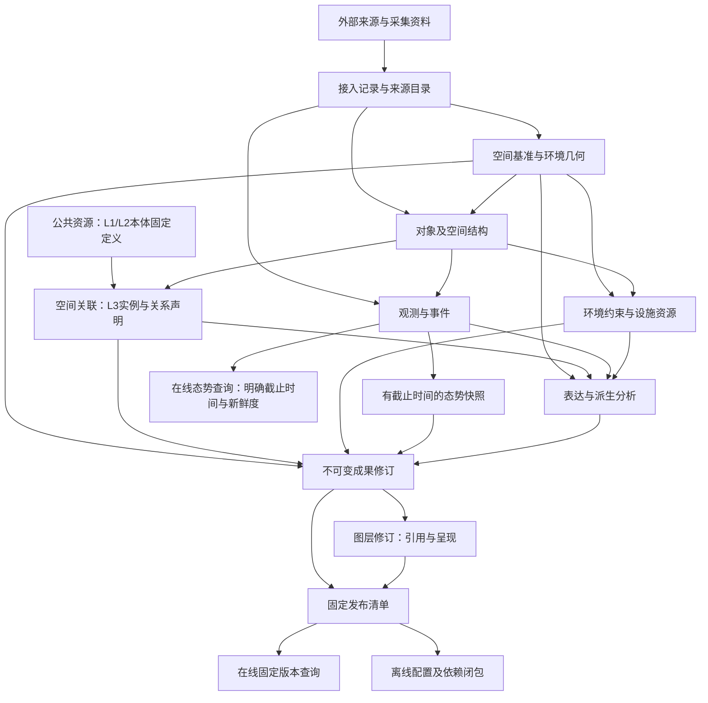

# 空间态势服务统一数据架构 v0.1

日期：2026-11-20。状态：总体设计基线草案；逻辑实体与字段为后续合同输入，不表示数据库、接口或成果类型已实现。

依据：[产品责任边界](空间态势服务数据责任与交付边界-v0.1.md)、[交付内容域](园区交付数据架构与B06范围-v0.1.md)、[完整机器人需求参考](机器人消费数据需求与行业对照-v0.1.md)。完整行业需求保留，只有属于本平台责任且实际具备的数据进入发布。

## 1. 总体结构

空间态势服务以空间对象为关联中心，以空间和时间为共同基准，以固定成果为发布单位。静态环境与动态态势采用不同生命周期，通过对象身份、空间范围及时间关联。

图中包含总体规划能力，当前未建设的环境约束、动态接入和分析不得作为已有成果发布。图层是数据引用与展示组织，成果是可验证的内容单位，发布是一次显式选择与冻结；三者各有身份和版本。

## 2. 七个内容域及权威归属

| 内容域 | 核心数据 | 权威与管理职责 |
| --- | --- | --- |
| 来源与接入 | 来源系统、资料、采集批次、接入批次、使用与再分发许可、原始版本 | 来源方拥有原始事实；平台记录实际收到的内容与处理链 |
| 空间环境 | 坐标框架、变换、范围、几何、覆盖、空间结构 | 平台管理已纳管成果；采集、设计、推导及现场核验分别保留 |
| 对象与语义 | 对象身份、版本、外部标识、定义引用、属性/关系声明 | 平台维护关联；本体模块维护定义，宿主持有实例；专业确认由责任方完成 |
| 环境规则与资源 | 空间限制、连接、入口、门梯/充电等设施及能力描述 | 园区或资料责任方提供依据；平台管理空间化表达，不执行控制 |
| 观测与事件 | 状态、告警、变化、外部机器人位置、临时限制 | 外部系统产生；平台对接入、空间关联、时间和新鲜度负责 |
| 表达与分析 | 点云/网格/瓦片、计算索引、分区、实际支持的分析 | 平台或外部算法产生；记录输入版本、方法和参数，结果不覆盖源事实 |
| 治理与分发 | 血缘、证据、质量、成果、图层、发布、交付、访问记录 | 平台管理完整性、版本和场景授权；商业权益由平台管理服务负责 |

这些是逻辑内容域，不要求新增七个导航或部署七个服务。业务主题如供配电、消防、给排水通过定义与图层引用组合，不各建一套身份、几何和时间体系。

## 3. 核心逻辑实体

| 实体 | 最小职责与关键关联 |
| --- | --- |
| SourceRecord / IngestBatch | 标识来源版本、接入时刻、内容摘要、许可、来源责任；关联采集资料和实际纳管成员 |
| SpatialFrame / TransformRevision | 框架、轴、单位、维度/高程；变换源/目标、方向、方法、误差、有效期、审核依据。只有已核准且适用的变换可用于对应定位 |
| SpatialScope | 范围几何及其frame；空间对象集合、覆盖与排除范围；明确半开边界或其他采用的边界政策 |
| ObjectIdentity / ObjectRevision | 稳定业务身份与某时刻/版本的对象描述分开；带对象命名空间、来源、空间范围及外部标识 |
| GeometryRevision / GeometryBinding | 几何内容及对象到几何的关联；支持点锚、线面体或表达引用，标明表示用途及证据强度 |
| DefinitionReference | 本体模块身份、版本、摘要及完整固定依赖闭包；不复制成宿主私有定义体系 |
| EntityClaim / RelationClaim | 对象分类/属性或有向关系；携带固定对象/定义引用、声明来源、有效时间、记录时间、依据及核实状态 |
| RuleRevision / ResourceRevision | 环境规则的空间/对象范围、条件、有效期与依据；设施位置和已知能力。控制接口描述可受控引用，凭据不进入成果 |
| Observation / Event | 来源记录身份、观测/事件时间、接收时间、对象/范围绑定、值/单位、质量和失效条件 |
| ArtifactRevision | 某类成果的不可变修订，固定内容成员、依赖、范围及能力；成果身份与修订分别管理 |
| LayerRevision / StyleRevision | 图层引用固定成果及筛选范围，样式独立版本；不保存另一套对象事实 |
| ReleaseManifest | 固定选择的成果/图层修订及依赖、交付配置、检查结果；对应场景与访问分类 |
| DeliveryManifest | 从某发布按指定配置导出的成员/外部依赖清单、摘要及协议版本；下载记录不等于交付验收 |

成果不是原始文件的同义词：一项成果可以有多个文件和查询表达；大文件可分块，但清单须列明全部固定块及根摘要。复用内容须经授权，不允许仅凭摘要跨工作区读取内容。

### 身份处理

当前 object_id 是模型候选内的对象标识，B06采用 `(工作区, 场景, 模型候选, object_id)` 明确命名空间。园区稳定对象身份作为后续独立映射能力，不借本批偷偷建立自动主数据系统。

跨候选/来源的同一对象只能通过有来源、有审核的 IdentityMapping 关联，不能按名称或局部ID自动合并。对象、几何、本体类型、资产台账ID分别表达：设备换位置不必更换稳定身份，设备替换也不应仅因位置相同继承旧身份。

## 4. 共同元数据与版本规则

每项成果清单至少包含以下字段组，具体命名在schema阶段冻结：

| 字段组 | 内容 |
| --- | --- |
| 身份与结构 | artifact_id、revision、kind、schema/profile及版本、标题 |
| 归属与来源 | workspace/scene、source_refs、处理/生成方式与责任主体 |
| 空间 | scope_ref、frame_ref、几何或模型来源、覆盖及排除说明 |
| 时间 | valid_time、recorded_at、generated_at；态势快照另有cutoff与窗口 |
| 内容 | members的相对路径、媒体类型、大小、摘要、编码/分块合同 |
| 依赖 | 固定成果/定义/模型引用、摘要、必需或外部依赖、兼容性 |
| 质量与能力 | 完整性、结构、局部语义、专业审核、现场核实分别记录；用途和已知缺失 |
| 分发 | 访问分类、许可、是否允许离线、是否完整随包携带、受控外部引用 |

schema版本、内容修订、发布版本、软件版本分别管理。内容摘要用于验证字节，不代替身份、授权或语义兼容。

数据流为：接入/编辑 → 工作修订 → 校验 → 显式采用 → 固定成果 → 固定发布 → 在线/离线消费。草稿可反复修改，固定修订只能追加新版本；后续修订不得改写旧成果。成果校验和专业批准分开，不因工程校验通过自动批准。

发布状态采用现有active/paused/retired分发机制，内容仍保留；回退为显式切换固定发布或按现有发布流程重发，不更新旧清单的依赖。原始资料更正通过新修订与失效/替代记录表达，不能静默覆盖已有证据。

## 5. 两种时间与态势查询

有效时间表示现实中声明适用或事件发生的时间，记录时间表示平台何时收到/记录。可补录、迟到和更正；更正追加记录并关联被更正记录，保留历史认知。

静态发布不连接实时最新值。动态服务可以按明确的最新查询政策返回状态，但响应须带服务版本、数据时间/截止时间、来源、新鲜度及缺失状态；分页使用同一查询快照或游标，避免每页漂移。态势冻结成果以显式窗口和cutoff导出，不冒称持续实时。

过期、未知、未观测、不适用、来源中断和无权限分别表达；未知不等于正常，观测值不自动推导专业事实。机器人内部TF/里程计、障碍传感、规划控制不成为平台持续接收或交付的默认义务。

## 6. 依赖、图层与交付合同

成果依赖形成可解析的有向无环图，引用固定身份/修订/摘要；拒绝循环、缺项、摘要不符及同一依赖的版本冲突，禁止以最新值回退。可选项只在用户选择前可选，一旦选入就成为该次发布的必需验证项。

图层声明主题、适用范围和查询能力，引用固定成果并关联样式；筛选表达须受限制且可重现，不执行任意代码。动态态势图层引用有版本的查询定义和新鲜度政策，不将其当前显示误认为固定成果。保存视图不等于发布数据。

发布配置定义必需/可选成果和能力，用户显式选择；结果清单列出 included、excluded、external、unavailable 及原因。离线自包含要求其全部必需依赖随包提供；仅保留模型摘要或证据URL时必须声明为外部引用，不能自称完整离线几何验证。

当前“完整交付”限定于所选配置，不代表整个园区所有资料。原始资料默认不分发，缺许可、敏感业务字段或主体身份需按交付配置投影/脱敏；投影产物有自己的摘要与血缘，不篡改原始成果。审计主体标识的对外保留范围在合同中明确，认证数据永不混入成果。

## 7. 服务与存储边界

| 组件 | 负责内容 | 明确边界 |
| --- | --- | --- |
| 公共资源—语义本体 | L1/L2定义、固定依赖、编制/校验/发布与标准交换 | 保持独立；不依赖场景、地图、宿主认证或数据库，不拥有实例与发布业务 |
| 来源/空间构建 | 接入、模型、几何、frame、覆盖与表达 | 不隐式认定专业语义或自由空间 |
| 空间关联 | 对象、L3声明、关系及已有业务绑定 | 不维护另一套L1/L2定义；不改写原始台账 |
| 态势适配 | 外部观测/事件、对象关联、新鲜度与窗口 | 不执行机器人/设施控制；接入凭据留在宿主配置 |
| 成果与发布 | 固定成果、依赖闭包、发布清单及生命周期 | 不自动读取最新实例污染旧发布 |
| 数据消费 | 授权查询、离线导出、受控适配及访问审计 | 权限先于读取，场景授权由宿主处理，商业权益由平台管理服务处理 |

物理存储按责任演进：元数据/索引/事务与幂等放事务存储；大几何/影像/分块和固定包放工件存储；固定清单关联二者。动态观测待有实际来源与负载后选时序/事件存储，当前不预建消息总线或全量图数据库。关系是逻辑模型，不意味着必须使用图数据库。

当前SQLite与已有文件目录继续作为部署实现，保留事务锁、固定快照及原子发布；本设计不触发全库迁移。新成果目录先作为发布内的兼容清单，日后再抽取通用目录服务。宿主运行库、密钥、会话、备份均不作为交付成员。备份是运维恢复资料，不是客户成果。

工作区/场景归属是必需授权上下文。目录列表、成员读取、在线查询、导出、外部引用均执行对应授权；内容去重不导致租户间授权穿透。大工件采用先生成校验、后原子登记；失败保持不可见暂存并按可恢复政策清理，不能留下半发布成果。

## 8. 现状映射与 B06 落地

| 现有内容 | 架构位置 | B06策略 |
| --- | --- | --- |
| model.json / spatial.npz及表达 | 固定空间成果与模型来源 | 复用既有模型绑定，发布清单明确哪些字节实际随包 |
| objects.json | 候选内对象及模型点锚 | 保留身份命名空间，不宣称稳定园区主数据 |
| 旧ontology.json / relations.json | 既有轻量对象/关系合同 | 原样兼容，与新模块化定义及声明分别呈现 |
| business.json | 固定业务关联成果 | 沿用原合同，不读取台账最新值补入旧发布 |
| scene-ontology-links.sqlite3 | 消费侧工作及不可变实例修订 | 显式选定修订，冻结到对象语义成果；不打包数据库 |
| 本体发布闭包 | 固定定义依赖 | 冻结所需闭包并验证冲突，不查询最新定义替代 |
| publication.json / offline包 | 固定发布与交付 | 兼容新增可选成果清单；旧发布缺新清单仍按旧合同读取 |

B06a先冻结schema及兼容政策，交付“对象语义查询”配置，包含固定对象索引、消费修订、定义闭包、声明、关系、依据与局部报告；不包含机器人定位/通行/任务控制能力。B06b做发布预检与冻结，B06c做同源在线/离线消费，B06d验收上线；按本版本边界分别验收，不纳入完整图层平台、态势数据接入或存储重构。

首批验收必须覆盖：模型与实例来源一致、依赖完整且无版本冲突、缺失或非法实例阻止采用、幂等包含所选修订、旧发布不漂移、包内外一致、篡改阻断、权限及暂停退役、旧合同兼容。无关系映射的对象成果可按明确配置成立，不能通过伪造关系校验通过解决；部分声明覆盖与全模型覆盖必须分别记录。

后续数据建设按实际来源和用途独立排期：B07地理配准不自动承诺机器人定位；环境约束、通行特征、设施资源、动态态势与派生分析分别定合同和验收。专业语义深化和本体独立产品化延续原批次，不扩大B06。

## 9. 设计冻结准则

新数据进入产品前回答：谁提供事实、谁负责核实、作用于哪个空间/对象与时刻、如何版本化、依赖什么、允许何种消费、缺失如何表达。任何尚无来源或实现的成果只留设计位置，不进入发布能力清单。

架构服务各类园区及多类消费方，预置主题与适配输出可以扩展，共同身份、空间、时间、版本、质量及授权合同保持一致。界面沿用已有功能导航，资源/图层/成果清单放内容区，配置类功能归配置管理，不因逻辑实体增加二次导航。
