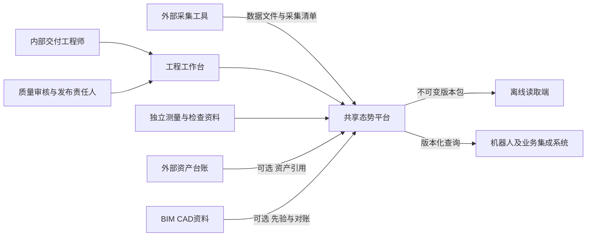
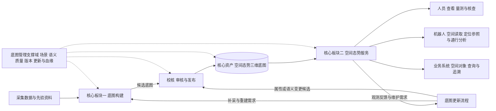
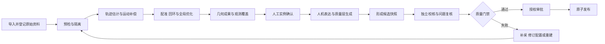
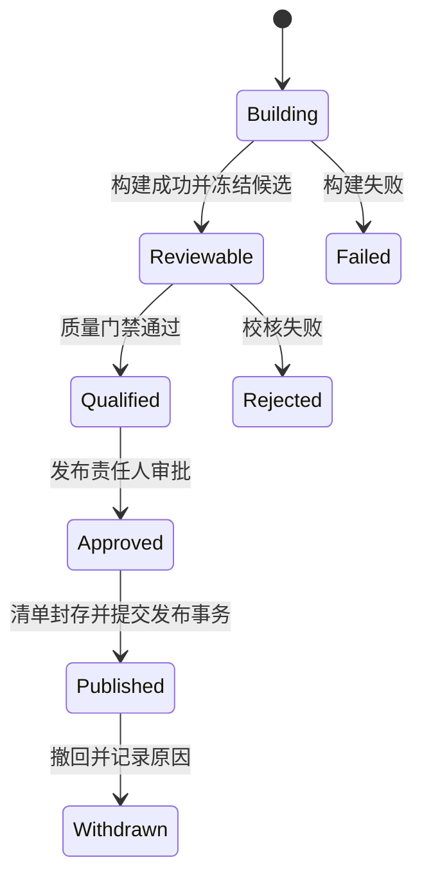
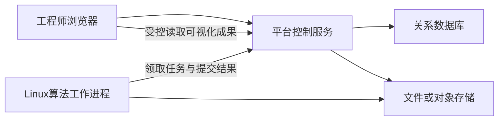

# 共享态势模型与服务平台首版架构设计

状态：架构提案，待技术验证后冻结为研发基线\
日期：2026-10-26\
适用范围：首版内部工程交付工具链，以及后续面向集成商交付的软件基础

文档定位：本文件保留为首版实现设计参考，具体实体、流程和技术选择均待详细设计审定。总体结构与边界以[总体概要技术架构设计](总体概要技术架构设计-v0.1.md)为准，当前文内版本为v0.3。

统一术语说明：本文件保留较早的“底图”用语以便追溯。后续详细设计统一采用总体概要技术架构中的“真值、人视图、机器视图、服务”；本文件的“底图”对应真值，派生表达须明确归入两类视图。

首版细化约束：真值是声明条件内经过校核的权威测量估计；两类视图可包含多个派生实例，均须绑定来源版本并声明派生损失。发布、查询、更新、权限与追溯共同使数据成为服务。机器视图必须以独立采集序列验证重定位适用性，不能仅以读取成功作为验收依据。以下实现建议按这些约束细化。

## 1 设计依据与架构结论

首批客户为项目制行业集成商，后续客户为机器人厂商和场景业主。首版由内部交付工程师操作，从零建立建图、质量校核与版本交付能力，算法优先评估成熟开源实现。

本架构承接《共享态势模型-产品定义与规划.docx》的产品边界，对《共享态势模型-技术设计方案.docx》中的首版实现作重新划分。本文是新提案，不代表原方案所有技术假设已经通过验证。

产品的核心主轴是“空间态势（三维底图）→ 服务”。三维底图是核心空间资产，空间态势服务把这份资产转化为可被人、机器人和业务系统使用的能力。底图构建是另一个核心板块，负责形成及重建这份资产。底图管理、更新、质量校核、版本发布、语义维护和数据血缘围绕底图的生命周期组织。

架构由两个核心板块与一个底图管理支撑域构成：底图构建板块解决“如何形成可信底图”，空间态势服务板块解决“如何基于底图持续提供能力”，底图管理支撑域保证底图可维护、可校核、可发布和可追溯。服务的能力边界与输出契约必须独立设计；它既支持查看与读取，也支持空间查询、对象定位与适用条件明确的空间计算。

首版采用模块化单体控制服务、独立算法工作进程、不可变成果存储和工程浏览器工作台。平台以场景为管理边界，以发布版本为对外消费边界，以候选构建为审核边界。建图算法通过适配器接入，可以替换；正式成果通过稳定的数据包与查询语义消费。

原“4+2”结构作为能力覆盖检查表保留，架构主图按底图、构建、服务及生命周期支撑组织。逻辑板块不等于部署服务，服务拆分由运行负载和隔离需求驱动。

### 1.1 首版目标

1. 从一种经过验证的采集组合生成可校核的室内静态底图。
2. 工程师能够发现并处理退化、未观测、冲突和质量超差。
3. 完成独立校核、审批、发布、离线交付、查询和回滚。
4. 任一正式成果可回溯到输入数据、配置、算法、校核与审批记录。
5. 在同一支持范围内，第二个不同布局场景使用同一产品构建，仅调整声明允许的配置。

### 1.2 首版边界

首版以离线批处理为主，采集由外部工具及操作人员完成。产品接受数据、检查质量、提供补采提示，不负责机器人运动控制、人员避让、任务调度或自主探索。

先支持一个室内场景族、一种采集组合和一种经验证的地面消费能力模型。毫米波融合、多机在线协同、自动语义识别、业务工单状态、在线态势维护、版本分支自动合并均不作为首版依赖。

外部资产台账为主数据源。首版管理自身空间实例与外部资产ID的绑定，不维护完整业务台账。没有外部资产系统时，可以建立待绑定的空间实例。

## 2 系统上下文



角色至少区分操作、质量审核、发布授权和只读。内部早期可由同一人兼任多个角色，但授权与审计记录分开，角色合并不能绕过质量门禁。

## 3 逻辑架构



底图是逻辑空间资产，不等同于单个三维文件。其几何、占据、实例、坐标与质量信息共同支撑服务，由发布清单关联为一致快照。首版空间态势以静态底图为核心，动态状态作为后续扩展，不能因名称包含“态势”而提前要求在线融合。

### 3.1 两个核心板块与支撑域

| 架构单元 | 核心职责 | 内部组成 |
|---|---|---|
| 底图构建 | 从观测形成可信底图，并支持必要重建 | 接入预检、任务编排、算法适配、轨迹估计、配准优化、几何及覆盖生成 |
| 空间态势服务 | 将底图转化为人和机器可消费的空间能力 | 可视化与量测、空间查询、实例查询、定位参照数据、通行派生计算、离线读取与版本分发、证据追溯 |
| 底图管理支撑域 | 维持底图完整生命周期与使用条件 | 场景配置、语义与实例维护、质量校核、版本发布、更新管理、数据血缘、权限与审计 |

空间态势服务可独立加载正式发布包运行，不要求构建进程常驻。底图构建在没有在线消费者时也能完成；它必须按约定产出可服务的成果。两者通过发布清单及表达契约衔接。

底图更新是围绕资产的生命周期流程：先登记变化与证据，判断影响；几何变更触发局部或全量构建，语义及属性变更进入相应修订流程；经适用校核和发布形成新版本，服务再切换到新版本。所有路径都不能直接覆盖已发布底图。

服务实现可以调用底图管理提供的版本与证据能力，但对外入口应按空间消费任务组织。工程师工作台则围绕选定底图展开构建、管理、更新和服务验证。

### 3.2 首版空间态势服务边界

| 服务 | 消费的问题 | 首版输出与边界 |
|---|---|---|
| 可视化与量测 | 现场是什么样，哪里未观测，尺寸是多少 | 人视图、质量层及适用分辨率下的量测 |
| 空间查询 | 指定区域有什么，哪里占据或未知 | 固定版本的点、射线、邻域及区域查询，附质量语义 |
| 对象空间服务 | 某台设备在哪，与外部资产如何对应 | 已确认实例、空间位姿与资产引用 |
| 定位参照服务 | 消费端使用什么地图定位 | 约定坐标下的局部几何及索引；首版不承诺在线位姿解算 |
| 通行分析 | 给定能力模型下空间是否满足通行条件 | 经验证模型的派生结果与限制；不承担实时避障和运动控制 |
| 版本分发与追溯 | 如何加载、更新和解释所用空间 | 发布包、版本差异、原子切换及可访问证据引用 |

### 3.3 模块职责与边界

| 模块 | 拥有的职责 | 主要输出 | 边界 |
|---|---|---|---|
| 场景与配置 | 场景范围、坐标定义、采集配置、验收要求、配置快照 | 可引用的配置版本 | 不维护设备驱动 |
| 数据接入与预检 | 导入、校验和、格式检查、时钟与标定资料检查、数据隔离 | 已登记数据集、预检报告 | 原始证据保留，不在入口宣称已完成全局坐标求解 |
| 构建编排 | 阶段依赖、资源调度、失败恢复、取消与重试 | 构建记录、候选版本 | 不内嵌具体SLAM实现 |
| 算法执行 | 数据解码、位姿估计、配准优化、几何与派生表达生成 | 阶段成果及质量诊断 | 不能直接发布正式版本 |
| 质量与证据 | 控制与检查资料管理、校核、问题清单、验收判定 | 绑定候选内容的质量结论 | 不以优化残差代替独立检查 |
| 语义与实例 | 类型定义、空间实例、资产绑定、人工确认 | 版本化实例与语义快照 | 不拥有EAM资产主数据 |
| 版本与发布 | 候选冻结、审批、清单封存、原子发布、撤回与回滚 | 正式发布版本 | 不修改已发布内容 |
| 版本化查询 | 按指定版本读取几何、占据、实例与质量 | 带版本和质量的查询结果 | 不承担实时避障与控制闭环 |
| 数据与血缘 | 原始、过程、成果的寻址、引用、校验与保留策略 | 可验证的数据依赖关系 | 首版不扩建通用企业数据治理平台 |

模块通过明确的命令与数据对象交互，不允许界面绕过控制服务直接修改数据库。算法工作进程只获得任务所需输入及暂存输出权限，正式状态由平台控制服务提交。

## 4 数据架构

### 4.1 三类数据分别管理

| 类别 | 内容 | 存储原则 |
|---|---|---|
| 原始证据 | 原始日志、点云、图像、标定文件、时钟资料、独立测量记录 | 导入后内容不可变，内容哈希校验，保留原始格式 |
| 过程数据 | 轨迹、关键帧、配准结果、中间地图、执行日志 | 按构建和阶段归档；清理受血缘与保留规则约束 |
| 正式成果 | 几何、占据、实例、质量、证据索引、交付报告、版本清单 | 正式发布后不可变，由清单建立一致快照 |

元数据、关系、任务状态与审计引用存关系数据库；大对象存文件系统或对象存储。首版允许使用本地成果目录，但只经统一存储接口访问，不把绝对文件路径写入对外交付规范。

### 4.2 核心实体

| 实体 | 标识与主要关联 | 作用 |
|---|---|---|
| Project | project_id | 内部交付管理范围，一个项目可包含多个场景 |
| Scene | scene_id | 空间、权限及版本历史的管理边界 |
| FrameDefinition | frame_id、revision、转换资料引用 | 定义局部坐标、轴序、单位和可选外部坐标关系 |
| Calibration | calibration_id、revision、内容哈希 | 定义传感器关系、时间偏移及适用条件 |
| Dataset | dataset_id、采集会话、对象清单 | 聚合一次或多次采集资料，不等于地图版本 |
| ObservationStream | stream_id、source_id、clock_ref、calibration_ref | 描述带逐帧或逐点时间语义的观测流 |
| ConfigSnapshot | config_id、schema_version、内容哈希 | 固化构建与质量规则；运行时不得原地修改 |
| BuildRun | build_id、输入快照、算法制品摘要、阶段状态 | 记录一次完整或局部构建 |
| Artifact | artifact_id、内容哈希、类型、大小、生成记录 | 不可变的数据对象 |
| Candidate | candidate_id、构建引用、内容摘要、基线release_id | 待校核与发布的成果集合 |
| QualityAssessment | assessment_id、候选摘要、规则版本、证据引用 | 保存实测值、结论、限制条件及复核记录 |
| SpatialInstance | instance_id、几何锚定、可选external_asset_id | 稳定空间身份；移动不自动产生新身份 |
| Release | release_id、manifest_hash、parent_release_id | 正式发布快照，显示版本号与全局唯一ID分开 |
| AuditEvent | event_id、主体、操作、时间、对象及前后状态引用 | 记录重要状态变更，采用追加方式 |

首版不使用每体素无限增长的source_list。采用成果块或空间区域到关键帧、观测片段的证据索引；需要更细粒度追溯时再增加关联。保留支持正式结论的证据，不保证任意中间数据永久保留。

### 4.3 坐标与时间

接入阶段检查坐标、时钟、标定元数据的可解释性，并保留原始值。传感器坐标到最终工程坐标的转换由位姿估计、配准和优化逐步求解，不要求尚未建图的数据在入口提供最终全局位姿。

必须区分传感器坐标、载体坐标、局部里程计坐标与工程地图坐标。转换记录注明方向、单位、来源、适用时间和误差说明。协方差若提供，必须声明参考坐标、扰动定义和有效性，不能用固定默认值伪装可靠估计。

时钟记录区分采集时间、接收时间和处理时间。多源融合要求时钟关系与偏移可解释；只有采集起点位姿和起止时间的数据包不足以处理运动畸变。

首版以工程局部坐标为必选，外部地理基准为可选。未建立地理基准关系时必须明确标记，不生成虚假的地理定位。外部坐标转换按工程所需建立，不强制经过固定的CGCS2000到WGS84串联链。

### 4.4 正式成果组织

```text
release-package/
  manifest.json
  geometry/          分块几何及索引
  occupancy/         已观测空闲 占据 未知的表达
  instances/         空间实例与外部资产绑定
  quality/           质量分区 问题清单 校核结果
  provenance/        构建参数 算法版本 证据索引
  reports/           人工可读交付报告
```

manifest至少关联：场景和发布ID、格式版本、基线版本、坐标定义、配置和标定版本、算法及依赖摘要、各文件哈希、表达用途与分辨率、质量声明、限制条件、证据保留位置与审批引用。

内部完整归档包与外部交付包可具有不同证据载荷。对外包不默认复制所有原始数据，但必须明确证据是否随包、如何定位、保留期限与访问条件，不能承诺脱离归档系统仍可完成全部原始证据追溯。

几何、占据、实例和质量是同一发布清单关联的成果，不要求全部塞入一种自定义体素结构。既有编码优先复用；具体编码在候选路线评测后确定，统一清单与语义先行。

## 5 构建与算法架构

### 5.1 标准构建流程



预检区分可处理的警告与禁止进入特定阶段的问题。原始资料可以登记并隔离，不因质量差就丢失证据。是否能降级构建、能否发布由明确规则判定。

S0可以跳过实例阶段。首个正式交付目标为人工确认的S1；自动语义识别不构成流程前提。

### 5.2 算法适配器

算法不是平台的领域数据模型。FAST-LIO2、Point-LIO、LIO-SAM等仅作为候选路线，未完成许可证、依赖和数据验证前，不指定为默认实现。

每个算法阶段声明以下契约：

- 输入：数据与配置的不可变引用、坐标时间约定、可选初始化和控制资料。
- 能力：支持的数据类型、所需传感器字段、是否包含回环、资源要求、适用条件。
- 执行：算法制品摘要、命令参数、环境、进度、取消与退出状态。
- 输出：成果清单、诊断信息、失败原因、坐标变换与质量适用范围。
- 血缘：输入哈希、参数快照、代码或镜像摘要、随机种子及并行设置（若适用）。

平台定义阶段级结果，适配器负责算法特有格式的转换。算法之间不能假定全部中间数据可互换；不支持的阶段组合在启动前拒绝。

记录环境不等于保证逐字节可复现。对存在数值非确定性的算法，采用声明容差的重复运行验证；对成果包传输与重组采用哈希级一致性验证。

### 5.3 任务可靠性

首版使用数据库持久化任务，不引入分布式消息平台作为必选基础设施。任务包含阶段、尝试次数、租约、心跳、输入摘要、输出暂存位置和错误码。

工作进程按租约领取任务，允许故障后重新执行。执行按至少一次设计；阶段结果提交通过输入摘要、任务标识和数据库约束实现幂等，不能依赖工作进程恰好只执行一次。

重试产生新的执行尝试，不覆盖失败记录。只复用输入及参数均未变化、校验通过的阶段成果。取消后保留诊断资料，不生成可发布结果。

## 6 质量架构

质量模型至少分别描述几何精度、观测覆盖、语义确认、时效与退化，不压缩为一个万能分数。A/B/C属于未来可固化的能力档位，首版先存实际测量值、方法、条件及适用用途，不直接沿用未经标定的系数。

必须在采集前定义目标空间范围和可检查的覆盖对象。未观测区域的分母不能由算法已生成的地图反向决定，否则无法发现漏建区域。覆盖报告区分目标范围外、未观测、遮挡不可达、观测退化和已检查区域。

空闲证据需要有效位姿和射线观测支持，不能由点云缺失推导。粗分辨率表达采用保守聚合规则，不能因平均概率或降采样删除细障碍后把区域标为空闲。

### 6.1 独立校核

控制点可以参与优化，独立检查点不得参与拟合、参数调整或同一轮优化。数据中记录用途和使用历史，防止控制点被重复当成独立真值。

质量结论分别报告绝对坐标误差、局部几何尺寸误差、重复性、区域覆盖及异常，不用配准残差单独证明绝对精度。测量方法、检查点分布及参考资料误差随结论记录。

### 6.2 发布门禁

发布条件由用途配置定义，至少包含：输入完整性、坐标可解释、必要校核通过、未知与退化标记完整、成果一致性、实例引用有效、必要审批完成。

问题分为阻断发布、限制用途、提示信息三类。已知缺陷可随限制条件交付，但硬性门禁不能通过普通备注绕过。调整验收范围或要求会生成新配置及候选快照，并重新审核。

质量报告、审批和发布均绑定同一候选内容摘要。任何几何、实例、质量规则或交付内容变更都会使受影响的旧结论失效，避免审核通过后换入另一份成果。

## 7 版本与增量架构

### 7.1 状态与发布



候选修订形成新候选，不能原地改动已经审核的内容。首版正式发布按场景维护线性历史，候选可并行构建，发布动作串行提交。

发布事务前，所有成果文件已写入不可变存储、校验通过且达到配置要求的持久化条件。事务内核验候选摘要、质量结论、审批和预期基线，登记Release，并原子更新场景当前发布指针。

事务失败不会对外暴露半成品版本，暂存对象可在确认无引用后清理。文件对象写入和数据库提交不假装是一个跨系统事务，通过先封存对象、后提交引用保证对外一致性。

回滚更新当前发布指针到允许使用的历史Release，并记录审计事件。历史内容保持不变；被撤回的版本不会因回滚而自动重新可用。

### 7.2 局部更新

首版增量采用候选变更集和不可变块替换。变更集明确基线release_id、影响范围、替换或新增成果、实例变化和所需复核。

局部重建允许扩大到必要的重叠区域；若优化改变全局位姿或坐标关系，必须扩大重算与校核范围，不能强行当作孤立块补丁。跨块引用和质量分区独立表达，不要求业务质量边界严格贴合物理存储网格。

基线已变化时，禁止自动后写覆盖。首版选择重新建立候选基线或人工复核；暂不实现多父版本自动合并。

内部构建的变更语义与外部版本分发的delta分开。外部分发delta只描述从确定旧清单到确定新清单的对象变化，并校验起止清单哈希。接收端先完整暂存、校验，再原子切换本地版本，失败保持旧版本。

## 8 查询与外部契约

### 8.1 三个契约面

| 契约面 | 首版内容 | 承载方式 |
|---|---|---|
| 接入契约 | 数据集清单、流描述、时钟、标定、可选轨迹、校验与拒绝原因 | 文件导入与平台API |
| 表达契约 | 发布清单、坐标、成果索引、质量、未知语义、读取示例 | 离线数据包与最小读取库 |
| 服务契约 | 构建状态、候选、校核、审批、发布、查询、追溯 | HTTP API及规范 |

首版不同时建设HTTP与gRPC两套协议。ROS等工具可用于采集和算法适配，但正式表达契约不要求消费方依赖ROS。

### 8.2 查询一致性

客户端指定release_id时，整个请求固定读取该发布快照。使用current入口时，服务器在请求开始解析一次release_id，分页和后续相关请求通过返回的release_id或令牌固定快照，避免版本切换期间混读。

查询响应区分传输和权限错误、数据不可用、语义未知、已观测空闲、已观测占据。返回未知不能掩盖文件损坏、版本不支持或权限失败。响应携带发布ID、表达类型与分辨率、必要质量与时间信息。

通行性是给定能力模型、参数和质量条件下的派生结果，不能等同于单点占据值。首版只支持已验证的模型，明确有效范围；不把所有平台运动学统一成任意参数表。

格式版本、接口版本、算法版本、配置版本、坐标定义版本与数据发布版本分别管理。兼容性由独立规则约束，不以底图主次版本替代全部兼容判断。

## 9 部署与技术边界

### 9.1 首版部署



开发可使用Windows工作站与Linux虚拟环境组合；算法执行以Linux环境优先验证。运行时内核、驱动、GPU和容器方式随选型实测确定，不先承诺所有操作系统通用。

初始部署允许同一台机器承载控制服务、数据库、存储和工作进程。重建任务不能占用查询服务全部资源，采用任务并发限制、进程内存和CPU限额、I/O调度及必要的GPU资源限制。后续可把工作进程迁移到独立计算节点，领域模型与外部契约不随之变化。

控制服务、算法工作进程和读取库分别打包。浏览器框架、后端语言、原生读取库语言在接口和最小验证确定后选定；不把框架选择当作本轮架构结论。关系数据库优先采用PostgreSQL，首版不依赖消息集群、图数据库或Kubernetes。

### 9.2 基础保障

- 文件导入按允许的根目录和类型执行；导入清单中的URI不能变成任意网络或文件访问入口。
- 不信任算法输出，平台校验清单、路径、格式和哈希后再登记。
- 首版提供身份认证、场景权限与发布授权；操作日志不能代替领域审计。
- 日志关联project_id、scene_id、build_id、job_id和release_id，记录阶段耗时、内存峰值、输入规模与错误。
- 备份覆盖数据库、正式成果、关键证据及其引用关系；必须做恢复演练，不能只检查文件已复制。
- 已发布对象的不可变性通过应用权限、写入策略和哈希校验保证；首版追加审计不宣称具备独立防篡改证明。
- 开源组件登记许可证、来源、版本、依赖及分发限制。算法进程隔离不作为许可证豁免依据。

## 10 架构验证与实施顺序

| 阶段 | 要验证的架构判断 | 通过依据 |
|---|---|---|
| A0 数据与评测准备 | 输入契约可覆盖候选采集组合，真值独立可获得 | 样例导入、时钟标定资料、控制与检查资料完整 |
| A1 算法可替换验证 | 至少两条候选路线能接入同一阶段结果契约 | 在相同评测资料上出具质量、资源和许可对照 |
| A2 最小发布闭环 | 从输入到正式版本的血缘与门禁成立 | 输入变更导致新构建；候选变更使旧审批失效；发布失败不暴露半包 |
| A3 外部消费验证 | 外部读取独立于建图实现 | 未参与核心实现的工程师依据规范读取样例；另一采集序列验证消费用途 |
| A4 局部维护验证 | 增量交付保持一致且可恢复 | 增量应用与目标完整包哈希一致；局部建图按容差及接缝校核 |
| A5 复制验证 | 支持范围内无需产品代码修改 | 第二现场复用同一构建，提交配置差异、交付工时与质量报告 |

以上为依赖顺序，不是工期承诺。性能目标必须注明数据规模、目标硬件、冷暖缓存、并发及统计口径，再通过试验确定阈值。

## 11 架构决策与待验证事项

| 编号 | 本轮提议 | 采用原因 | 重新评估触发条件 |
|---|---|---|---|
| ADR-001 | 模块化单体控制服务＋独立算法进程 | 降低零起步的运维成本，隔离算法依赖和资源 | 独立扩容或团队发布边界成为明确需求 |
| ADR-002 | 发布清单关联多种不可变成果 | 支持几何、占据和语义各自演进 | 真实查询或存储成本要求调整 |
| ADR-003 | 线性正式发布＋并行候选 | 满足首版人工交付，降低合并复杂度 | 多责任主体长期离线分支维护 |
| ADR-004 | 工程局部坐标必选，地理坐标可选 | 室内试点不依赖国家控制网接入 | 首个跨场景地理联动合同需求 |
| ADR-005 | S1人工确认，自动识别可插拔 | 先保证身份与位置正确 | 标注成本有真实统计且自动化可验证 |
| ADR-006 | 独立检查与发布审批绑定候选摘要 | 保证质量结论对应实际发布内容 | 只扩展验证手段，不削弱绑定关系 |
| ADR-007 | 数据包与最小读取库先行 | 尽早验证机器消费，控制SDK范围 | 明确端侧平台、语言及性能要求 |

待验证事项包括：首个真实消费用途和场地、传感器与采集组合、算法及许可证、几何与占据编码、空间分块策略、性能基准、独立校核方法、证据保留周期和外部交付方式。

这些事项未定不阻止逻辑架构讨论，但会影响实现选择和交付能力声明，必须在相应研发阶段开始前解决。本文未批准任何原方案中的精度系数、退化阈值、传感器参数或固定交付周期。
