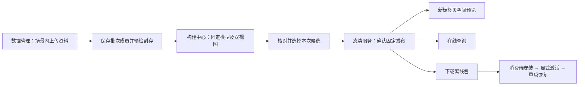

# 上传资料到发布与消费 P10

本批完成两套P9上传资料的后半程：**场景资料 → 封存采集批次 → 模型冻结 → 同源双视图 → 人工核对 → 固定发布 → 在线／离线消费**。精度优化继续后置。



## 当前查看入口

本批成果在 **8775**，登录“模拟场景管理员”。8770继续保留原场景；两套运行区不混用。

| 场景 | 资料／批次 | 固定成果 |
| --- | --- | --- |
| 办公室RGB-D | [上传资料](http://127.0.0.1:8775/workbench/layout.html#data?space=space-d7a370b8107c30f7&tab=inputs&input=input-5ef4889e188f4ebc)、[来源批次](http://127.0.0.1:8775/workbench/layout.html#data?space=space-d7a370b8107c30f7&tab=batches&batch=batch-22c57f8aeb21485f) | [本次构建](http://127.0.0.1:8775/workbench/layout.html#build?space=space-d7a370b8107c30f7&tab=flow&job=build-4afeb912b75b4146)、[态势服务](http://127.0.0.1:8775/workbench/layout.html#delivery?space=space-d7a370b8107c30f7&job=build-4afeb912b75b4146&publication=preview-ff05c24196a74d44) |
| OS1-16激光 | [上传资料](http://127.0.0.1:8775/workbench/layout.html#data?space=space-0004d0e3c133f5fb&tab=inputs&input=input-32fe9d0c917c4b84)、[来源批次](http://127.0.0.1:8775/workbench/layout.html#data?space=space-0004d0e3c133f5fb&tab=batches&batch=batch-854b411e002541a4) | [本次构建](http://127.0.0.1:8775/workbench/layout.html#build?space=space-0004d0e3c133f5fb&tab=flow&job=build-56a696db36e74ee3)、[态势服务](http://127.0.0.1:8775/workbench/layout.html#delivery?space=space-0004d0e3c133f5fb&job=build-56a696db36e74ee3&publication=preview-1d8a0fdd97a546c2) |

若登录后回到空间目录，再次打开对应链接即可。本机使用模拟平台认证，不代表真实accounts生产联调完成。

## 如何沿页面查看完整流程

1. 从“数据管理”的上传资料详情点击“整理到批次”。
2. 创建批次，确认勾选的资料后“保存成员”，填写原因，再“预检并封存”。勾选只是未保存的预选，不等于已经纳入批次。
3. 点击批次成员的“用于构建”。构建页面固定场景、资料与批次；显式提交任务，依次查看模型和两类视图。
4. 在流程页“核对本次模型”，确认尚未验收精度并填写说明；核对后“前往确认发布”。
5. 单独“确认发布”。在固定发布卡片打开空间、在线查询、下载离线包或查看本地消费说明。
6. 展开“版本与技术详情 → 来源追溯”。上传资料节点显示来源与操作者，展开摘要可看上传包SHA-256及封存成员摘要；“来源批次 · 修订2”可跳回准确批次。

P9已存在但没有批次引用的两个候选仍原样保留。P10按封存批次重新运行真实构建，没有给旧模型补写来源。两个新批次均为导入样本的流程重放，不表示新现场采集。

## 三个动作的区别

| 动作 | 保存什么 | 后续动作 |
| --- | --- | --- |
| 上传并登记 | 场景内资料、格式、上传包摘要与操作者 | 显式整理批次和构建 |
| 核对并选择／确认发布 | 当前选择／独立不可变发布快照 | 打开或调用具体发布 |
| 下载／安装／激活 | 导出的ZIP／消费库内容／消费端活动引用 | 安装后仍需显式激活；重启需显式恢复 |

服务端页面不观察消费机器状态，不能把下载按钮成功当作机器人启用。

## 已验证的异常处理

- 跨场景资料、跨场景批次及跨场景候选不能构建或发布。
- 封存成员不能覆盖，过期批次修订和过期核对修订会被拒绝。
- 资料停用阻止新构建，历史固定发布仍可读；资料恢复不改写固定离线包。
- 查看者可浏览和查询授权空间，不能创建批次、构建、发布或默认下载离线包。
- 发布后重复上传原ZIP复用原资料及名称，不改变已有批次、任务和发布。

## 重放验收

相关后端回归与前端构建：

```powershell
.venv/Scripts/python.exe -X utf8 -m pytest tests/test_uploaded_batch_flow.py tests/test_input_uploads.py tests/test_preview_batches.py tests/test_preview_publications.py tests/test_preview_consumer_store.py tests/test_preview_workflow.py tests/test_preview_lineage.py tests/test_platform_business.py -q
pnpm --dir apps/workbench run build
```

使用本批浏览器实际下载包和在线查询回执，启动独立禁网消费进程。输出目录必须不存在：

```powershell
.venv/Scripts/python.exe -X utf8 -m experiments.scripts.verify_uploaded_consumption --output var/validation/uploaded-consumption-p10-replay --browser-main output/playwright/flow-batch-p10-browser-result.txt --browser-extra output/playwright/flow-batch-p10-extra-result.txt
```

服务需要重启时，在8775空闲且新认证输出目录不存在的条件下，可以继续当前隔离运行区：

```powershell
.venv/Scripts/python.exe -X utf8 -m experiments.scripts.serve_scene_journey_demo --source var/validation/input-upload-p9-2026-11-04-001/runtime --output var/validation/uploaded-journey-p10-new-auth --candidate build-4afeb912b75b4146 --existing-runtime --port 8775
```

`--existing-runtime`明确继续指定隔离运行区；默认仍为复制运行区，不接管原始`var/nyu`。新模拟认证上下文不复用旧登录Cookie。

本批离线包约39.67 KiB和30.19 KiB，只携带当前查询所需的表面单元及版本来源，不携带人视图点云。它们不是ROS导航地图或已经验证可运行的机器人软件包。

参见[P10验收](../validation/上传资料发布与消费-P10-2026-11-04.md)、[来源追溯补充字段](../../contracts/schemas/preview-lineage-upload-v0.1.md)、[P9资料上传](场景资料上传P9运行.md)。
