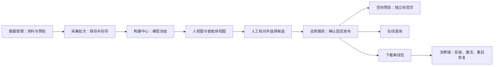

# 场景端到端流程 P8

本轮目标是让一个场景的已有资料、构建成果、固定发布和消费入口连续可用。核心层级仍为 **Workspace → 场景空间 → 多轮资料／批次 → 多个模型候选与固定发布**。

## 一条主线

语义本体与空间关联按业务需要补充；本轮几何双视图流程可以先完成。候选选择、固定发布和消费端激活是三个独立动作。

## 页面操作

| 步骤 | 所在模块 | 操作与输出 |
| --- | --- | --- |
| 1 | 数据管理 | 选择有权限的场景空间，登记服务端已分配资料，打开资料详情并预检；得到资料ID和检查记录 |
| 2 | 数据管理／采集批次 | 将本轮资料加入批次并保存、封存；形成不可改成员及准入修订 |
| 3 | 构建中心 | 从批次交接资料，显式提交；依次查看模型冻结和两类视图状态 |
| 4 | 构建流程 | 查看双视图同源结果，填写核对说明并确认选择；尚未发布 |
| 5 | 态势服务 | “前往确认发布”固定携带候选；核对“本次候选”后单独确认发布 |
| 6 | 空间预览 | “打开固定版本”在新标签页显示该发布的三维数据，可切换两类视图 |
| 7 | 态势服务 | “范围查询”在线读取同一发布；无表面证据的区域保持未知 |
| 8 | 态势服务／消费端 | 下载固定离线包，按“本地消费”命令核验并安装、显式激活；重启后显式恢复 |

发布页常用操作为“打开固定版本、范围查询、下载离线交付包、本地消费”。“版本与技术详情”按需展开，包含来源构建、模型版本、分发管理、版本比较、清单、追溯和流程核对。

“返回本次构建”对应交接的候选；各历史发布的“查看来源构建／查看模型版本”对应各自来源。二者可能不同。目标候选与已选候选不一致时阻止发布其他版本，需要返回目标构建重新核对。

在“空间预览 → 查看场景流程”点击“查看本地消费步骤”，会固定候选和发布，直接展开该发布的消费说明。页面不读取机器人状态，下载和导出不代表安装或激活。

## 当前查看入口

- [8770当前场景的态势服务](http://127.0.0.1:8770/workbench/layout.html#delivery?space=space-ea727be75c1049db&job=build-70889cca2d8c42e1&publication=preview-74dff419ff5142ac)。本轮已更新前后端；重启后需重新登录“模拟管理员”。原选择、两个历史发布及资料不变。
- [8772本轮独立验收场景](http://127.0.0.1:8772/workbench/layout.html#delivery?space=space-d7a370b8107c30f7&job=build-3e101514540e4492&publication=preview-28733ab2359c4b4f)。需要时登录“模拟场景管理员”。这里复用P7成果完成了本轮核对、发布及消费验收。

精度、导航与实机运行尚未验收。P8验收时资料登记依赖已分配的服务端封存样本；后续[P9](场景资料上传P9运行.md)已增加两类受支持资料包的本机上传，任意文件上传仍不支持。真实accounts生产联调独立于本机模拟验收。

验收：[P8记录](../validation/场景端到端流程-P8-2026-11-04.md)。前置：[P6资料准备](数据准备连续入口P6运行.md)、[P7采集批次](采集批次与历史版本P7运行.md)、[P3模型与双视图](模型与独立视图P3运行.md)。
