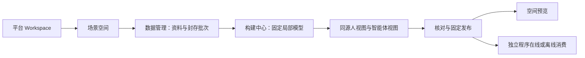

# P24–P27 推进与验收汇总

范围：用户授权连续实施与每批验收；以跑通一个场景空间的业务和技术流程为优先，没有增加精度优化批次。

## 批次状态

| 批次 | 本轮结果 | 状态 |
| --- | --- | --- |
| P24 激光多帧建图 | 实际10帧激光 → ICP估计轨迹／逐帧点块 → 固定局部模型 → 双视图 → 发布 → 在线／离线消费 | 已完成本机验收 |
| P25 真实平台联调 | 公开OIDC／JWKS核对、配置检查工具、原身份与登录回归、待配置项明确 | 准备完成；真实联调待客户端及Workspace配置 |
| P26 独立程序在线消费 | 平台service票据适配、固定版本只读查询、场景授权、时间拒答和独立Python客户端 | 已完成本机mock换票与真实模型HTTP验收；真实换票待P25 |
| P27 稳定试用与交接 | 8790固定入口、独立业务／认证目录、软件版本封存、启停、异常重启、冷恢复、恢复后继续发布 | 本机部署演练完成；真实环境与独立人工签收待完成 |

四个批次不能统称为生产验收全部完成。剩余重要外部事项是平台客户端及覆盖配置、真实Workspace权限联调、另一工程师按手册操作签收。界面美化、更多格式、精度与算法扩展继续暂缓。

## 当前可操作成果

[固定试用入口](http://127.0.0.1:8790/workbench/layout.html#delivery?space=space-48f0fb3fd895ff25&publication=preview-67ea46dba756460c)，选择“模拟工作区所有者”。主线归属仍为Workspace → 多个场景空间 → 各自资料、批次和历史模型版本。

定义层继续共用语义本体，空间关联归属当前场景与固定模型；本轮没有再拆新的管理板块。数据和成果保持一场景一空间，不以用户个人作为客户边界。

## 验收证据

- P24：275项后端、35项主流程浏览器及11项全屏过程检查；2个禁网消费进程。实际输入128,759点，模型30,652点，精度未验收。
- 最终全量回归：1,763项通过、13项跳过，另22个子用例通过，耗时18分36秒；无失败／错误。日志output/playwright/p24-p27-full-regression-final.txt。4条警告来自刻意弱RSA测试及旧doctor读取NumPy元数据，未影响结果。
- P25–P27新增48项专项（公开契约3、在线消费34、试用部署11）；连同恢复并发和生命周期复核55项通过，日志p24-p27-recheck.txt。
- P27：从空业务根至发布35项，冷恢复后再构建发布35项，最终页面重登录／退役与当前版本检查3项；独立在线消费7个进程43项检查及CLI退出码检查，2个禁网进程各7项消费恢复后的新发布。
- 冷恢复52文件一致；最新双版本及退役审计备份89文件已核验。会话与凭据不在业务包内。
- 旧P23／P24业务116文件及封存样本摘要复核，未改变。

初次全量发现旧测试桩依赖已变的参数位置，以及一次Node原生验签子进程失败。已改为明确batch_ref参数，并对相关模块及P25–P27联合复核55项通过；失败日志保留，不能计为首次全绿。

机器汇总：output/playwright/flow-batches-p24-p27-acceptance.json。前端P24已完成TypeScript／Vite构建及浏览器验收；P25–P27复用该编译产物，封存版本与当前运行校验一致。当前服务8790保持运行。

## 设计及逐批记录

- [P24验收](激光多帧建图接入-P24-2026-11-05.md)
- [P25准备与缺失配置](平台真实联调准备-P25-2026-11-05.md)
- [P26验收](独立程序在线消费-P26-2026-11-05.md)
- [P27验收](固定试用与恢复交接-P27-2026-11-05.md)
- [实现设计](../architecture/平台与程序消费及试用收口-P25-P27-2026-11-05.md)
- [固定入口运行与交接手册](../guides/固定试用入口与平台接入-P25-P27运行.md)

所有样本依然是流程验证成果。没有可信观测UTC时不满足实时新鲜度，unknown不转为空闲；所有模型与响应保持unverified、robot_ready=false。
