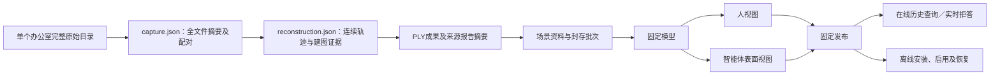

# P28：整段办公室交付验证

结论：**本机流程验收完成**。用一个办公室的完整录制序列，实际贯通离线建图、已有成果入库、封存批次、固定模型、同源双视图、发布和独立在线／离线消费。没有新增业务模块或精度优化任务。

## 当前入口

- [数据管理](http://127.0.0.1:8790/workbench/layout.html#data?space=space-70c34b60ae23ce32&tab=inputs&input=input-314a934d8f054a0b)
- [构建流程](http://127.0.0.1:8790/workbench/layout.html#build?space=space-70c34b60ae23ce32&job=build-d537e52341de4af0&tab=flow)
- [固定空间预览](http://127.0.0.1:8790/workbench/layout.html?screen=space&preview=1&space=space-70c34b60ae23ce32&publication=preview-ac610a63aee24e95#space)

使用现有的“模拟工作区所有者”身份。新录制单独建立“P28 · NYU办公室0005”场景空间，原 P27 OS1 场景和历史发布保留。

## 实际数据及处理

来源：本机 `D:\Work Space\SampleSpace\激光点云数据集\offices\office_0005`。没有改写外部文件。

| 项目 | 本次结果 |
| --- | --- |
| 录制跨度 | 8.578032 秒，整段；没有两秒截断 |
| 目录文件 | 1,045 个，合计392,345,837字节；全部清点和摘要复核 |
| 深度／RGB | 256／255帧；另534个辅助文件，仅清点、不参与建图 |
| 配对与排除 | 固定20ms容差，255帧有效；首帧41.382ms超限排除，原因保留 |
| 连续建图 | 255帧、254条边全部通过已有几何与双向检查；无位姿桥接、跳过失败边或单位矩阵替代 |
| 点云 | 原采样观测4,718,801点；固定2cm体素保留实际观测点后346,167点 |
| 成果格式 | binary little endian XYZRGB PLY，5,192,685字节，首帧相机局部坐标，米 |
| 上传包 | 4,738,756字节；现有 cospace.pointcloud-input/0.1 ＋ cospace.input-upload/0.1 |
| 固定模型路线 | normalize_declared_pointcloud：保留输入成果坐标，独立生成同源双视图 |

整段RGB-D建图在隔离的 Python 3.12／Open3D 0.19 环境由CLI执行，应用随后按“已有空间成果”路线接入。工作台没有增加自动执行整段RGB-D重建的入口；模型中的input_frames=1表示一个点云文件，原采集256帧／使用255帧记录在预处理报告中。

完整录制处理完成不表示房间已完整覆盖。覆盖率仍为未知，未列出单元仍为unknown；时间仍为文件名时间、未确认UTC；精度和导航能力保持未验收。本次没有回环、表面融合或独立测量校核。

## 血缘与交接

| 记录 | 固定标识 |
| --- | --- |
| 场景 | space-70c34b60ae23ce32 |
| 资料 | input-314a934d8f054a0b |
| 批次 | batch-1af06c67dbad4fd1，封存修订2 |
| 模型 | build-d537e52341de4af0 |
| 发布 | preview-ac610a63aee24e95 |

capture SHA256：`26c27b8cf22d5fd4bf78eb0cf577e9f1a18421b640ef7328caf95a183e4dbf77`。

reconstruction SHA256：`a5fd2e9a3932976d2474a675a4cc9a162639e24b85073712cae9f34f553f276b`。

PLY SHA256：`fb70deec79a205760fd60aaa44004209462b023aa6a6feee59206d71427d6661`。

输入ZIP SHA256：`00fad83a4def5e50cdf4ad95b13d6347c66fbcf2e46fdbd9598d1b27bf294eb2`。

固定离线包 SHA256：`27a43f7a51bca44a3f20e8f574a2b8343edd7cac7f50a0caa61b9784731658c1`。

应用的provenance保留预处理报告和点云摘要，离线包同样保留；报告正文作为交接附件保存，没有混入应用支持的采集格式。摘要校验检查绑定与完整性，不认证上游报告真实性，也不代替独立精度验收。原始图像不复制到交接附件，重算需要原始目录。

## 验收

- 186项相关后端回归通过，包含新增21项整段清点、连续性、篡改和交接绑定测试；不是重跑此前1,763项全量回归。
- 隔离Open3D环境7项实际运行测试通过。
- 浏览器82项分步检查：新建场景3、首次完整交付33、重复上传及固定版本复验30、查询／人视图补验9、实际重启后7。重复上传没有增加资料、模型或发布。
- 3个禁网离线进程共17项：安装不自动激活、显式启用、进程重启恢复、真实表面查询、未知保持未知、来源报告摘要／批次保留及错误包拒绝。
- 服务重启前后独立在线程序各10项检查，共20项；4次CLI验证历史查询退出0、实时拒答退出3。使用本地mock换票，未计作真实平台联调。
- 业务冷备份121文件、88,174,778字节，独立SHA256校验通过；实际重启前后121文件摘要完全一致。本批未重复执行P27的完整冷恢复演练。
- 排除7个进程协调锁后，原有208个业务／样本文件中204个字节不变；4个共享索引／授权文件因新增场景、批次、预检及消费授权正常更新。原批次和预检数据库的旧记录另行逐行比对保留。原始样本、旧资料和固定发布未被替换。

备份：output/playwright/p28-trial-backup.zip，SHA256 `ee1a112b702686a4bf5fa96e4afe0d46df6b98af082a99cc69e5e34cdb775483`。

机器汇总：output/playwright/flow-batch-p28-acceptance.json。完整日志、截图及失败尝试均保留。首次新建场景自动化因未带明确场景的路由被重定向而超时，改为明确场景入口后通过；没有以失败计数充当验收通过。

## 本批边界与下一事项

P28证明现有结构能够承接整段办公室样本的场景成果并稳定交付；精度优化、更多格式、界面美化继续暂缓。真实平台客户端／Workspace联调，以及另一位工程师按手册独立操作签收，仍是后续外部验收事项。

见[设计](../architecture/整段场景交付验证-P28-2026-11-06.md)和[操作手册](../guides/整段办公室交付-P28运行.md)。
